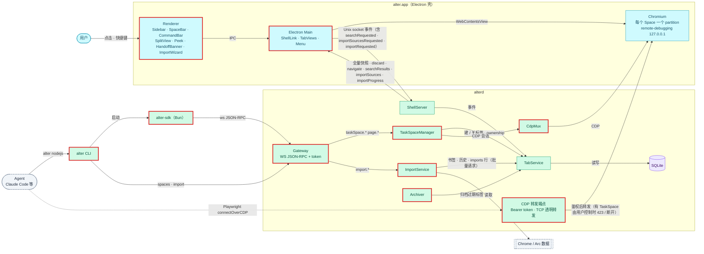
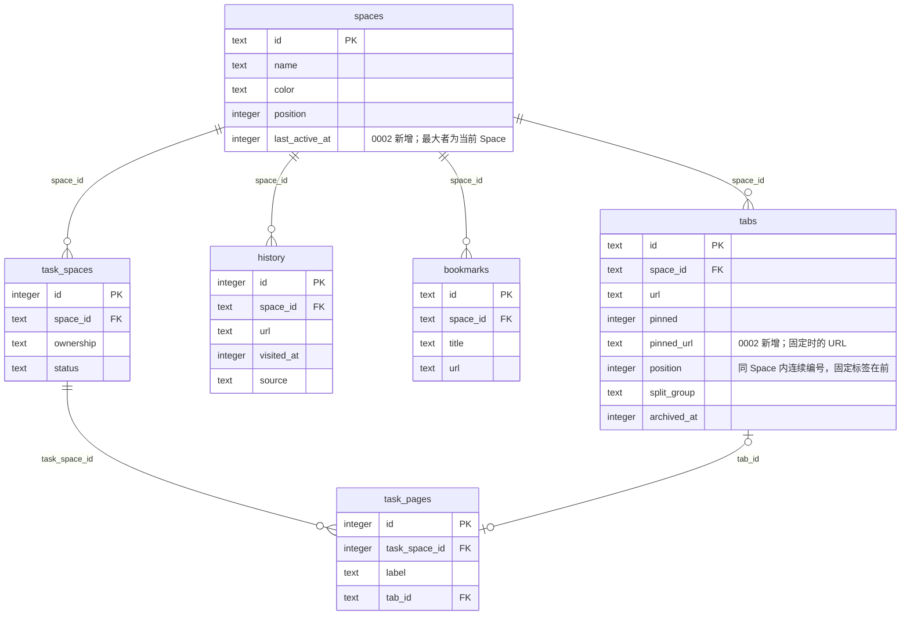
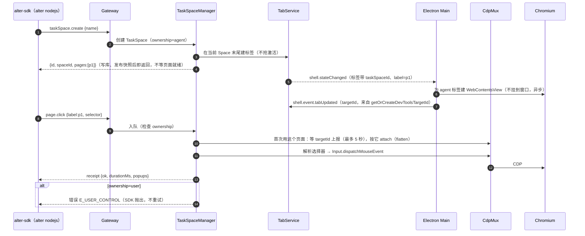

# 设计：alter 核心功能：Space、agent、浏览增强与导入

<!-- 用于 feature 类需求的设计（以及新增依赖、改动数据模型、跨仓库，或带有安全 / 性能 / 迁移风险的 chore）。图：源文件在 ./assets/*.mmd，用 dflow:diagram 块嵌入（references/diagrams.md）。 -->

## 上下文
这份设计讲整体：哪些组件是新的、节点之间的契约、唯一的一次数据库迁移。每个节点的细节（消息字段、错误码、时序、UI 结构）写在 `nodes/<node-slug>/design.md`。对应父级 requirement.md 的「变更内容」「非功能需求」「成功标准」。

现状（PR #3 之后）：
- alterd 有 `lifecycle`、`shell/`（ShellServer）、`tabs/`（TabService）三块；TabService 独占 `Store`，按事件改库后广播全量快照（`crates/alterd/src/tabs/mod.rs`）。
- Electron Main 按快照管理 WebContentsView（`apps/browser/src/main/tab-views.ts`），只为当前 Space 的激活标签建视图。
- Renderer 有 Sidebar / AddressBar / NavButtons。
- SDK 是占位；CLI 只有 `--version` 和 `status`；没有 site/、skills/ 和安装脚本。

## 目标与非目标
- 目标：按 architecture.md 的目标架构落地 Gateway、TaskSpaceManager、CdpMux、ImportService、Archiver 和 Renderer 的各个 UI 部件；保持「alterd 是状态唯一来源、Electron 按快照对齐」的声明式模型；只做一次数据库迁移。
- 非目标：替换 Electron 壳；MCP 适配；多窗口；Developer ID 签名。

## 架构
<!-- dflow:diagram assets/arch-add-core-features.mmd -->

<!-- /dflow:diagram -->

边界不变：只有 alterd 写 SQLite、只有 alterd 发 CDP；Electron Main 只管窗口、视图和菜单；Renderer 只经 IPC。红框是本需求新增或有较大改动的组件。新增的 alterd 模块都在 `crates/alterd/src/` 下：`gateway/`、`cdp/`、`import/`、`archive.rs`、`takeover.rs`；TaskSpace 的状态与 ownership 状态机放在 TabService 里（`tabs/task_space.rs`、`tabs/ownership.rs`），不另建 `task_space/` 模块（实现时的调整，见 N2、N3 的 design.md）。协议类型仍以 `crates/alter-core/src/protocol/` 为源头，生成到 `packages/protocol`。

## 组件
| 组件 | 仓库 | 职责 | 新增 / 变更 |
|---|---|---|---|
| alter-core `store/` | alter | 迁移 0002；spaces / tabs 的新查询；history、bookmarks、task_spaces、task_pages、imports 的仓储 | 变更（N1、N2、N4、N5） |
| alter-core `protocol/` | alter | Shell 消息增加 Space、固定、移动、分屏、恢复、接管、`cdpReady` 等事件；Gateway 的请求 / 响应 / 事件类型；`ts-rs` 导出 | 变更（每个节点） |
| TabService | alter | 新增 Space 事件、固定 / 移动 / 恢复 / 分屏、`shell.discard`；快照增加 `pinned`、`splitGroup`、`taskSpaceId`、`label`、`archived`、`taskSpaces`；命令栏搜索（N4）；导入的书签 / 历史 / imports 批量写入、搜索加书签、Shell 的导入事件（N5）；仍是数据库唯一写者 | 变更（N1–N5） |
| Gateway | alter | loopback WS JSON-RPC、token 鉴权、`gateway.json`、事件推送、CDP 转发端点 | 新增（N2） |
| TaskSpaceManager | alter | TaskSpace / Page 生命周期、page budget、每个 TaskSpace 一个串行命令队列、ownership 状态机。逻辑组件：状态与状态机在 TabService 的 `tabs/task_space.rs`、`tabs/ownership.rs`，串行队列是 Gateway 里每个 TaskSpace 一把 `tokio::sync::Mutex`（`Gateway::queue`），接管信号在 `takeover.rs` | 新增（N2、N3） |
| CdpMux | alter | 连 Chromium remote-debugging 端口，按标签维护 CDP 会话，实现 page 原语、叠层注入 | 新增（N2、N3） |
| Archiver | alter | 定时把超过阈值的非固定标签归档 | 新增（N4） |
| ImportService | alter | 读 Chrome / Arc 的书签、历史并写库（Cookie 导入移到后续 change） | 新增（N5） |
| alter CLI | alter | `nodejs`、`spaces list`、`import` | 变更（N2、N5） |
| alter-sdk | alter | `taskSpace()` 等全局函数与 Page API、错误映射、`waitForControl` | 新增（N2、N3） |
| Electron Main | alter | 应用菜单与快捷键、Space 删除时 `clearStorageData`、agent 标签离屏视图、`--remote-debugging-port=0` 与 `cdpReady`、分屏布局、Peek 视图、命令栏期间隐藏页面视图 | 变更（N1–N5） |
| Renderer | alter | SpaceBar 与编辑面板、固定分区与拖拽、HandoffBanner、CommandBar、SplitView、Peek 控件、已归档列表、ImportWizard | 变更（N1–N5） |

## 接口契约
三类跨进程接口，字段与错误码的权威定义在各节点的 design.md「接口契约」，存档时合并进 `infra/api.md`：

| 接口 | 提供方 → 使用方 | 本需求的增量（节点） |
|---|---|---|
| Shell Control（`shell.sock`，JSON 行） | alterd ↔ Electron Main | 事件 `spaceCreated` / `spaceUpdated` / `spaceActivated` / `spaceDeleted` / `tabPinned` / `tabMoved`，指令 `shell.discard`（N1）；事件 `cdpReady`（N2）；事件 `ownershipReturned` / `userTookControl`（N3）；事件 `searchRequested`、指令 `shell.searchResults`，事件 `splitRequested` / `splitDissolved` / `tabRestored`（N4）；事件 `importSourcesRequested` / `importRequested`、指令 `shell.importSources` / `shell.importProgress`（N5）；快照字段随之增加 |
| Gateway（`ws://127.0.0.1:<port>/rpc`，JSON-RPC 2.0） | alterd → SDK、CLI | api.md 表中的全部方法与事件（N2、N3、N5） |
| CDP 转发（`http://127.0.0.1:<cdpPort>`） | alterd → Playwright | Tokio TCP 透明代理：读请求头校验 Bearer token 后把字节原样转给 Chromium（HTTP 发现接口与 WebSocket 都这样）；有 TaskSpace 由用户控制时回 423，接管时断开已有连接（N2、N3） |
| Electron IPC（`window.alter`） | Main ↔ Renderer | Space、固定、移动、命令栏、分屏、Peek、接管、导入的通道（N1–N5），定义在 `apps/browser/src/shared/` |
| CLI | alter → 用户 / agent | `nodejs`、`spaces list`（N2），`import`（N5） |

快照仍是唯一的状态通道：Electron 不缓存 alterd 之外的状态，所有 UI 状态都从下一份快照推出来。只发给请求方的指令是 `shell.navigate`、`shell.error`，以及新增的 `shell.discard`（N1）、`shell.searchResults`（N4）、`shell.importSources` 与 `shell.importProgress`（N5）。

## 数据模型
```sql
-- 迁移 0002（crates/alter-core/migrations/0002_spaces_tabs.sql，N1）
ALTER TABLE spaces ADD COLUMN last_active_at INTEGER;   -- NULL：从未激活过；最大者为当前 Space
ALTER TABLE tabs ADD COLUMN pinned_url TEXT;            -- 固定时记下的 URL；未固定为 NULL
-- 已有数据：spaces.last_active_at 保持 NULL（没有任何值时退回 position 最小的 Space）；
-- tabs.position 在每个 Space 内按 (pinned DESC, position) 重新编号为 0..n-1
```

其余表（`history`、`bookmarks`、`task_spaces`、`task_pages`、`imports`）在 0001 里已经建好，N2、N4、N5 只是开始读写它们，不改结构。迁移前把 `alter.db` 复制为 `alter.db.bak-<旧版本号>`（用 SQLite 在线备份 API，WAL 内容也会一起写入）。

<!-- dflow:diagram assets/er-add-core-features.mmd -->

<!-- /dflow:diagram -->

data-model.md 中有三条规则会改，存档时更新：
- 「激活的 Space 取 position 最小的」改为「取 `last_active_at` 最大的，全为 NULL 时取 position 最小的」。
- 「`position` 只增不重排」改为「同一 Space 内连续编号，固定标签在前，固定 / 取消固定 / 拖拽时重排」。
- 「删除 Space」明确为硬删：级联删除行，由 alterd 下次启动时删除 partition 目录。

## 核心流程
agent 动作的主路径（N2；N3 在「入队」一步加 ownership 检查）：

<!-- dflow:diagram assets/seq-add-core-features.mmd -->

<!-- /dflow:diagram -->

## 决策
| 决策 | 选择 | 考虑过的替代方案 | 理由 |
|---|---|---|---|
| 需求组织 | 一个路由 change，5 个节点串行（revision 2 起；原第 6 个节点 release-site 与 N5 的 Cookie 导入移到后续 change，N2 → N5 的 Cookie 写入接口、N3 / N5 → N6 的交付随之作废） | 6 个独立 change（原路线图） | 用户要求一次看到完整需求；节点各自评审和验证，风险等同于独立 change |
| UI 状态来源 | 继续用全量快照，新增字段，不加 `shell.setOverlay` / `shell.setLayout` 之类的命令 | api.md 早先规划的命令式指令 | 与 PR #3 的决策一致：Main 无状态对齐，不需要确认与回滚；500 标签时快照往返约 1.1 ms |
| agent 叠层 | alterd 经 CDP 往页面注入隔离 world 的 shadow DOM（`pointer-events: none`） | 盖在页面上的透明 WebContentsView（会挡住鼠标）；Renderer 元素（被 WebContentsView 盖住） | 只有注入能叠在页面之上且不拦截用户操作；注入走 CDP，符合「只有 alterd 发 CDP」 |
| 标签与 CDP target 的对应 | N2 的 T1 spike 已定为方案 C：Main 建视图时用 `webContents.getOrCreateDevToolsTargetId()` 取 targetId，经 `shell.event.tabUpdated` 上报，CdpMux 按它 `Target.attachToTarget {flatten:true}` | 新标签先加载带标记的 `about:blank#alter-tab=<id>` 再按 URL 认领 | Electron 直接给出 targetId，不依赖页面加载顺序；spike 的 e2e 证明 100 个标签都能对上（N2 log.md 的 T1） |
| Peek | Electron 内的浮层 WebContentsView，不进数据库 | 当作一个特殊标签存库 | Peek 是临时的，不需要恢复，也不暴露给 agent |

## 风险与权衡
- [CDP target 对应关系不可靠] → 已由 N2 的 T1 spike 关闭：方案 C 在 e2e 里 100 个标签都对上了 target，结论写在 N2 的 design.md。
- [Chromium remote-debugging 端口本身不鉴权，本机任何进程都能连] → 只绑定 127.0.0.1；端口号由 Chromium 写在 `ALTER_HOME/chromium/DevToolsActivePort`，Electron 读出后经 0600 的 `shell.sock` 交给 alterd，不另外落盘，也不经 Gateway 暴露；对外只提供带 token 的转发端点。残余风险：本机进程可以读该文件或扫描端口直接连 Chromium。这与 architecture.md 的信任边界（本机能读用户数据目录的进程等同于用户本人）一致，记录在案。
- [快捷键的真实按键进不了 WebContentsView 的 e2e] → 快捷键做成应用菜单的 accelerator，e2e 断言菜单项的 accelerator 字符串，再用 `menuItem.click()` 驱动行为；按键到菜单的映射由 macOS 保证。
- [Chrome / Arc 数据格式变化] → 用 fixture 固定 2026-10 的格式；解析失败的单条跳过并计数，不中断导入。
- [规模大，单个 PR 难评审] → 每个节点单独评审、单独验证，最后再做一轮整体评审；PR 描述按节点分节。

## 迁移与上线
- 数据库：迁移 0002 在 alterd 启动时自动执行，执行前生成 `alter.db.bak-1`；不支持降级，回滚办法是退回旧版 app，并用备份文件替换 `alter.db`。
- 发布：本需求不做对外发布（revision 2 起移到后续 change）。
- 功能开关：不设开关。Gateway 随 alterd 启动，没有 agent 连接时只多一个空闲的监听端口。

## 宪章检查
| 原则 | 状态 | 说明 |
|---|---|---|
| 规格先行 | PASS | 全部行为写在 5 个节点的 Spec Delta 里，批准后才动代码 |
| 测试先行 | PASS | 每个场景都有对应任务和 seam：Rust 契约测试、SDK 单测、CLI `assert_cmd`、Electron e2e |
| 简单优先 | PASS | 新增依赖各有理由，写在节点设计里：tokio-tungstenite（Gateway 与 CdpMux 的 WS，N2；CDP 转发是 Tokio TCP 透明代理，不用它）、futures-util（拆分 WS 读写两端，N2）、tungstenite（`alter` CLI 的同步 WS，N2）、getrandom（token，N2）、toml（config.toml，N3）；rusqlite 加开 `backup` / `functions` 特性（N4 的 Unicode 搜索、N5 的一致快照）；CDP 客户端是自写的最小实现（tokio-tungstenite 加 serde_json），没有用 chromiumoxide，理由见 N2 的「决策」（Keychain、Cookie 解密与 `alter upgrade` 的依赖随后续 change）。不引入 UI 库，拖拽用 HTML5 DnD |
| 边界契约 | PASS | Shell、Gateway、CDP 转发、IPC、CLI 的契约都写在节点设计里，并先由契约测试覆盖：`crates/alterd/tests/shell.rs`、新的 `crates/alterd/tests/gateway.rs`、`packages/sdk/tests/` |
