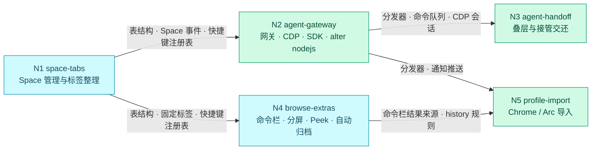

# 流程路线：alter 核心功能：Space、agent、浏览增强与导入

<!-- 流程路线型需求的流程控制文档。"## Nodes" 下每个节点一行，语法同任务行：
- N<n> <node-slug> [after:N1,N2] [repos:api,web] [P] <标题>
[after:] 列出本节点开始前必须完成（任务全部勾选、Review: PASS、Overall: READY）的节点；
[repos:] 持有该节点目录的仓库（省略 = 需求涉及的全部仓库）；[P] 表示可并行的候选。
每个节点放在 nodes/<node-slug>/ 下，有自己的 requirement.md、tasks.md 和 log.md。语法见 references/formats.md §14 -->

## Nodes
- N1 space-tabs Space 管理与标签整理
- N2 agent-gateway [after:N1] agent 网关、CDP 与脚本运行时
- N3 agent-handoff [after:N2] agent 叠层与接管交还
- N4 browse-extras [after:N1] 命令栏、分屏、Peek 与自动归档
- N5 profile-import [after:N2,N4] 从 Chrome / Arc 导入

## Route
<!-- dflow:diagram assets/flow.mmd -->

<!-- /dflow:diagram -->

N2 和 N4 都只依赖 N1，逻辑上可以并行，但两者都要改 `crates/alter-core/src/protocol/shell.rs`、`crates/alterd/src/tabs/`、`apps/browser/src/main/tab-views.ts` 和侧边栏组件，所以不标 `[P]`，按 N1 → N2 → N3 → N4 → N5 的顺序串行做（N6 release-site 已在 revision 2 移出本需求）。N4 在 N3 之前做也可以，`dflow status` 会把两者同时列为可开始。

## Handoffs
- **N1 → N2、N4**：迁移 0002 之后的表结构（`spaces.last_active_at`、`tabs.pinned_url`）；Space 新建 / 切换 / 删除事件和 `shell.discard` 指令；快照里的 `TabView.pinned`；标签在同一 Space 内连续编号的 `position` 规则；应用菜单和快捷键注册表（`apps/browser/src/main/menu.ts`），N4 会把 `tab.new`（Cmd+T）改成打开命令栏。
- **N2 → N3**：Gateway 的 JSON-RPC 分发与事件推送（`taskSpace.ownershipChanged` 走同一条推送通道）；TaskSpaceManager 里每个 TaskSpace 的串行命令队列，ownership 检查就挂在这里；快照里的 `taskSpaces` 列表和标签的 `taskSpaceId` / `label`；CdpMux 按标签取 CDP 会话的接口，N3 用它注入叠层脚本。
- **N2 → N5**：Gateway 的 `import.run` / `import.status` 方法与 `import.progress` / `import.done` 事件挂在同一分发器上。
- **N4 → N5**：命令栏的结果来源接口（Renderer 收到的 `commandBar.results`），N5 往里面加一类「书签」结果；`history` 表的写入规则（导入的历史 `source` 为 `chrome` / `arc`，与浏览产生的 `alter` 并存）。
