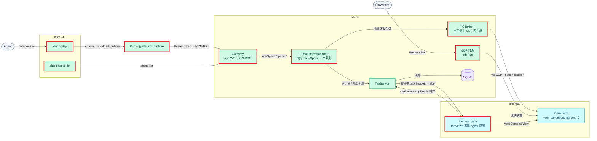
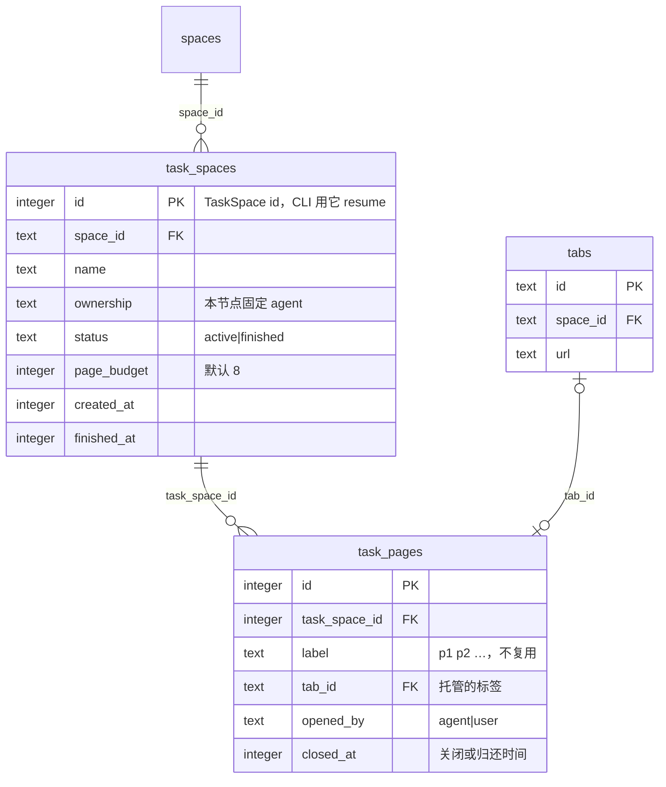
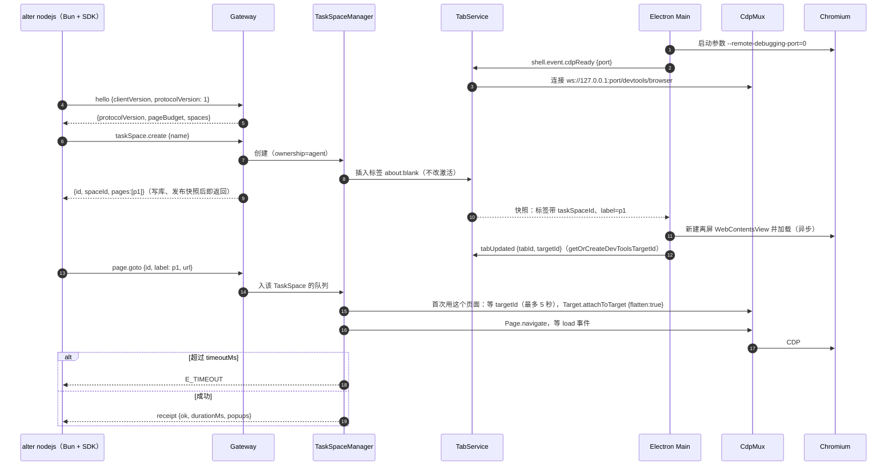

# 设计：agent 网关、CDP 与脚本运行时

## 上下文
对应本节点 requirement.md 的全部 Spec Delta。

目标形态已写在 `infra/api.md`（Gateway 方法表、receipt、事件、SDK 形状）、`infra/core-flows.md`（「agent 用脚本操作页面」时序）和 `infra/components.md`。本设计只补充那里没定的部分：hello 的参数、错误格式、快照字段、CDP 连接方式、Bun 与 SDK 的加载、测试 seam。

现状：
- alterd 只有 ShellServer 与 TabService。
- Electron 没有开 remote-debugging 端口，也只为激活标签建视图。
- SDK 是占位；CLI 只有 `status`。

## 目标与非目标
- 目标：api.md 表中除 `taskSpace.handOff` / `takeOver`（N3）和 `import.*`（N5）以外的全部方法；`page.dialog` / `page.popup` / `page.download` 事件；CDP 转发；SDK；`alter nodejs`、`alter spaces list`。
- 非目标：ownership 切换；agent 叠层；MCP；多个 Electron 实例。

## 架构
<!-- dflow:diagram assets/arch-agent-gateway.mmd -->

<!-- /dflow:diagram -->

- `crates/alterd/src/gateway/`
  - `mod.rs`：Gateway 状态与 tokio-tungstenite 的 accept，在握手回调里校验 Bearer token；每个连接一个写出队列。
  - `rpc.rs`：JSON-RPC 编解码与分发。
  - `gateway.json` 的原子写（0600）在 `alter_core::gateway_file`，由 `lifecycle.rs` 在 `alterd.json` 之前写出。
  - `forward.rs`：CDP 转发，HTTP `/json/version`、`/json/list`、WS 双向拷贝。
- TaskSpace（实现时的调整，不另建 `task_space/` 模块）：TaskSpace 表与内存状态在 TabService 的 `crates/alterd/src/tabs/task_space.rs`；串行执行是 Gateway 里每个 TaskSpace 一把 `tokio::sync::Mutex`（`Gateway::queue`，页面动作与 `taskSpace.*` 在锁里执行）；`crates/alterd/src/gateway/page.rs` 把 `page.*` 翻译为 CdpMux 调用，`actions.rs` 是 snapshot、选择器、点击、输入等原语，`events.rs` 跟踪对话框、弹窗与下载事件。
- `crates/alterd/src/cdp/mod.rs`（CdpMux）：一个 browser 级 WebSocket，flatten session 模式，按 `sessionId` 分发响应与事件；targetId 来自 Main 上报（T1 结论，方案 C），sessionId 由 `Target.attachToTarget {flatten:true}` 取得并按 targetId 缓存；写出任务在写出前检查接管信号。`overlay.rs` / `overlay.js` 是 N3 的叠层。
- TabService 与 TaskSpace 的关系：TaskSpace 的操作就是 TabService 的方法，Gateway 经 `with_tabs` / `op` 把闭包交给 TabService 的循环执行（`tabs::Request::Gateway`），TabService 仍是数据库唯一写者，`task_spaces` / `task_pages` 的读写都在同一个循环里。
- Electron Main：
  - `app.commandLine.appendSwitch("remote-debugging-port", "0")` 加 `remote-debugging-address=127.0.0.1`；`ready` 之后从 `userData/DevToolsActivePort` 读端口，经 Shell 发 `shell.event.cdpReady {port}`。
  - `TabViews.apply` 对带 `taskSpaceId` 的标签总是建视图，不挂到窗口时也设置 1280×800 的 bounds，这样截图和布局都有尺寸。
- `packages/sdk`：
  - `src/client.ts`：Bun 内置的 WebSocket，支持 `headers`。
  - `src/task-space.ts`、`src/page.ts`、`src/errors.ts`。
  - `src/runtime.ts`：设置全局函数，供 `bun --preload` 使用。
- `crates/alter-cli/src/nodejs.rs`：找 Bun，顺序是 `ALTER_BUN_PATH` → 与 `alter` 同目录的 `bun` → PATH。找 runtime，顺序是 `ALTER_SDK_RUNTIME` → `<alter 同目录>/../sdk/runtime.js`（打包后）→ 仓库内 `packages/sdk/src/runtime.ts`（开发时，由 `CARGO_MANIFEST_DIR` 编译期常量定位）。然后执行 `bun --preload <runtime> <脚本文件>`，脚本写到临时文件，`-e` 与 stdin 两种来源都一样处理。

## 组件
| 组件 | 仓库 | 职责 | 新增 / 变更 |
|---|---|---|---|
| `alterd::gateway` | alter | WS 服务、鉴权、分发、事件推送、`gateway.json`、CDP 转发 | 新增 |
| `alterd::tabs::task_space`、`Gateway::queue` | alter | TaskSpace / Page 生命周期与预算（TabService 内）；每个 TaskSpace 一把 `tokio::sync::Mutex` 的串行队列（Gateway 内） | 新增 |
| `alterd::cdp` | alter | 最小 CDP 客户端、target 对应、page 原语 | 新增 |
| `alterd::tabs` | alter | 新的内部请求（建 agent 标签、托管、`cdpReady`）；快照增加 `taskSpaceId`、`label`、`taskSpaces` | 变更 |
| `alter_core::store` | alter | `task_spaces` / `task_pages` 仓储 | 变更 |
| `alter_core::protocol` | alter | `gateway.rs`（请求 / 响应 / 事件 / `GatewayFile` / `Receipt`）、Shell 的 `cdpReady` 与新字段 | 变更 |
| `@alter/sdk` | alter | TaskSpace / Page API | 新增实现 |
| `alter nodejs`、`alter spaces list` | alter | CLI 子命令 | 新增 |
| Electron Main | alter | remote-debugging 端口、`cdpReady`、agent 离屏视图、侧边栏 agent 标记 | 变更 |

## 接口契约
**Gateway**：以 `infra/api.md` 的方法表为准。补充与改动如下，存档时写回 api.md：
- `hello` 的请求为 `{clientVersion: string, protocolVersion: 1}`，响应 `{protocolVersion: 1, pageBudget: number, spaces: [{id, name}]}`。
- 错误：`{"jsonrpc":"2.0","id":…,"error":{"code":<int>,"message":"…","data":{"code":"E_…","message":"…","details"?:{…}}}}`。
  - JSON-RPC 的 `code`：-32700 解析失败、-32600 请求不合法、-32601 方法不存在、-32602 参数不合法、-32000 业务错误。
  - `data.code` 总是 16 个 `ErrorCode` 之一；方法不存在时为 `E_INVALID_ARGUMENT`。
- `taskSpace.create` 的 `profileId` 参数删除（api.md 里的遗留字段，没有对应概念）。
- `page.*` 的公共参数 `{id, label}`；元素动作加 `selector`、`value?`、`timeoutMs?`（默认 5000，定位元素的等待上限）、`actionLabel?`（3–6 个词的动作描述，N3 的叠层用，本节点只写进日志）。
- 选择器语法：`@e<n>`（最近一次 snapshot 的引用）、`text=<精确文本>`、`loc=css:<css>`、`loc=role:<role>[name="<name>"]`、`xpath=<xpath>`，其余按原生 CSS。
- `page.snapshot` 的文本格式：每个节点一行，`<缩进>- <role> "<name>"`，可交互节点（button、link、textbox、searchbox、checkbox、radio、combobox、menuitem、tab、option、switch、slider、spinbutton）末尾带 ` [@e<n>]`；一次 snapshot 生成的引用在下一次 snapshot 之前有效。
- 事件（JSON-RPC 通知，推给建立了该 TaskSpace 连接的客户端）：`page.dialog`、`page.popup`、`page.download`，字段同 api.md。「建立了该 TaskSpace 连接」指这个连接的请求参数里出现过该 `id`，或 `taskSpace.*` 的响应返回过它。
- 弹窗：动作期间页面打开的窗口（按 `Page.windowOpen` 计数）记为同一 TaskSpace 的下一个 Page，视图上报 targetId 后放进该动作回执的 `popups`（最多等 5 秒）；不在动作里打开的只推 `page.popup`。弹窗不受 page budget 限制。
- 下载：目录取 `ALTER_DOWNLOAD_DIR`，否则 `~/Downloads`（config.toml 的 `download_dir` 随 N3 引入 config.toml 时补上）；完成后由 guid 改名为建议文件名（只取文件名部分，重名加 ` (n)`），再推 `page.download`。`page.goto` 到下载地址时导航以 `net::ERR_ABORTED` 结束，按成功返回回执。
- 回执日志：每个 `page.*` 调用（含 `page.close`）一行 JSON，`target` 为 `receipt`，字段 `task_space_id`、`label`、`method`、`duration_ms`、`ok`、`error_code`（成功时为空字符串）、`action_label`（元素动作的 `actionLabel`，没有时为空字符串）。
- `page.snapshot {scope?, root?}`：`scope` 为 `full_page`（默认，整棵树）或 `subtree`（`root` 为选择器，只输出该元素在无障碍树里的子树）；api.md 里的 `viewport` 本节点不支持，回 `E_INVALID_ARGUMENT`。
- `page.reload {waitUntil?, timeoutMs?}`：`waitUntil` 为 `domcontentloaded` 时等 `DOMContentLoaded`，否则等 `load`。
- `page.waitFor` 的条件为 `url`（子串）、`selector`、`fn`（返回真值，可以是异步函数）、`ms`；api.md 的「事件」条件由 SDK 的 `waitForEvent("popup"|"download"|"dialog")` 订阅通知实现，不经 `page.waitFor`。
- `taskSpace.create` / `resume` 的结果 `TaskSpaceInfo` 带 `name`。
- SDK 形状：`page.mouse.{move,down,up,click,wheel}`、`page.keyboard.{down,up,press,type}`；`TaskSpace.name`。api.md 的 `waitForFileChooser()` 本节点不做（文件上传用 `setInputFiles`），留作后续。
- 串行：同一 TaskSpace 的 `page.*`、`taskSpace.newPage` / `adopt` / `release` / `finish` / `cdp` 排在同一队列。
- `taskSpace.cdp {id, method, params?}` → `{result}`，不带页面会话（Target、Browser 域）。`page.mouse {op: move|down|up|click|wheel, args}`、`page.keyboard {op: down|up|press|type, args}` → 回执。`page.fetch {url, options?, saveAs?}` 在页面里 `fetch`（带页面的 Cookie），返回 `{ok, status, headers, body}`；`saveAs` 必须是绝对路径，此时正文写进文件、返回 `path` 代替 `body`。
- `page.cdp {id, label, method, params?}` → `{result}`，原样转发到该页面的会话；对话框打开时也放行（可用来处理对话框）。

**gateway.json**（`alter_core::protocol::GatewayFile`）：`{"port": 50123, "token": "<64 hex>", "cdpPort": 50124, "version": "0.1.0"}`，0600，先写临时文件再 rename；alterd 退出时删除。

**Shell Control 增量**：
- `shell.event.cdpReady {port}`（Electron → alterd）：alterd 连接或重连 CdpMux，端口只保存在内存里。
- `shell.event.openRequested` 增加可选字段 `openerTabId`：网页弹窗（`window.open`、`target=_blank`）的来源标签，Main 填写。来源标签是某个 TaskSpace 的 Page 时，alterd 把新标签记为该 TaskSpace 的下一个 Page（agent 标签，不抢激活），否则照旧在该 Space 新建用户标签。
- `shell.event.tabUpdated` 增加可选字段 `targetId`：Main 为标签建视图后上报一次该视图的 CDP targetId；alterd 只记在内存（tabId → targetId），这个字段不改数据库、不触发广播。
- 快照的 `TabView` 增加 `taskSpaceId?: number`、`label?: string`。
- `ShellState` 增加 `taskSpaces: [{id, spaceId, name, ownership, status}]`（只含 `active` 的）。

**CDP 转发**：每个连接先读 HTTP 请求头校验 `Authorization: Bearer <token>`，通过后把请求头原样交给 Chromium 的 remote-debugging 端口，再双向拷贝字节（发现接口与 WebSocket 一样）。Chromium 按请求的 `Host` 头生成 `webSocketDebuggerUrl`，原样转发时它就是 `ws://127.0.0.1:<cdpPort>/devtools/browser/<id>`，不需要改写响应。缺少或错误的 token 返回 401；还没收到 `cdpReady` 时 503；连不上 Chromium 时 502。

**CLI**：`alter nodejs [-e <code>]`，退出码同脚本，没有 `gateway.json` 或连不上时为 2；`alter spaces list [--json]`，退出码 0，连不上时为 2。

## 数据模型
不改表结构，开始读写 0001 已有的 `task_spaces` 与 `task_pages`：

```sql
-- 不新增迁移。用到的约束（0001 已有）：
-- task_pages UNIQUE (task_space_id, label)：标签在 TaskSpace 内唯一，关闭后不复用（取 MAX 编号 + 1）
-- idx_task_pages_tab：一个活跃标签同一时刻只能被一个 TaskSpace 托管
-- release 与 page.close 都只置 task_pages.closed_at；page.close 另外归档 agent 打开的标签
```

<!-- dflow:diagram assets/er-agent-gateway.mmd -->

<!-- /dflow:diagram -->

## 核心流程
<!-- dflow:diagram assets/seq-agent-gateway.mmd -->

<!-- /dflow:diagram -->

## 决策
| 决策 | 选择 | 考虑过的替代方案 | 理由 |
|---|---|---|---|
| CDP 客户端 | 自写最小客户端：tokio-tungstenite 加 serde_json，方法名用字符串，flatten session | chromiumoxide（architecture.md 原定） | chromiumoxide 的生成类型跟不上 Electron 44 的 Chromium，还假设由它自己启动浏览器；我们只用二三十个方法，自写约 400 行，没有版本锁定问题。存档时更新 architecture.md 的外部依赖表 |
| WS 库 | tokio-tungstenite（Gateway 与 CDP 客户端共用）；CDP 转发是 Tokio TCP 透明代理（手写读请求头校验 token，之后双向拷贝字节），不用 hyper 也不用 tungstenite | axum + tower；hyper | 只需要握手回调里看 header 与 WS 帧，不需要 HTTP 框架；转发不解析 HTTP / WS，T4 选了依赖最少的透明代理 |
| task_spaces 的写者 | 并入 TabService 的循环 | TaskSpaceManager 自己开写连接 | 保持「数据库单写者」 |
| agent 页面的视图 | 离屏 WebContentsView，固定 1280×800 | 只在用户点开时建 | agent 需要活的 target；截图需要尺寸 |
| SDK 运行方式 | `bun --preload runtime.ts script` | 把脚本包进 SDK 的入口文件 | preload 让脚本保持原样，报错行号与用户的脚本一致 |
| tab ↔ CDP target 对应 | 方案 C：Main 用 `webContents.getOrCreateDevToolsTargetId()` 读 targetId，经 `tabUpdated.targetId` 上报 | A 标记 URL（adopt 的用户标签无标记、同 URL 认错）；B Main 用 debugger 读（违反「只有 alterd 发 CDP」） | T1 spike：C 在初始、重载、崩溃重建、同 URL 导航后都 100/100，且不发 CDP |
| 动作描述的字段名 | 协议与 SDK 都叫 `actionLabel` | 沿用 api.md 的 `label` | api.md 里 `label` 同时是 Page 标签，一个请求里会有两个同名字段；存档时同步 api.md |

## 风险与权衡
- [tab ↔ CDP target 对应] → T1 的 spike 在 Electron 44 上比较两个方案：
  - A：agent 新建的标签先加载 `about:blank#alter-tab=<tabId>`，CdpMux 按 URL 认领 target。用户标签被 adopt 时没有标记可用：只能按 URL 加标题去猜，同一页面开两个标签时会认错。
  - B：Main 用 `webContents.debugger` 只调用一次 `Target.getTargetInfo` 拿到 targetId，随 `tabUpdated` 上报，然后立即 detach。
  
  B 违反「只有 alterd 发 CDP」的字面规则，选它时要在本设计记录例外与理由。spike 的通过标准：100 个标签全部正确对应，重载、崩溃重建后仍正确。结论写回本节。

  **T1 结论：方案 C**（spike 中发现）：Electron 44 的 `webContents.getOrCreateDevToolsTargetId()` 直接给出该 WebContents 的 CDP targetId，不发 CDP。实测（`apps/browser/e2e/spike-targets.spec.ts`（临时 spike 测试，T9 时删除，见 log.md），100 个离屏视图）：

  | 阶段 | A（标记 URL） | B（debugger） | C（getOrCreateDevToolsTargetId） |
  |---|---|---|---|
  | 初始 | 100/100 | 100/100 | 100/100 |
  | 重载 10 个后 | 100/100 | 100/100 | 100/100 |
  | 崩溃 5 个并重新加载后 | 100/100 | 100/100 | 100/100 |
  | 2 个导航到相同 URL 后 | 98/100 | 98/100（按 URL 判定） | 100/100 |

  targetId 在 WebContents 的整个生命周期内不变（重载、渲染进程崩溃重建、导航都不变），C 与 B 读到的 id 完全一致。选 C：Main 建视图时读一次 targetId，经 `shell.event.tabUpdated` 的新字段 `targetId` 上报；alterd 只在内存里记 tabId → targetId，不落库。Main 不发 CDP，无需对宪章开例外。
- [离屏视图的节流] → Chromium 会对不可见页面降频定时器，`page.waitFor` 可能变慢；给 agent 视图设置 `webContents.setBackgroundThrottling(false)`。
- [Bun 的 WebSocket 不支持 headers 时] → Bun 的 WebSocket 构造参数支持 `headers`（Bun 扩展），`.bun-version` 锁定版本；SDK 单测覆盖握手头。
- [remote-debugging 端口本身不鉴权] → 见父级设计「风险」：端口号只在 Chromium 自己写的 `DevToolsActivePort` 与 alterd 内存里，对外只暴露带 token 的转发端点。

## 迁移与上线
无数据迁移。Gateway 随 alterd 启动；旧版 CLI 没有 `nodejs` 子命令，不存在兼容问题。

## 宪章检查
| 原则 | 状态 | 说明 |
|---|---|---|
| 规格先行 | PASS | 23 条 requirement |
| 测试先行 | PASS | Gateway 契约测试 `crates/alterd/tests/gateway.rs`（真 alterd + WS 客户端）；SDK 单测 `packages/sdk/tests/`（假 Gateway）；CLI `crates/alter-cli/tests/nodejs.rs`；需要真 Chromium 的 `page.*` 在 `apps/browser/e2e/agent.spec.ts` 里经 `alter nodejs` 驱动 |
| 简单优先 | PASS | 新依赖：`tokio-tungstenite`（alterd 的 Gateway 与 CDP 客户端的异步 WS；CDP 转发是 TCP 透明代理，不用它）、`futures-util`（只开 `sink` / `std`，拆分 WS 的读写两端）、`tungstenite`（`alter` CLI 的同步 WS 客户端，CLI 不引入 tokio 以守冷启动预算；测试也用它）、`getrandom`（token）；不引入 chromiumoxide，理由见「决策」 |
| 边界契约 | PASS | Gateway、`gateway.json`、Shell 增量、CDP 转发都在上面写明，先由契约测试覆盖 |
