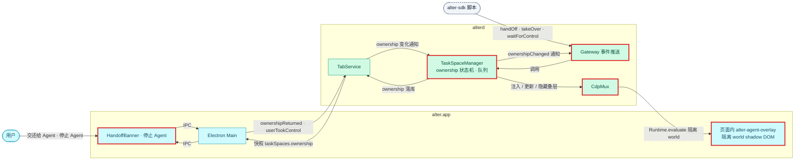
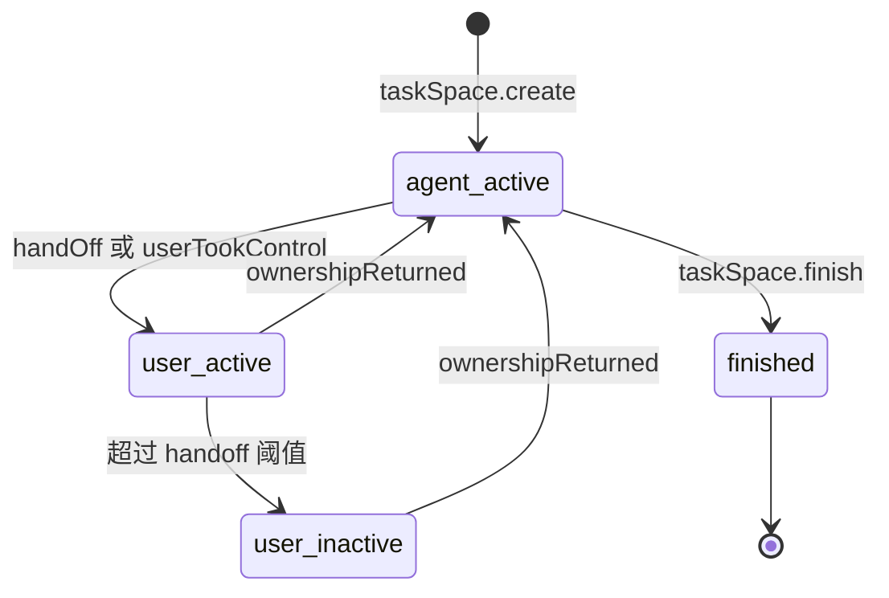
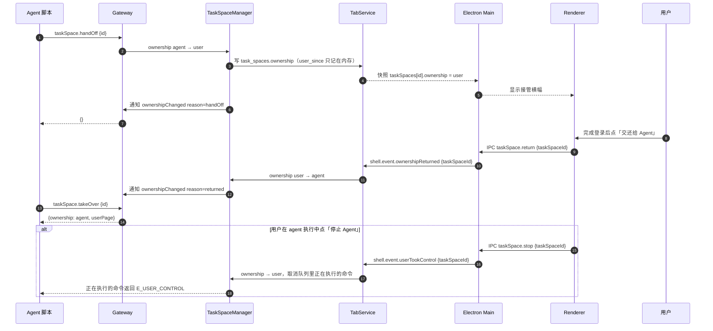

# 设计：agent 叠层与接管交还

## 上下文
对应本节点 requirement.md 的全部 Spec Delta，以及 `infra/core-flows.md`「交还与接管」时序。

N2 交付之后：
- TaskSpaceManager 已有每个 TaskSpace 的串行队列，`task_spaces.ownership` 恒为 `agent`。
- Gateway 能向订阅了某个 TaskSpace 的连接推送通知（`page.dialog` 等）。
- 快照里有 `taskSpaces`。

本节点补上 ownership 状态机、强制执行、UI、叠层。

## 目标与非目标
- 目标：handOff / 交还 / takeOver / 停止 Agent，`E_USER_CONTROL` 的强制执行，叠层，`waitForControl`，`inactive` 超时。
- 非目标：叠层的动画细节（只要求位置与文字正确）；系统通知。

## 架构
<!-- dflow:diagram assets/arch-agent-handoff.mmd -->

<!-- /dflow:diagram -->

- ownership 检查放在 TaskSpace 队列取出命令、执行之前，这是唯一的入口，所以不会漏。用户主动接管时，TabService 在把 ownership 写成 user 的同一步递增接管信号（`crates/alterd/src/takeover.rs` 的 `watch`：每个 TaskSpace 一个、全局一个），命令在排队之前订阅，等待循环（选择器轮询、`waitFor`、导航等待）都 `select!` 这个信号，变化就返回 `E_USER_CONTROL`；入队未写出的 CDP 命令由写出任务丢弃（实现时由 `CancellationToken` 改为 `watch`，见「实现细节（T2）」）。
- 叠层：
  - alterd 在 agent 动作时按需显示叠层：在主框架的隔离 world `alter-overlay`（`Page.createIsolatedWorld`）里执行 `crates/alterd/src/cdp/overlay.js`，创建或更新 `<alter-agent-overlay>` 元素（`position: fixed`、`pointer-events: none`、`z-index` 最大值，shadow DOM 里放光标与动作文字），转为用户控制时隐藏（`hide`）。实现时改为不用 `Page.addScriptToEvaluateOnNewDocument` 预先注入、不注册自定义元素，见「实现细节」。
  - 每个带 `actionLabel` 的动作在派发输入事件之前调用 `show`；ownership 变为 `user` 时调用 `hide`。
  - 元素放在主文档的 `documentElement` 下，页面脚本看得到它，但它不拦截事件，也不影响布局。
- UI：Renderer 新增 `HandoffBanner.tsx`（横幅与「交还给 Agent」）和侧边栏顶部的「停止 Agent」按钮（`data-testid="stop-agent"`），显示条件都由快照里的 `taskSpaces` 推出。

## 组件
| 组件 | 仓库 | 职责 | 新增 / 变更 |
|---|---|---|---|
| `alterd::tabs::ownership`、`alterd::takeover` | alter | 状态机、接管信号（取消正在执行的命令）、`inactive` 计时器 | 新增 |
| `alterd::cdp::overlay` | alter | 叠层脚本注入与 show / hide | 新增 |
| `alterd::tabs` | alter | `ownershipReturned` / `userTookControl` 事件，写 `task_spaces.ownership` / `status` | 变更 |
| `alterd::gateway` | alter | `taskSpace.handOff` / `takeOver`，`taskSpace.ownershipChanged` 通知 | 变更 |
| `@alter/sdk` | alter | `handOff()`、`waitForControl()`、`takeOverTaskSpace()` | 变更 |
| Renderer `HandoffBanner.tsx`、`Sidebar.tsx` | alter | 横幅、停止按钮 | 新增 / 变更 |
| Electron Main | alter | IPC `taskSpace.return` / `taskSpace.stop` 转为 Shell 事件 | 变更 |

## 接口契约
Gateway：
- `taskSpace.handOff {id}` → `{}`。已经是 `user` 时幂等，也返回 `{}`，不重复推送。
- `taskSpace.takeOver {id}` → `{ownership: "agent", userPage: string | null}`。所在 Space 没有激活标签、或激活标签已被另一个 TaskSpace 托管（一个标签同一时刻只属于一个 TaskSpace）时 `userPage` 为 `null`；ownership 为 `user` 时返回 `E_USER_CONTROL`。
- ownership 为 `user` 时被拒绝（`E_USER_CONTROL`）的 agent 命令：全部 `page.*`、`taskSpace.newPage` / `adopt` / `release` / `finish` / `cdp` / `takeOver`；只读的 `taskSpace.resume` / `list` / `tabs` 与幂等的 `handOff` 不受限。
- 原始 CDP 透传（`taskSpace.cdp`、`page.cdp`）可以作用于任何页面：只要有未结束的 TaskSpace 正由用户控制就回 `E_USER_CONTROL`，不只看请求的那个 TaskSpace；检查之前先订阅全局接管信号，检查通过后、发送之前任何 TaskSpace 被接管也中止。
- 接管时刻的保证：TabService 把 ownership 写成 user 并让全局接管信号加一，是单线程运行时里同一个不让出的回合；转发任务与原始 CDP 透传每次恢复都先看接管信号（`biased`）；原始命令进入 CdpMux 写出队列时也带着接管信号，写出任务真正发送前再检查一次，接管后丢弃。
- 接管信号（`crates/alterd/src/takeover.rs`）：每个 TaskSpace 一个、全局一个，由 TabService 在把 ownership 写成 user 的同一步递增。agent 调用产生的全部 CDP 命令都带接管信号进入写出队列（task-local `cdp::GUARD`：`page.*` 用该 TaskSpace 的，原始透传用全局的；建立页面会话的初始化命令也在内），写出任务发送前检查，接管后丢弃。alterd 自己的命令（例如接管时隐藏叠层）不带信号。
- 接管边界的定义：一条原始命令（或转发连接上的一段字节）**开始写出**（交给 WebSocket / TCP 发送）的时刻就是它的发出时刻。接管之后不会再有原始命令或转发字节开始写出；接管之前已经开始写出的，即使因背压在接管之后才离开本进程、到达 Chromium，也算接管前发出——已交给传输层的字节无法撤回，等待它写完再完成接管也不会改变 Chromium 收到它的时刻。Chromium 按顺序处理命令，效果等同于这条命令在用户接管前一刻执行。这依赖 alterd 的 `new_current_thread` 运行时，`TabService::run` 与 `forward::serve` 启动时断言它。
- CDP 转发端点（N2 R18）：转发的是整个浏览器，没有 TaskSpace 之分。只要有未结束的 TaskSpace 正由用户控制，新连接回 `423 Locked`；有 TaskSpace 转为用户控制时，正在转发的连接全部断开（切断信号由 TabService 在写 ownership 的同一步发出；转发连接的请求头写入与转发都在切断优先的 `select!` 里）。全部交还后恢复转发。
- 通知 `taskSpace.ownershipChanged {id, ownership, reason}`，`reason ∈ handOff | userTookControl | returned`。推给所有 create / resume 过该 TaskSpace 的连接。

Shell Control（Electron → alterd）：
- `shell.event.ownershipReturned {taskSpaceId}`
- `shell.event.userTookControl {taskSpaceId}`

TaskSpace 不存在时回 `shell.error E_TASK_SPACE_NOT_FOUND`；ownership 已是目标值时不做任何事、不广播。

实现细节（T2）：
- ownership 检查：`page.*` 在该 TaskSpace 的队列锁之后、发任何 CDP 命令之前检查；`taskSpace.newPage` / `adopt` / `takeOver` 在 TabService 里检查。`taskSpace.handOff` / `takeOver` 也排进该 TaskSpace 的队列。
- 取消：每个 TaskSpace 一个 `watch` 接管信号，另有一个全局信号（`crates/alterd/src/takeover.rs`），`page.*` 在排队之前订阅；TabService 把 ownership 写成 `user` 的同一个同步步骤里递增该 TaskSpace 与全局的信号（单线程运行时下不可分，见「接管边界的定义」），正在执行和排队中的命令都以 `E_USER_CONTROL` 结束（入队未写出的 CDP 命令由写出任务丢弃，pending 由 N2 的守卫清理）；`ownershipChanged` 通知随后才推给 SDK，不参与取消。
- 超时：`alter_core::config::Config::handoff_timeout()`（`ALTER_HANDOFF_TIMEOUT_MS` → `handoff_timeout_minutes` → 30 分钟）；alterd 起一个周期为「阈值 / 3，限制在 10 ms 到 60 s 之间」的任务（10 ms 下限只在测试用的极短阈值时起作用），把进入 user 超过阈值的 TaskSpace 标记为 `inactive`。启动时库里已是 user 的从启动时刻计时。
- 快照的 `taskSpaces` 含 `active` 与 `inactive`（不含 `finished`），交还超时后横幅仍可交还。
- config.toml 在 `crates/alter-core/src/config.rs`：`handoff_timeout_minutes`、`archive_after_hours`、`download_dir`；N2 推迟的下载目录 `download_dir` 一并接上（`ALTER_DOWNLOAD_DIR` → `download_dir` → `~/Downloads`）。
- 状态机代码在 `crates/alterd/src/tabs/ownership.rs`（TaskSpace 的状态在 TabService 里，不另建 `task_space/` 模块）。

叠层（T5）：
- 脚本 `crates/alterd/src/cdp/overlay.js`，每次 show / hide 时在主框架的隔离 world `alter-overlay`（`Page.createIsolatedWorld`）里执行，不用 `Page.addScriptToEvaluateOnNewDocument`：叠层只在 agent 动作时出现，按需创建即可。
- 隔离 world 里没有 `customElements`，元素 `<alter-agent-overlay>` 不注册自定义元素，只 `attachShadow({mode: "open"})`；可见状态记在元素的 `data-visible` 属性上，不依赖隔离 world 的全局变量。
- 带 `actionLabel` 的元素动作在派发输入之前，以目标元素中心为光标位置显示叠层；ownership 转为 user 时 Gateway 隐藏该 TaskSpace 各页面的叠层；截图前暂时藏起，截完按原状态恢复。

快照：`taskSpaces[].ownership` 在 `agent` / `user` 间变化，`status` 增加 `inactive`。

IPC（Renderer → Main）：`taskSpace.return {taskSpaceId}`、`taskSpace.stop {taskSpaceId}`。

SDK：`TaskSpace.handOff(): Promise<void>`、`TaskSpace.waitForControl({timeoutMs = 600000}): Promise<void>`、全局 `takeOverTaskSpace(id): Promise<TaskSpace>`（返回的对象带 `userPage(): Page | null`）。

## 数据模型
不新增迁移。`task_spaces.ownership` 与 `status` 两列 0001 已有。「进入 user 状态的时间」只记在 TaskSpaceManager 的内存里：alterd 重启后从启动时刻重新计时（见假设）。

```sql
-- 状态变化只写已有的列
UPDATE task_spaces SET ownership = 'user' WHERE id = ?1;
UPDATE task_spaces SET status = 'inactive' WHERE id = ?1 AND ownership = 'user';
UPDATE task_spaces SET ownership = 'agent', status = 'active' WHERE id = ?1;
```

TaskSpace 的状态机：

<!-- dflow:diagram assets/state-agent-handoff.mmd -->

<!-- /dflow:diagram -->

## 核心流程
<!-- dflow:diagram assets/seq-agent-handoff.mmd -->

<!-- /dflow:diagram -->

## 决策
| 决策 | 选择 | 考虑过的替代方案 | 理由 |
|---|---|---|---|
| 叠层的实现 | CDP 注入到隔离 world 的 shadow DOM，`pointer-events: none` | 透明 WebContentsView 盖在页面上；Renderer 元素 | 透明视图会挡住鼠标；Renderer 元素被 WebContentsView 盖住；注入走 CDP，符合「只有 alterd 发 CDP」 |
| ownership 的 UI 状态通道 | 快照里的 `taskSpaces` | `shell.setOverlay` 指令（core-flows.md 原图） | 与 N1 / N2 的快照模型一致；存档时更新 core-flows.md 的时序图 |
| 取消正在执行的命令 | `watch` 接管信号（每个 TaskSpace 一个、全局一个），与写 ownership 同一步递增（原计划每个命令一个 `CancellationToken`） | 等命令自然结束 | R5.S1 要求 1 秒内返回；`waitFor` 可能等很久；一个信号同时覆盖正在执行、排队中与入队未写出的命令 |
| 进入 user 的时间 | 只记在内存 | 加一列 `user_since`（需要迁移 0003） | 本需求只做一次迁移；重启后重新计时只会让 `inactive` 来得更晚，不影响安全语义 |

## 风险与权衡
- [页面的 CSP 或 Trusted Types 阻止注入] → 隔离 world 不受页面 CSP 的脚本限制；叠层元素加在主文档上（不注册自定义元素），若页面通过 MutationObserver 删掉它，就在下一次 `show` 时重建。
- [页面截图会拍进叠层] → `page.screenshot` 之前先 `hide`，截完再恢复。这一点会改动 N2 的截图实现，写在 T5 里。
- [`tokio-util` 是新依赖] → T2 选了 `tokio::sync::watch`（每个 TaskSpace 一个取消计数），不引入 `tokio-util`。
- [`toml` 是新依赖] → config.toml 的解析用 `toml` crate（只开 `parse` 与 `serde` 特性）。手写解析器要处理注释、引号与转义，容易出错；`toml` 是 serde 生态的标准实现。

## 迁移与上线
无数据迁移。旧数据里的 `ownership` 全是 `agent`，与新状态机兼容。

## 宪章检查
| 原则 | 状态 | 说明 |
|---|---|---|
| 规格先行 | PASS | 9 条 requirement |
| 测试先行 | PASS | 状态机与强制执行用 `crates/alterd/tests/gateway.rs`（真 alterd，Shell 假客户端代替 Electron）；SDK 用 `packages/sdk/tests/handoff.test.ts`；叠层与 UI 用 `apps/browser/e2e/handoff.spec.ts` |
| 简单优先 | PASS | 新增依赖只有 `toml`（config.toml 解析，只开 `parse` / `serde`，理由见「风险」）；接管信号用 `tokio::sync::watch`，不引入 `tokio-util` |
| 边界契约 | PASS | Gateway 方法、通知、Shell 事件、IPC 都在上面写明 |
