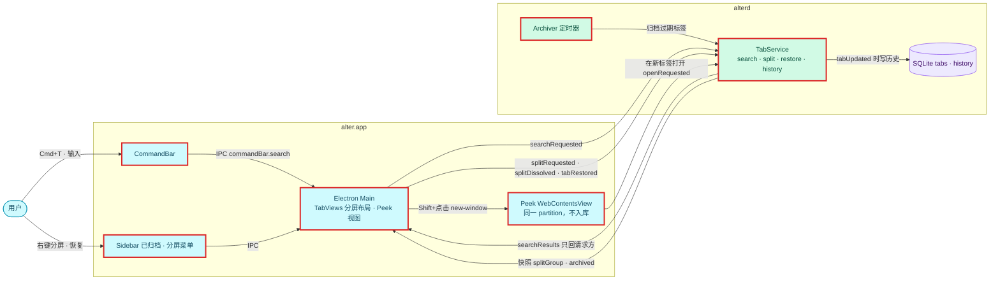
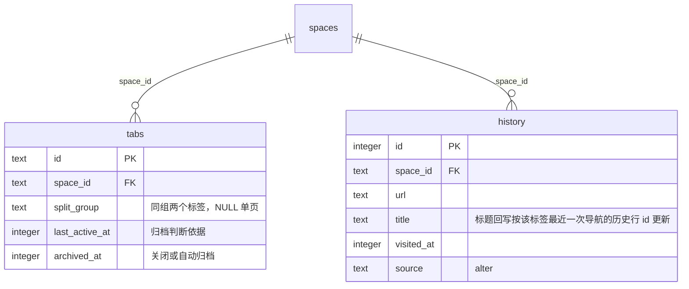
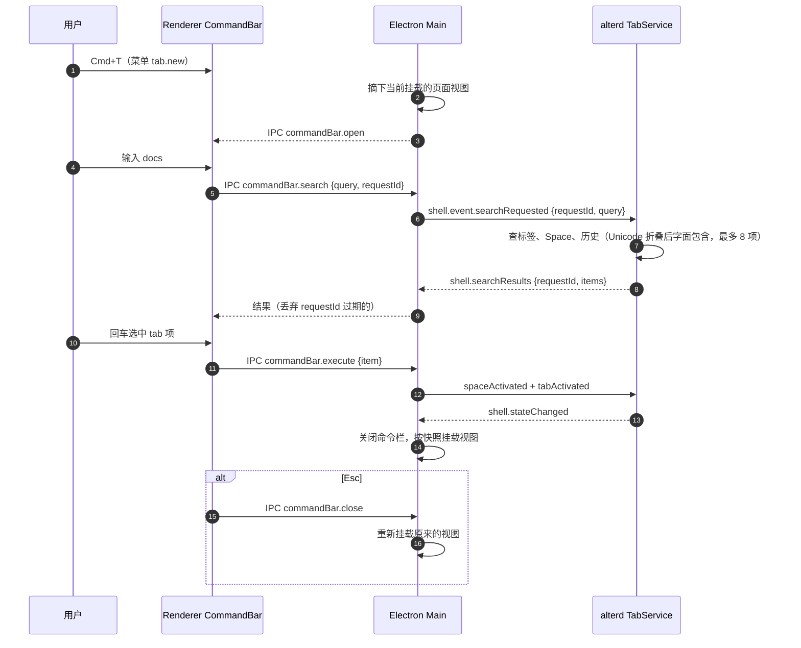

# 设计：命令栏、分屏、Peek 与自动归档

## 上下文
对应本节点 requirement.md 的全部 Spec Delta。

N1、N2 之后：
- 快照里有 `pinned`、`taskSpaceId`。
- 菜单注册表在 `apps/browser/src/main/menu.ts`，`tab.new` 目前是聚焦地址框。
- `history` 表 0001 已建，但还没人写。
- `tabs.split_group` 列已在，但还没人用。
- 关闭标签只是置 `archived_at`。

## 目标与非目标
- 目标：历史记录、命令栏、分屏（2 个）、Peek、自动归档与恢复。
- 非目标：书签界面；分屏比例拖动；Peek 的前进后退按钮。

## 架构
<!-- dflow:diagram assets/arch-browse-extras.mmd -->

<!-- /dflow:diagram -->

- 搜索在 alterd 里做：标签、Space、历史都在它的数据库里；N5 往里加书签时只改 alterd。
  - 请求与结果走 Shell 的「只回请求方」模式（同 `shell.navigate`）。
  - Renderer 每次输入变化发一次请求，带递增的 `requestId`，丢弃过期的结果。
- 分屏状态在快照里（`TabView.splitGroup`）。`TabViews.apply` 发现当前 Space 的激活标签有 `splitGroup` 时，挂载同组的两个视图，左右各半。左边是组成分屏时的激活标签：两者在组内的顺序存在 `split_group` 的值里，值的格式为 `<左边标签 id>`，右边标签的 `split_group` 也写这个值，左边就是 id 等于该值的那个。
- Peek 完全在 Electron 内：
  - `setWindowOpenHandler` 里 `disposition === "new-window"` 且 `features === ""`（Shift+点击）时，新建一个同 partition 的 WebContentsView，大小为内容区的 80%，居中；打开期间摘下底下的页面视图（页面视图会盖住 Renderer），Renderer 在内容区画半透明遮罩和「在新标签打开」按钮。Esc（页面里或 Renderer 里）或点遮罩关闭。
  - 带窗口特性的 `window.open`（OAuth 弹窗）仍按 N1 之前的规则转为新标签。
- 自动归档：`crates/alterd/src/archive.rs` 里一个 tokio 定时器，周期为「阈值 / 3，限制在 10 ms 到 60 s 之间」（10 ms 下限只在测试用的极短阈值时起作用），发内部请求给 TabService 执行一条 UPDATE，有行变化才广播。

## 组件
| 组件 | 仓库 | 职责 | 新增 / 变更 |
|---|---|---|---|
| `alter_core::store::history` | alter | 写历史、更新标题、搜索 | 新增 |
| `alter_core::store::tabs` | alter | `split`、`dissolve_split`、`restore`、`archive_stale`、`list_archived` | 变更 |
| `alterd::tabs` | alter | 新事件、搜索、快照增加 `splitGroup` 与 `archived` | 变更 |
| `alterd::archive` | alter | 定时归档 | 新增 |
| `alter_core::protocol::shell` | alter | 新事件与 `shell.searchResults` | 变更 |
| Renderer `CommandBar.tsx`、`ArchivedList.tsx`、`PeekChrome.tsx`、`Sidebar.tsx` | alter | UI | 新增 / 变更 |
| Electron Main `tab-views.ts`、`peek.ts`、`menu.ts` | alter | 分屏布局、Peek 视图、`tab.new` 改为打开命令栏 | 变更 / 新增 |

## 接口契约
Shell Control 增量（Electron → alterd）：

| 消息 | 字段 | 效果 | 错误 |
|---|---|---|---|
| `shell.event.searchRequested` | `{requestId: number, query: string}` | 只向发送方回 `shell.searchResults` | — |
| `shell.event.splitRequested` | `{tabIds: [left, right]}` | 两者 `split_group = left`；若任一已在别的分屏里，先解散那个分屏 | `E_INVALID_ARGUMENT`（不是恰好 2 个、相同、跨 Space）、`E_TAB_NOT_FOUND` |
| `shell.event.splitDissolved` | `{tabId}` | 该组两个标签的 `split_group` 置 NULL | `E_TAB_NOT_FOUND` |
| `shell.event.tabRestored` | `{tabId}` | `archived_at = NULL`，放到普通分区末尾，激活 | `E_TAB_NOT_FOUND`（不存在或未归档） |

alterd → Electron：`shell.searchResults {requestId, items: [{kind: "tab"|"space"|"history"|"open", title, url?, tabId?, spaceId?, input?}]}`。

快照增量：
- `TabView.splitGroup: string | null`。
- `ShellState.archived: [{id, spaceId, url, title, archivedAt}]`：每个 Space 至多 50 项，按 `archivedAt` 降序。

既有消息的行为增量：
- `tabUpdated` 带 `url` 时追加一条历史，不论 URL 是否变化，因为每条都对应一次主框架导航（`about:blank` 除外）；带 `title` 时只更新**该标签最近一次导航写入的那一行**（alterd 在内存里记标签 → 历史行 id；重启后、该标签下一次导航之前的标题回写不写历史）。同 Space 两个标签访问同一 URL 时各自的标题互不覆盖。
- 搜索的匹配规则：标签、Space、历史一律「Unicode 小写折叠后字面包含」（Rust 的 `str::to_lowercase`）。历史在 SQL 里用连接上注册的 `alter_fold(text)` 加 `instr`，不用 `LIKE`（`LIKE` 只对 ASCII 忽略大小写，且有通配符）。N5 往结果里加书签时用同一规则。
- `tabClosed` 关闭分屏中的标签时一并解散分屏。

IPC（Renderer ↔ Main）：`commandBar.open` / `commandBar.close`（Main → Renderer 与反向）、`commandBar.search {query, requestId}`、`commandBar.execute {item}`、`tab.split {tabId}`（与当前激活标签分屏）、`tab.unsplit {tabId}`、`tab.restore {tabId}`、`peek.close`、`peek.promote`；Main → Renderer：`commandBar.results {requestId, items}`（搜索结果，Renderer 丢弃过期的 requestId）、`peek.state {open, bounds?}`（Peek 开闭与视图在窗口里的位置）。

## 数据模型
不改表结构，只开始使用已有的列和表：

```sql
-- 归档：一条 UPDATE，排除固定、激活、被托管的标签
UPDATE tabs SET archived_at = ?now
WHERE archived_at IS NULL AND pinned = 0 AND last_active_at < ?now - ?threshold
  AND last_active_at < (SELECT MAX(o.last_active_at) FROM tabs o
                        WHERE o.space_id = tabs.space_id AND o.archived_at IS NULL)
  AND id NOT IN (SELECT tab_id FROM task_pages WHERE tab_id IS NOT NULL AND closed_at IS NULL);
-- 搜索历史：按 url 去重取最近一次（裸列 title 取 MAX(visited_at) 那一行），alter_fold 为 Unicode 小写折叠
SELECT h.url, h.title, MAX(h.visited_at) AS last FROM history h
JOIN spaces s ON s.id = h.space_id AND s.archived_at IS NULL
WHERE instr(alter_fold(h.title), ?q) > 0 OR instr(alter_fold(h.url), ?q) > 0
GROUP BY h.url ORDER BY last DESC LIMIT ?n;
```

<!-- dflow:diagram assets/er-browse-extras.mmd -->

<!-- /dflow:diagram -->

## 核心流程
命令栏：

<!-- dflow:diagram assets/seq-browse-extras.mmd -->

<!-- /dflow:diagram -->

## 决策
| 决策 | 选择 | 考虑过的替代方案 | 理由 |
|---|---|---|---|
| 搜索放在哪里 | alterd，请求 / 应答 | Renderer 里用快照过滤，历史另外下发 | 历史可能有几十万行，不能放进快照；一处实现，N5 加书签也只改这里 |
| 命令栏期间的页面 | 摘下页面视图 | 用 `capturePage` 截图当背景 | 先做最简单的；截图背景是体验优化，不在场景里 |
| 分屏顺序 | `split_group` 存左边标签的 id | 新增列 | 不加迁移；值本身就能决定左右 |
| Peek 的识别 | `disposition === "new-window"` 且没有 `features` | 在页面里注入监听 Shift+点击 | 不碰页面；Chromium 已经把 Shift+点击映射为 `new-window` |
| 归档执行者 | alterd 定时器 | Electron 定时器 | 归档改数据库，只能 alterd 做 |

## 风险与权衡
- [历史搜索在大量历史上变慢] → 全表一次扫描按 URL 分组；10 万行实测 20–27 ms（T3、T14 记录，含 Shell 往返），低于 50 ms，不引入 FTS5。
- [Shift+点击在不同页面上的 disposition 不一致] → e2e 覆盖普通链接；`target="_blank"` 加 Shift 的组合也按 Peek 处理，在 log.md 记录实测结果。
- [N1 的 R12 场景要随 MODIFIED 一起重跑] → `tab.new` 改为命令栏后，「新标签与聚焦地址框」场景通过命令栏的「打开」项仍应成立；T6 把 `shortcuts.spec.ts` 全部重跑一遍。

## 迁移与上线
无数据迁移。升级后第一次启动时，所有超过 12 小时没激活过的标签会被一次性归档：这符合预期，「已归档」列表可以恢复。

## 宪章检查
| 原则 | 状态 | 说明 |
|---|---|---|
| 规格先行 | PASS | 12 条 requirement |
| 测试先行 | PASS | alterd 行为用 `crates/alterd/tests/shell.rs`；UI 用 `apps/browser/e2e/command-bar.spec.ts`、`split.spec.ts`、`peek.spec.ts`、`archive.spec.ts` |
| 简单优先 | PASS | 无新依赖；分屏不加列，搜索不引入 FTS |
| 边界契约 | PASS | Shell 增量与 IPC 写在上面，先由契约测试覆盖 |
