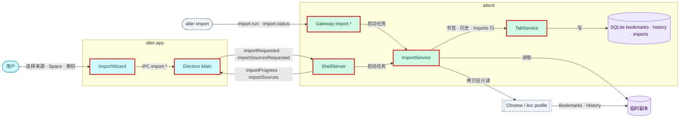
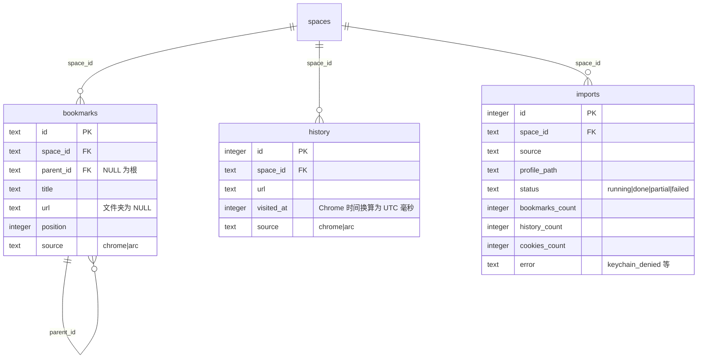
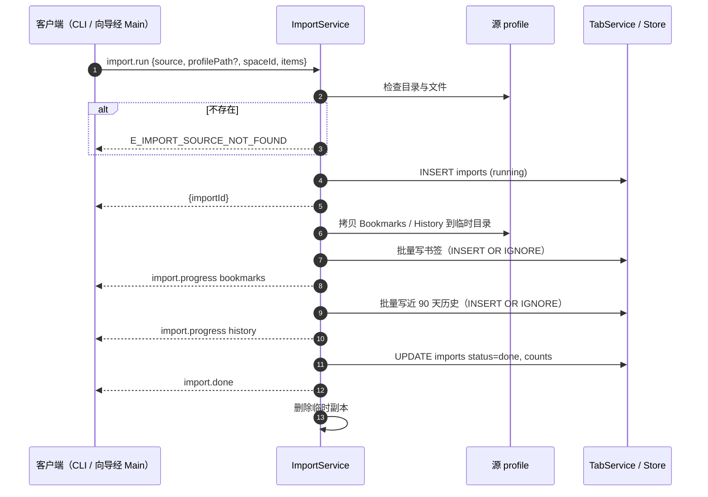

# 设计：从 Chrome / Arc 导入

## 上下文
对应本节点 requirement.md 的全部 Spec Delta，以及 `infra/core-flows.md`「从 Chrome / Arc 导入 profile」时序。

N2、N4 之后：
- Gateway 能分发方法、推送通知。
- CdpMux 能对某个标签的会话发任意 CDP 命令。
- 命令栏的搜索在 alterd 的 TabService 里。
- `bookmarks`、`history`、`imports` 三张表 0001 已建。

## 目标与非目标
- 目标：书签、近 90 天历史的导入（Chrome 与 Arc），Gateway / Shell / CLI / 向导四个入口，命令栏的书签结果。
- 非目标（revision 2 起）：Cookie 导入（Keychain 取口令、解密、写入 partition）移到后续 change，本节点不实现。
- 非目标：密码、扩展、表单；导入后同步；Arc 侧边栏数据。

## 架构
<!-- dflow:diagram assets/arch-profile-import.mmd -->

<!-- /dflow:diagram -->

- `crates/alterd/src/import/`：
  - `mod.rs`：任务编排、进度。
  - `bookmarks.rs`：解析 JSON 树。
  - `history.rs`：读 `urls` join `visits`。
  - `sources.rs`：数据根目录与 profile 枚举。
- 任务在独立的 tokio 任务里跑，拷贝 / 备份源文件、读 SQLite 与解析放进 `spawn_blocking`；来源检查与 profile 列表（几次 `metadata` / `read_dir`）直接在调用处同步执行，量很小（数据根目录下的子目录）。写库仍经 TabService 的循环：批量请求，每批 500 行一个事务。
- 两个入口共用 `Imports::start(req, events)`（`crates/alterd/src/import/mod.rs`；Gateway 入口在 `gateway/imports.rs`，Shell 入口是 `import::run_for_shell`）：
  - Gateway 入口把进度转成通知推给发起连接。
  - Shell 入口把进度转成 `shell.importProgress` 回发起的 Electron 连接。
- 向导：`apps/browser/src/renderer/src/ImportWizard.tsx`，入口是侧边栏底部的菜单按钮 `sidebar-menu` →「导入…」（`menu-import`）。向导是侧边栏里的面板（与「已归档」列表同处），侧边栏不被页面视图覆盖，不需要摘下页面视图。Cookie 复选框禁用（Cookie 导入在后续 change）。

## 组件
| 组件 | 仓库 | 职责 | 新增 / 变更 |
|---|---|---|---|
| `alterd::import` | alter | 读取、写入、进度 | 新增 |
| `alterd::gateway` | alter | `import.run` / `import.status`，`import.progress` / `import.done` 通知 | 变更 |
| `alterd::tabs` | alter | 书签与历史的批量写入；搜索加书签；Shell 的导入事件 | 变更 |
| `alter_core::store::bookmarks`、`imports` | alter | 仓储 | 新增 |
| `alter import` | alter | CLI | 新增 |
| Renderer `ImportWizard.tsx` | alter | 向导 | 新增 |

## 接口契约
Gateway（以 api.md 为准，补充字段）：
- `import.run {source: "chrome"|"arc", profilePath?: string, spaceId: string, items?: ("bookmarks"|"history"|"cookies")[]}`：`items` 省略时为书签与历史；含 `cookies` 时为 `E_INVALID_ARGUMENT`（Cookie 导入在后续 change）。立即返回 `{importId}`，错误有 `E_IMPORT_SOURCE_NOT_FOUND`、`E_SPACE_NOT_FOUND`、`E_INVALID_ARGUMENT`。
- `import.status {importId}` → `{status, counts: {bookmarks, history, cookies, skipped}, warning?, error?}`。
- 通知：`import.progress {importId, item, counts}`，`import.done {importId, status, counts, warning?}`。`warning` 预留给 Cookie 导入的 `keychain_denied`，本节点不会出现；`counts.cookies` 恒为 0。
- 计数：`counts.bookmarks` / `counts.history` 是本次处理的条目数（含已存在而未重复写入的），重复导入同一 profile 时计数不变；`counts.skipped` 是无法解析的条目数。
- `skipped` 只在 alterd 内存里（`imports` 表没有这一列）：alterd 重启后 `import.status` 读表，`skipped` 报 0。未知的 `importId` 为 `E_INVALID_ARGUMENT`。
- `items` 按书签、历史的固定顺序执行，与传入顺序无关；空数组为 `E_INVALID_ARGUMENT`。来源检查先于 `items` 与 Space 的检查。
- 某类的数据文件不存在时这一类计 0，不算失败；读取或写库出错时停止，状态 `failed`，`import.status` 的 `error` 为原因。
- 日志：开始一条（`开始导入`）、每完成一类一条（`导入完成一类`，带 `item`、`count`、`skipped`）、结束一条（`导入结束`，带 `status`），满足父需求的可观测性 NFR。
- 源文件先做成 `ALTER_HOME/import-tmp/<importId>/` 下的副本，导入结束后删除：`History` 经 SQLite 的 backup API 从只读连接备份（包含未 checkpoint 的 WAL，是一致快照）；源库被锁（源浏览器持有独占锁）或打不开时退回文件拷贝（连同 `-wal` / `-journal`）并记 warn 日志。`Bookmarks` 是 JSON，直接拷贝。
- alterd 启动时（拿到单实例锁、打开数据库之后）把遗留的 `running` 导入记为 `failed`、`error` 为 `interrupted`，并删除整个 `ALTER_HOME/import-tmp`：上次退出或崩溃时被丢下的导入没有任务在做，副本也不该留在磁盘上。收尾写库失败或导入行已不在时，导入记为 `failed`。

Shell Control 增量：
- `shell.event.importSourcesRequested {requestId}` → `shell.importSources {requestId, chrome: string[], arc: string[]}`。profile 列表为数据根目录下含 `Bookmarks`、`History` 或 `Cookies` 之一的子目录名，按名称排序。
- `shell.event.importRequested {requestId, source, profile, spaceId, items}` → 每个进度一条 `shell.importProgress {requestId, importId, status, item?, counts, warning?, error?}`，最后一条的 `status` 为 `done`、`partial` 或 `failed`。
  - `profile` 是列表里的子目录名（含 `/`、`.`、`..` 的为 `E_INVALID_ARGUMENT`），alterd 在该浏览器的数据根目录下找它。
  - 没能开始（来源不存在、Space 不存在、参数不合法）时只回一条 `failed`，`importId` 为 0，`error` 为 `<错误码>: <说明>`。Shell 没有按请求关联的错误回复，所以用这个字段（T6 增加）。
- Electron 的 IPC：`import.sources`（渲染 → 主，invoke；主进程发 `importSourcesRequested`，5 秒没有回应按空列表）、`import.start`（渲染 → 主，转为 `importRequested`）、`import.progress`（主 → 渲染，原样转发 `importProgress`）。

搜索结果增加 `kind: "bookmark"`，排在 Space 之后、历史之前；书签按标题与 URL 匹配，排除文件夹，只搜当前 Space 的书签（与 R11.S5「当前 Space 的书签」一致，执行时也在当前 Space 新建标签），同一 Space 内按写入顺序。

CLI：`alter import --from chrome|arc [--profile <path>] --space <id> [--items a,b]`。stdout 为 `imported bookmarks=<n> history=<n> cookies=<n> skipped=<n>`，退出码 0（`import.done` 带 `warning` 时另在 stderr 打印 `warning: <warning>`；本需求不会出现，`partial` / `keychain_denied` 随 Cookie 导入在后续 change）；来源不存在为 1；连不上 Gateway 为 2。
- 其他业务错误（stderr `<code>: <message>`）与导入状态 `failed` 也为 1；`--profile` 的相对路径先按 CLI 的当前目录转成绝对路径再发给 alterd。
- 等 `import.done` 的读超时为 10 分钟；CLI 的 Gateway 客户端是一个同步会话（`Session`：请求、收通知），`alter spaces list` 等一次性调用仍用 `call`。

时间换算：Chrome 时间（1601-01-01 起的微秒）→ UTC 毫秒 = `t / 1000 - 11644473600000`。

## 数据模型
不新增迁移，使用 0001 已有的表与唯一索引：

```sql
-- 书签去重：idx_bookmarks_dedupe (space_id, parent_id, url, title) WHERE url IS NOT NULL
-- 文件夹没有 url，不在唯一索引里：按 (space_id, parent_id, title, url IS NULL) 先查再插，保证重复导入不重复建文件夹
INSERT OR IGNORE INTO bookmarks (id, space_id, parent_id, title, url, position, source) VALUES (…);
-- 历史去重：idx_history_dedupe (space_id, url, visited_at)
INSERT OR IGNORE INTO history (space_id, url, title, visited_at, source) VALUES (…);
INSERT INTO imports (space_id, source, profile_path, status, started_at) VALUES (?, ?, ?, 'running', ?);
```

注意：SQLite 唯一索引里 `NULL` 互不相等，根级书签的 `parent_id` 为 NULL，会让 `INSERT OR IGNORE` 失效。根级条目同样先查再插，T2 的 R1.S2 测试专门覆盖这一点。

<!-- dflow:diagram assets/er-profile-import.mmd -->

<!-- /dflow:diagram -->

## 核心流程
<!-- dflow:diagram assets/seq-profile-import.mmd -->

<!-- /dflow:diagram -->

## 决策
| 决策 | 选择 | 考虑过的替代方案 | 理由 |
|---|---|---|---|
| alterd 直接依赖 rusqlite | 用工作区已有的 rusqlite 读源 profile 的 `History` 副本 | 把读取放进 alter-core | 读的是外部浏览器的库，与 alter 自己的仓储无关；rusqlite 已在工作区与 alter-core 里，不新增 crate |
| 向导经哪条通道 | Shell（`importRequested`） | Main 连 Gateway | Main 只有一条到 alterd 的通道，不额外持有 token |

## 风险与权衡
- [源浏览器正在运行时数据库被锁或正在写] → `History` 先经 SQLite backup API 从只读连接取一致快照；被锁（独占锁）或打不开时退回 `std::fs::copy` 拷贝主文件及 `-wal` / `-journal` 再打开副本（见「接口契约」）。

## 迁移与上线
无数据迁移。

## 宪章检查
| 原则 | 状态 | 说明 |
|---|---|---|
| 规格先行 | PASS | 12 条 requirement |
| 测试先行 | PASS | 解析与写入用 `crates/alterd/tests/import.rs`（真 alterd + Gateway 客户端，fixture 在测试里生成）；CLI 用 `crates/alter-cli/tests/import.rs`；向导用 `apps/browser/e2e/import.spec.ts` |
| 简单优先 | PASS | 没有新 crate；alterd 直接依赖工作区已有的 rusqlite（理由见「决策」） |
| 边界契约 | PASS | Gateway、Shell、CLI 的契约写在上面，先由契约测试覆盖 |
