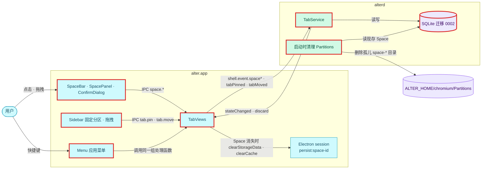
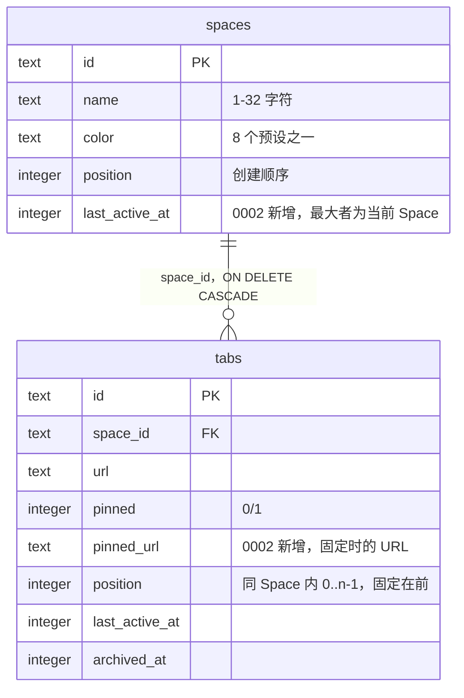
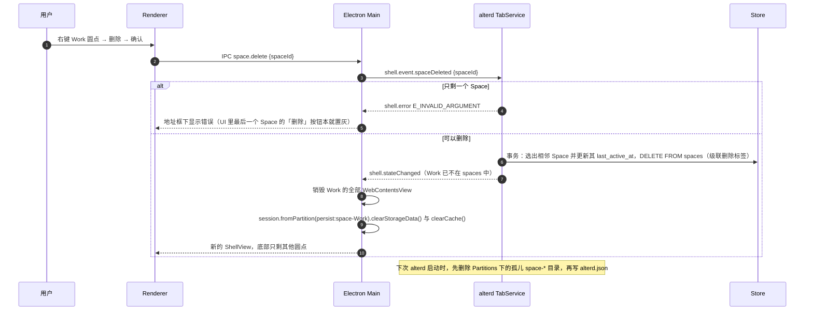

# 设计：Space 管理与标签整理

## 上下文
对应本节点 requirement.md 的全部 Spec Delta。

现状：
- `TabService::handle`（`crates/alterd/src/tabs/mod.rs`）按事件分派到 `Store` 的方法，成功就 `publish()` 一份全量快照；被拒绝时只回发送方 `shell.error`。
- `Store` 的 `insert_tab`、`activate_tab`、`close_tab`（`crates/alter-core/src/store/tabs.rs`）已经实现「`last_active_at` 严格递增」和「关闭时激活相邻标签」。
- 快照里的当前 Space 取 `list_spaces()` 的第一个（position 最小）。
- Electron 的 `TabViews.apply`（`apps/browser/src/main/tab-views.ts`）只为 `activeSpaceId` 的激活标签建视图并挂载，别的视图保留到标签从快照消失为止。
- Renderer 的 `Sidebar.tsx` 底部只显示当前 Space 名称。

## 目标与非目标
- 目标：Space 的新建 / 编辑 / 切换 / 删除，记住当前 Space，删除时清理 Cookie 与磁盘目录；固定、Arc 式关闭固定标签、拖拽；应用菜单快捷键；迁移 0002 与迁移前备份。
- 非目标：Space 拖拽排序；标签跨 Space 移动；命令栏；自动归档（N4）。

## 架构
<!-- dflow:diagram assets/arch-space-tabs.mmd -->

<!-- /dflow:diagram -->

- alterd 侧全部在 TabService 和 Store 里：新增 4 个 Space 事件、2 个标签事件的处理，以及 `snapshot()` 改为按 `spaces.last_active_at` 选当前 Space，并输出 `pinned`。
- 启动清理放在 `lifecycle::run` 里、`Store::open` 之后、写 `alterd.json` 之前，新文件 `crates/alterd/src/partitions.rs`。
- Electron Main 新增 `apps/browser/src/main/menu.ts`（应用菜单，菜单项 id 与 accelerator 照 R12 的表）。新增 IPC 通道，定义在 `apps/browser/src/shared/shell.ts`。`TabViews.apply` 在 Space 从快照中消失时调用 `clearStorageData` 与 `clearCache`；视图跟随快照：`TabView.discarded`（由 alterd 记录）为 true 的标签不建视图；用户关闭标签时立即关掉它的视图并设关闭屏障，直到 `shell.discard` 或标签从快照消失（见「接口契约」）。
- Renderer 新增 `SpaceBar.tsx`（圆点行、「+」）、`SpacePanel.tsx`（名称、颜色、保存 / 创建、删除）、`ConfirmDialog.tsx`；`Sidebar.tsx` 分固定 / 普通两个分区，行可拖动，行上有图钉按钮。
- 菜单的点击处理与 Renderer 的 IPC 处理共用 `apps/browser/src/main/actions.ts` 里的同一组函数（`closeActiveTab`、`activateSpaceAt(n)`、`cycleTab(±1)`、`togglePinActive` 等，由 `createActions(ctx)` 生成），这样 e2e 用 `menuItem.click()` 测到的就是用户按键时走的代码。

## 组件
| 组件 | 仓库 | 职责 | 新增 / 变更 |
|---|---|---|---|
| `crates/alter-core/migrations/0002_spaces_tabs.sql` | alter | 加列、重新编号 position | 新增 |
| `crates/alter-core/src/store/migrate.rs` | alter | 有待执行迁移且库非空时，先用 SQLite 备份 API 写 `alter.db.bak-<v>` | 变更 |
| `crates/alter-core/src/store/spaces.rs` | alter | `create_space`、`update_space`、`activate_space`、`delete_space`、`active_space_id`、`list_space_ids` | 变更 |
| `crates/alter-core/src/store/tabs.rs` | alter | `set_pinned`、`move_tab`、`close_tab` 区分固定、`list_open_tabs` 带 `pinned` | 变更 |
| `crates/alter-core/src/protocol/shell.rs` | alter | 新事件、`shell.discard`、`TabView.pinned` | 变更 |
| `crates/alterd/src/tabs/mod.rs` | alter | 新事件的校验与分派 | 变更 |
| `crates/alterd/src/partitions.rs` | alter | 启动时清理孤儿 partition 目录 | 新增 |
| `apps/browser/src/main/menu.ts`、`actions.ts` | alter | 应用菜单与共用动作 | 新增 |
| `apps/browser/src/main/tab-views.ts`、`index.ts` | alter | 跟随 `discarded` 建 / 关视图、关闭屏障、clearStorageData + clearCache、新 IPC | 变更 |
| `apps/browser/src/renderer/src/SpaceBar.tsx`、`SpacePanel.tsx`、`ConfirmDialog.tsx`、`Sidebar.tsx` | alter | UI | 新增 / 变更 |
| `apps/browser/e2e/fixtures/server.ts` | alter | `/set-cookie`、`/echo-cookie` 测试页 | 变更 |

## 接口契约
Shell Control 新增（Electron → alterd，每行一个 JSON，字段 camelCase）：

| 消息 | 字段 | 效果 | 错误 |
|---|---|---|---|
| `shell.event.spaceCreated` | `{name, color}` | 末尾新建，成为当前 Space（`last_active_at` 取全体最大值 + 1 与当前时间中较大者） | `E_INVALID_ARGUMENT`（名称去空白后为空或超过 32 个字符、颜色不在预设内） |
| `shell.event.spaceUpdated` | `{spaceId, name?, color?}` | 只改给出的字段；两者都没给时什么也不做、不广播 | `E_SPACE_NOT_FOUND`、`E_INVALID_ARGUMENT` |
| `shell.event.spaceActivated` | `{spaceId}` | 设为当前 Space | `E_SPACE_NOT_FOUND` |
| `shell.event.spaceDeleted` | `{spaceId}` | 硬删并级联；删的是当前 Space 时先激活后一个，没有就前一个 | `E_SPACE_NOT_FOUND`、`E_INVALID_ARGUMENT`（只剩一个） |
| `shell.event.tabPinned` | `{tabId, pinned}` | 固定：移到固定分区末尾并记 `pinned_url`；取消：移到普通分区开头、清空 `pinned_url`；状态没变时不广播 | `E_TAB_NOT_FOUND` |
| `shell.event.tabMoved` | `{tabId, pinned, index}` | 移到目标分区的第 `index` 位（超出时放末尾），跨分区时同时改固定状态 | `E_TAB_NOT_FOUND` |

`shell.event.tabClosed` 对固定标签的新行为：保留行，`url := pinned_url`，激活标签按相邻规则转移，并只向发送方回 `shell.discard {tabId}`。

alterd → Electron 新增 `shell.discard {tabId}`：只发给请求方，且每个连接上全部消息的写出顺序与 TabService 处理事件的顺序一致：每个连接在 TabService 里登记一条先进先出的发件箱（`Request::Connect`），快照与只回给它的消息（`shell.navigate`、`shell.error`、`shell.discard`）都由 TabService 按处理顺序放进去，连接任务只按顺序写出，不跳过任何一份快照；Main 关闭该标签的 WebContentsView。卸载状态以 alterd 为准：TabService 在内存里记录已卸载的固定标签（关闭固定标签时加入，`tabActivated` 时移除，标签被删时移除；不落库，重启后页面本来就没加载），快照的 `TabView.discarded` 为 true 时 Main 不为它建视图、已有的关掉；已卸载期间 alterd 忽略它的 `tabUpdated`（只可能来自旧页面）。在已卸载的标签里打开地址（`openRequested` 带它的 `tabId`）时没有页面可导航，alterd 不回 `shell.navigate`，而是把 url 改为新地址、写库成功后清除卸载状态并广播快照，Main 随之按新 url 建视图。用户关闭某个标签时 Main 立即关掉它的视图并设「关闭屏障」（按次数计，同一固定标签连续关闭几次就要等几条 `shell.discard`）：关闭结果全部到达前（固定标签收到对应的 `shell.discard`，普通标签从快照消失）不为它建视图，因为这时到达的快照还是关闭之前的；页面事件与弹窗只在视图仍是该标签当前登记的视图时上报。屏障期间 Main 的动作（地址框打开、关闭 / 固定当前标签、循环切换）也不把这个标签当作激活标签，因为手上的快照还是关闭之前的。

快照变化：
- `TabView` 增加 `pinned: boolean` 与 `discarded: boolean`（固定标签被关闭后页面已卸载）。
- 已卸载的标签不算激活：每个 Space 的激活标签是未卸载标签里 `last_active_at` 最大的；Space 只剩已卸载的标签时没有激活标签（内容区显示「没有打开的标签」，在地址框打开地址会新建标签）。
- `tabs` 在每个 Space 内按 `position` 升序，固定标签总在前面。
- `activeSpaceId` 取 `last_active_at` 最大的 Space，全为 NULL 时取 position 最小的。

Electron IPC 新增（`apps/browser/src/shared/shell.ts`）：`space.create {name, color}`、`space.update {spaceId, name?, color?}`、`space.activate {spaceId}`、`space.delete {spaceId}`、`tab.pin {tabId, pinned}`、`tab.move {tabId, pinned, index}`、`address.focus`（Main → Renderer，载荷 `{newTab: boolean}`）。预设颜色列表 `SPACE_COLORS` 定义在 `crates/alter-core/src/protocol/shell.rs`，并导出为 TS 常量，alterd 校验与 Renderer 色板共用一份。ts-rs 不导出常量，所以由 `export_ts` 额外写一个 `spaceColors.ts`。

## 数据模型
```sql
-- crates/alter-core/migrations/0002_spaces_tabs.sql
ALTER TABLE spaces ADD COLUMN last_active_at INTEGER;
ALTER TABLE tabs ADD COLUMN pinned_url TEXT;
-- 已有固定标签的 pinned_url 取当前 url
UPDATE tabs SET pinned_url = url WHERE pinned = 1;
-- 每个 Space 内的未归档标签按 (pinned DESC, position) 重新编号为 0..n-1。
-- 先把新编号算进临时表再 UPDATE … FROM：在 UPDATE 里用相关子查询数「排在前面的行」，
-- 会读到同一条语句里已经改过的行，编号可能重复。
CREATE TEMP TABLE renumbered AS
  SELECT id, ROW_NUMBER() OVER (PARTITION BY space_id ORDER BY pinned DESC, position, id) - 1 AS pos
  FROM tabs WHERE archived_at IS NULL;
UPDATE tabs SET position = renumbered.pos FROM renumbered WHERE renumbered.id = tabs.id;
DROP TABLE renumbered;
-- 已归档的标签不参与排序，统一置 -1
UPDATE tabs SET position = -1 WHERE archived_at IS NOT NULL;
```

迁移前备份：`migrate::apply(conn, db)` 发现 `MAX(version) >= 1` 且有待执行的迁移时，先 `conn.backup(MAIN_DB, "<db>.bak-<v>", None)`（rusqlite 0.40 的 `backup` feature），成功后再迁移；备份失败就中止启动（退出码 1），不在没有备份的情况下迁移。

<!-- dflow:diagram assets/er-space-tabs.mmd -->

<!-- /dflow:diagram -->

## 核心流程
删除 Space：

<!-- dflow:diagram assets/seq-space-tabs.mmd -->

<!-- /dflow:diagram -->

重新编号的写法：固定、取消固定、移动，以及关闭普通标签（归档后补上空出的编号，放在选相邻标签之后）都在一个事务里，先算出该 Space 未归档标签的新顺序（Rust 里排好一个 `Vec<id>`），再逐行 `UPDATE tabs SET position = ?`。500 个标签时是 500 条 UPDATE，在单个事务里约 1 ms（WAL），不需要 gap 编号之类的技巧。

## 决策
| 决策 | 选择 | 考虑过的替代方案 | 理由 |
|---|---|---|---|
| 当前 Space 的持久化 | `spaces.last_active_at`，最大者为当前 | settings 键值表 | 用户选择；与标签的激活规则一致 |
| 删除语义 | 硬删 + 级联 + `clearStorageData` + `clearCache` + 启动时删目录 | 软删（`archived_at`）可恢复 | 用户选择；隐私上更彻底 |
| 磁盘目录由谁删 | alterd 在下次启动时删 | Electron 立即删目录 | Chromium 可能还持有该 partition 的文件句柄，立即删不可靠；`clearStorageData` 与 `clearCache` 先保证 Cookie、storage 与 HTTP 缓存立刻失效 |
| 固定标签的关闭 | 只卸载（`shell.discard`）+ URL 回到 `pinned_url` | 与普通标签相同的关闭 | 用户选择 Arc 式 |
| `position` 规则 | 同 Space 内连续编号，固定在前 | 保留「只增不重排」并另加排序键 | 拖拽需要插到中间；连续编号让「相邻标签」的查询保持简单 |
| 快捷键的实现 | 应用菜单 accelerator | Renderer 里监听 keydown | 焦点在 WebContentsView 里时 Renderer 收不到按键；菜单在任何焦点下都生效 |
| 拖拽 | HTML5 DnD | 引入拖拽库 | 一个列表、两个分区，原生够用，不加依赖 |
| 预设颜色的单一来源 | Rust 常量，`export_ts` 另写 `spaceColors.ts` | Renderer 与 alterd 各写一份 | 避免两份列表漂移；`protocol` 规格禁止手写生成文件 |

## 风险与权衡
- [Playwright 的 `dragTo` 对 HTML5 DnD 支持不稳定] → R11.S5 先用 `locator.dragTo`；不稳定时改为在 Renderer 里派发 `dragstart` / `dragover` / `drop` 事件，并在 log.md 记录偏差。拖拽的规则本身由 R11.S1–S4 的契约测试守住。
- [`clearStorageData` 不清内存里已加载页面的状态] → 先销毁该 Space 的全部视图再清，顺序写在 `TabViews.apply` 里；R5.S5 断言的是 cookie store。
- [迁移 0002 对用户已有的数据库不可逆] → 迁移前备份；R14.S1 守住备份的内容。
- [N4 会改 Cmd+T 的行为] → 菜单注册表集中在 `menu.ts`，N4 用 MODIFIED 改 R12 的表。

- [每个连接的发件箱不限长] → 慢连接会攒下它没读的快照（各连接共享同一个 `Arc<str>`，队列里只是指针）；本机只有 Electron Main 一个客户端且持续读取，换来严格的先进先出。已结束连接的发件箱在新连接登记与每次发布时移除；TabService 结束时各连接随之关闭。

## 迁移与上线
迁移 0002 随 alterd 启动自动执行，执行前写 `alter.db.bak-1`；回滚办法是退回旧版并用备份文件替换 `alter.db`。没有功能开关。

## 宪章检查
| 原则 | 状态 | 说明 |
|---|---|---|
| 规格先行 | PASS | 16 条 requirement 都在本节点的 Spec Delta 里 |
| 测试先行 | PASS | alterd 行为由 `crates/alterd/tests/shell.rs` 契约测试驱动，存储由 `crates/alter-core/tests/store.rs` 驱动，UI 由 `apps/browser/e2e/spaces.spec.ts`、`pinned.spec.ts`、`shortcuts.spec.ts` 驱动 |
| 简单优先 | PASS | 不加新依赖（只给 rusqlite 打开 `backup` feature）；`menu.ts` 与 `actions.ts` 两个新模块是让菜单与 IPC 共用一份动作的最小拆分 |
| 边界契约 | PASS | 新的 Shell 消息先由契约测试覆盖，Electron 端随后接入 |
