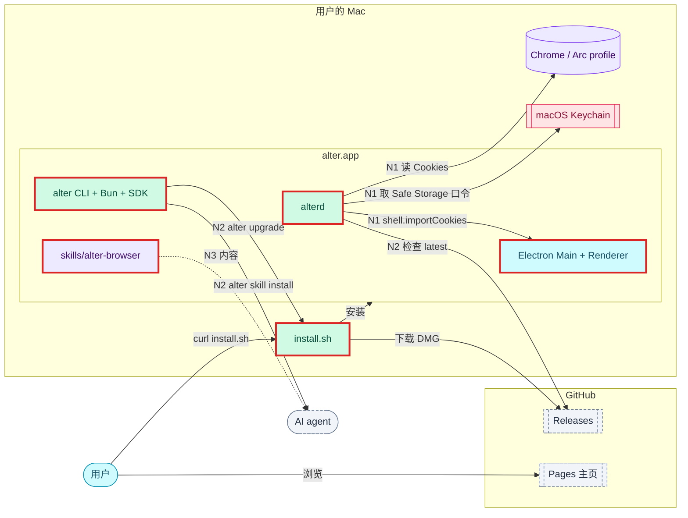

# 设计：补齐：Cookie 导入、发布安装、主页与 agent skill

<!-- 用于 feature 类需求的设计（以及新增依赖、改动数据模型、跨仓库，或带有安全 / 性能 / 迁移风险的 chore）。图：源文件在 ./assets/*.mmd，用 dflow:diagram 块嵌入（references/diagrams.md）。 -->

## 上下文
本设计讲整体：三个节点各改系统的哪一部分，以及节点之间的契约。每个节点的细节写在它自己的设计文档里：
- `nodes/cookie-import/design.md`
- `nodes/release-install/design.md`
- `nodes/site-skill/design.md`

对应父级 requirement.md 的「变更内容」「非功能需求」「成功标准」。

现状与约束：
- 架构以 `.dev-flow/infra/architecture.md` 为准：
  - 进程：alter.app、alterd、alter CLI 三个进程。
  - 数据访问：只有 alterd 写 SQLite，也只有 alterd 发 CDP。
  - 网络：只监听 127.0.0.1。
- 宪章：
  - 新增运行时依赖要在设计里说明理由。
  - 测试不访问外网，钥匙串在系统边界 mock。
  - install.sh 要过 shellcheck，并有 `--dry-run`。

## 目标与非目标
- 目标：把 AGENTS.md 里所有标「待建立」或「后续 change」的部分做完，即 Cookie 导入、DMG、Release、install.sh、`alter upgrade`、主页和 skill；另外加上 `alter skill install|uninstall` 与更新提示。
- 非目标：公证、Intel 包、app 内一键升级、`waitForFileChooser`，以及父级 requirement.md「范围外」列出的其他各项。

## 架构
<!-- dflow:diagram assets/arch-add-release-and-cookies.mmd -->

<!-- /dflow:diagram -->

边界变化：
- **architecture.md 的一处决定改变**：Cookie 不再「经 CDP 写入」，改为 alterd 解密后经 Shell 指令交给 Electron Main，由 Main 用 cookies API 写进 partition。
  - 理由：Electron 的 partition 不在 DevTools 的 browserContext 表里，见 N1 的设计。
  - 「只有 alterd 发 CDP、只有 alterd 写 SQLite」两条规则仍然成立：Main 写的是 Chromium 自己管理的 Cookie 存储，与它在用户浏览时写 Cookie 的方式相同。
- **新的外部依赖**：
  - GitHub Releases：install.sh 和 `alter upgrade` 从这里下载，alterd 从这里读 latest。
  - GitHub Pages：发布主页。
  - macOS 钥匙串：取 Safe Storage 口令。
  - 这三项在 architecture.md 里都已列为「后续 change」，存档时把这个标注去掉。
- **不新增进程、crate 或 package**：
  - install.sh 与打包脚本放在 `scripts/`。
  - skill 放在 `skills/`，主页放在 `site/`，这两个目录在目录结构里早已预留。

## 组件
| 组件 | 仓库 | 职责 | 新增 / 变更 |
|---|---|---|---|
| alterd `import/{cookies,keychain}.rs` | alter | 读取并解密 Cookie（N1） | 新增 |
| alterd `update.rs` | alter | 检查新版本、推送通知（N2） | 新增 |
| alterd Gateway / TabService | alter | `shell.importCookies` 的往返（N1）；`app.updateAvailable` 与快照字段（N2） | 变更 |
| alter-core protocol / config | alter | `ImportedCookie`、`ShellCommand::ImportCookies`、`ShellEvent::CookiesImported`（N1）；`UpdateAvailable`、`ShellState.updateAvailable`、`update_check`（N2） | 变更 |
| Electron Main `cookie-import.ts` | alter | 写 partition（N1） | 新增 |
| Renderer `ImportWizard.tsx`、`UpdateBanner.tsx` | alter | Cookie 选项与原因文案（N1）；更新提示条（N2） | 变更 / 新增 |
| alter CLI `exe.rs`、`skill.rs`、`upgrade.rs`、`import.rs` | alter | 解析符号链接、skill 安装、升级（N2）；导入的 help（N1） | 新增 / 变更 |
| SDK `runtime.ts` | alter | `[alter:notice]` 提示（N2） | 变更 |
| `scripts/{dist,fetch-bun,check-bundle,install}.sh`、`version-check.sh` | alter | 打包、校验、安装、tag 检查（N2） | 新增 / 变更 |
| `apps/browser/electron-builder.yml` | alter | DMG 配置（N2） | 新增 |
| `.github/workflows/{release,pages}.yml`、`ci.yml` | alter | 发布 Release（N2）、发布主页（N3）、shellcheck 门禁（N2） | 新增 / 变更 |
| `site/`、`skills/alter-browser/`、README | alter | 主页、skill、安装说明（N3） | 新增 / 变更 |

## 接口契约
节点之间的契约。完整字段见各节点的设计。
- **Shell Control**（N1 新增）：
  - alterd 发出：`shell.importCookies {requestId, spaceId, cookies: ImportedCookie[]}`。
  - Main 回报：`shell.event.cookiesImported {requestId, imported, rejected}`。
  - 下发对象：最近一次发 `cdpReady` 的连接。
  - 时限：10 秒，可用 `ALTER_IMPORT_COOKIE_TIMEOUT_MS` 改。
- **Shell 快照**（N2 新增）：`ShellState.updateAvailable?: {version, url}`。没有更新时不出现这个字段。
- **Gateway 通知**（N2 新增，api.md 早已预留）：`app.updateAvailable {version, url}`。当时已连接的客户端，以及之后每个新连接，在鉴权后各收到一次。
- **Gateway 语义变化**（N1）：
  - `import.run` 的 `items` 可以含 `cookies`。
  - `import.done.status` 可以为 `partial`，此时 `warning` 为 `keychain_denied` 或 `shell_unavailable`。
- **CLI**：
  - N2 新增：
    - `alter upgrade [--check] [--json] [--version v<x.y.z>]`。
    - `alter skill install|uninstall [--target <dir>]…`。
  - N1 改动：`alter import` 的 help。
- **install.sh**（N2）：
  - 参数：`--version`、`--prefix`、`--bin-dir`、`--with-skill`、`--dry-run`。
  - 环境变量：`ALTER_RELEASE_API`、`ALTER_RELEASE_BASE`。
  - 最后一行输出：`alter <v> installed to <prefix>/alter.app`。
- **Release 资产**（N2 → N3）：`alter-<v>-arm64.dmg`、`alter-<v>-arm64.dmg.sha256`、`install.sh`。安装命令为 `curl -fsSL https://github.com/ethanyulabs/alter/releases/latest/download/install.sh | bash`。
- **app 包的布局**（N2 → N3）：`alter.app/Contents/Resources/{bin/{alterd,alter,bun}, sdk/runtime.js, skills/alter-browser/}`。
- **环境变量**：本需求新增的全部列在这里，测试和开发都靠它们隔离外部系统。

  | 变量 | 生效范围 | 用途 |
  |---|---|---|
  | `ALTER_KEYCHAIN_FAKE` | 仅 debug 构建 | 替代钥匙串 |
  | `ALTER_IMPORT_COOKIE_TIMEOUT_MS` | 都生效 | Cookie 回报的等待时限 |
  | `ALTER_RELEASE_API` | 都生效 | Release API 地址；debug 构建只有设置了它才检查更新 |
  | `ALTER_RELEASE_BASE` | 都生效 | Release 下载根 |
  | `ALTER_UPDATE_CHECK_DELAY_MS` | 都生效 | 首次检查更新前的延迟 |
  | `ALTER_SKILL_DIR` | 都生效 | skill 源目录 |
  | `ALTER_INSTALL_UNAME_M` / `_S` | install.sh | 覆盖 `uname` 的结果 |

## 数据模型
不改 SQLite 表结构，没有迁移。用到的已有字段：
- `imports.cookies_count`：Cookie 计数。
- `imports.status = 'partial'`：部分完成。
- `imports.error`：`partial` 时存 warning。

新增的落盘内容：
- skill 安装目录里的 `.alter-skill` 标记文件，内容是 CLI 版本号。
- `config.toml` 的 `update_check` 键，可选。

## 决策
| 决策 | 选择 | 考虑过的替代方案 | 理由 |
|---|---|---|---|
| 拆分 | 路由型 feature，3 个节点串行 | 拆成两个独立需求；4 个节点 | 用户在 2026-10-22 选定；三个节点的 Spec Delta 互相独立，N3 依赖 N2 的契约 |
| 节点顺序 | N1 → N2 → N3 | 先做发布，即 N2 → N1 → N3 | N1 风险最高，被拦时要尽早知道；N1 和 N2 都要改协议文件，不宜并行 |
| HTTP | 系统 curl 子进程 | Rust HTTP 客户端 | CLI 冷启动预算与依赖最少；理由详见 N2 的设计 |
| skill 安装 | `alter skill install` 子命令 | 只在 install.sh 里复制 | 用户要求「可以使用 alter 命令单独安装」 |
| 节点间协议的归属 | 协议类型的导出：N1 MODIFIED「协议类型导出」，N2 ADDED「导出更新提示类型」 | 两个节点都 MODIFIED 同一条需求 | 避免 FLOW007：两个节点改同一条需求时，存档会按顺序覆盖 |

## 风险与权衡
- [风险] 钥匙串与解密的代码再次被安全分类器拦下。→ N1 的 T3 和 T4 标为 blocked，节点不算完成。run 报告会建议用 `dev-flow update` 改 flow，让 N2 不依赖 N1，从而先交付发布。
- [风险] 打包与 release 工作流要联网，且只能在 GitHub 上端到端验证。→ 工作流里的每一步都是本地能跑的脚本，已经被测试；首次发布作为 SC6 在发布后监控。
- [风险] 更新检查让 alterd 第一次主动联网。→ 只访问 GitHub API，只带 User-Agent；可以用 `update_check = false` 关闭；debug 构建默认不检查；检查失败只记日志。
- [权衡] ad-hoc 签名的 DMG 从浏览器下载后会被 Gatekeeper 拦下。主页主推 install.sh，并写明「仍要打开」的兜底办法。

## 迁移与上线
- 合并顺序：三个节点都在一个分支上，存档时压成一个提交、开一个 PR。
- 合并之后：
  1. 维护者在 Settings → Pages 把 Source 设为 GitHub Actions。
  2. 把三处版本号改成 `0.2.0`，推送 `v0.2.0` tag。
  3. 观察 SC6。
- 回滚：
  - Release 出问题：把它标为 draft，latest 回到上一版。
  - 代码出问题：还原提交即可，没有数据迁移。
  - 更新提示可以用 `update_check = false` 关闭。
- 存档时要更新的基础文档：
  - architecture.md：Cookie 写入路径，以及去掉「后续 change」的标注。
  - components.md：ImportService、新增组件，以及去掉「待发布 change」的行。
  - api.md：`app.updateAvailable` 去掉「待发布」，新增 Shell 消息和 CLI 子命令。
  - core-flows.md：Cookie 导入时序与升级时序。
  - overview.md：现状。
  - AGENTS.md：现状、目录结构、命令表（`bun run dist`）。

## 宪章检查
| 原则 | 状态 | 说明 |
|---|---|---|
| 规格先行 | PASS | 行为都写在三个节点的 Spec Delta 里，批准后才动代码 |
| 测试先行 | PASS | 每个场景都有任务和 seam：alterd 契约测试（假 Electron 端、假 Release 服务器）、CLI 与脚本的 `assert_cmd`、SDK 的 bun test、Electron e2e（包括打包后的 app） |
| 简单优先 | PASS | 新增运行时依赖只在 N1：`security-framework` 用于钥匙串，`pbkdf2`（默认开启 HMAC，不单独引入 `hmac`）、`sha1`、`sha2`、`aes`、`cbc` 用于解密，理由见 N1 设计的决策表。N2 和 N3 不新增运行时依赖，HTTP 用系统 curl。不新增 crate 或 package |
| 边界契约 | PASS | Shell、Gateway、CLI、install.sh 和 app 包布局的契约都写在本节与各节点的设计里，并在使用方依赖之前先由契约测试覆盖 |
