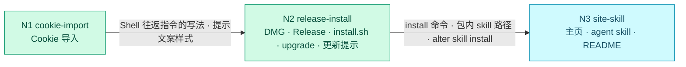

# 流程路线：补齐：Cookie 导入、发布安装、主页与 agent skill

<!-- 流程路线型需求的流程控制文档。"## Nodes" 下每个节点一行，语法同任务行：
- N<n> <node-slug> [after:N1,N2] [repos:api,web] [P] <标题>
[after:] 列出本节点开始前必须完成（任务全部勾选、Review: PASS、Overall: READY）的节点；
[repos:] 持有该节点目录的仓库（省略 = 需求涉及的全部仓库）；[P] 表示可并行的候选。
每个节点放在 nodes/<node-slug>/ 下，有自己的 requirement.md、tasks.md 和 log.md。语法见 references/formats.md §14 -->

## Nodes
- N1 cookie-import 从 Chrome / Arc 导入 Cookie
- N2 release-install [after:N1] 打包发布、安装、升级与更新提示
- N3 site-skill [after:N2] 主页与 agent skill

## Route
<!-- dflow:diagram assets/flow.mmd -->

<!-- /dflow:diagram -->

三个节点串行，按 N1 → N2 → N3 的顺序做，都不标 `[P]`：
- N1 与 N2 在逻辑上互不依赖，但都要改 `crates/alter-core/src/protocol/{shell,gateway}.rs`、Electron Main 的 Shell 分发（`apps/browser/src/main/index.ts`）和 Renderer，并行只会制造冲突。
- 先做 N1，因为它最可能卡住：上一轮实现 Cookie 时，钥匙串与解密的代码被安全分类器拦下过。N1 卡住时，按执行策略把对应任务标 blocked，N1 不能算完成；这时 run 报告里会建议用 `dev-flow update` 调整顺序，例如让 N2 改为不依赖 N1。
- N3 要引用 N2 定下的 install 命令、包内 skill 路径和 `alter skill install`，所以排在 N2 之后。

## Handoffs
- **N1 → N2**：
  - Shell 协议里「alterd 下发带 `requestId` 的指令，Main 回一条带同一 `requestId` 的事件」的写法：`shell.importCookies` / `shell.event.cookiesImported`，以及 TabService 里按 `requestId` 等待回报的 map。N2 的更新提示只往快照里加字段，用不到往返，但沿用同一套协议类型的组织方式。
  - 导入向导里提示文案的样式（`partial` 的原因文案），N2 的侧边栏更新提示条沿用。
  - `cdpReady` 连接的记录：N2 用不到，这里列出来是为了说明它的边界。
- **N2 → N3**：
  - 安装命令：`curl -fsSL https://github.com/ethanyulabs/alter/releases/latest/download/install.sh | bash`，与 `scripts/install.sh` 头部的用法注释一致。
  - Release 资产命名：`alter-<version>-arm64.dmg`、`.sha256`、`install.sh`。Release 页：`https://github.com/ethanyulabs/alter/releases/latest`。
  - 包内 skill 的位置：`alter.app/Contents/Resources/skills/alter-browser`，由 `electron-builder.yml` 的 `extraResources` 从仓库的 `skills/alter-browser` 复制而来。N2 放的是占位的 `SKILL.md`，N3 换成正式内容。
  - `alter skill install [--target <dir>]` / `alter skill uninstall`：输出与退出码见 N2 design.md。
