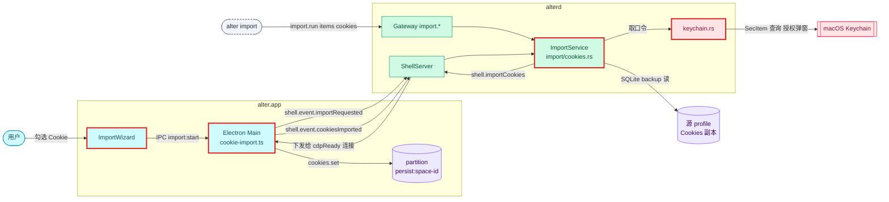
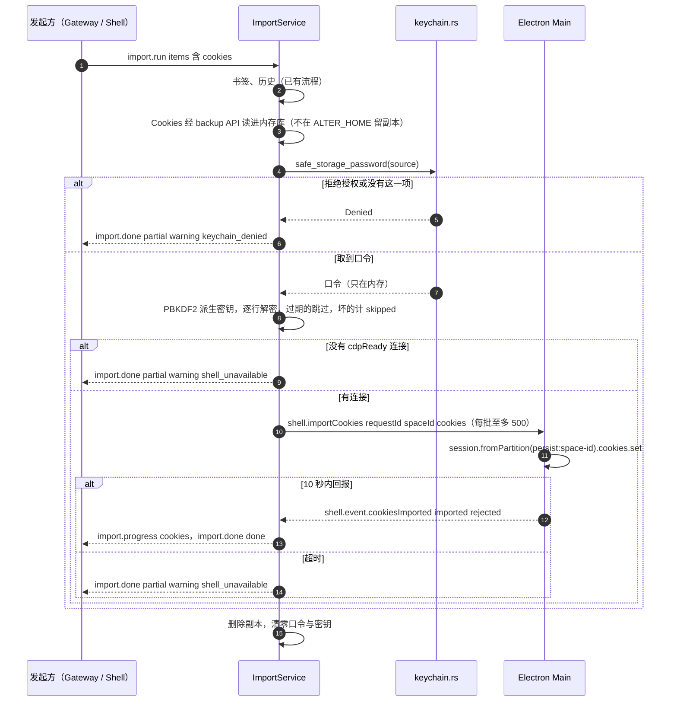

# 设计：从 Chrome / Arc 导入 Cookie

## 上下文
本设计对应 N1 requirement.md 的全部 Spec Delta。现状如下：
- ImportService（`crates/alterd/src/import/mod.rs`）已经能导入书签与历史。
- 含 `cookies` 的请求在 `mod.rs:72-77` 以 `E_INVALID_ARGUMENT` 拒绝，`mod.rs:151` 留了空分支，`mod.rs:158` 已经给 `counts.cookies` 赋值。
- 已有的类型与表结构：`ImportCounts.cookies`、`ImportStatus::Partial`（`crates/alter-core/src/protocol/gateway.rs:214,221`）、`imports.cookies_count` 列、`partial` 状态（`migrations/0001_init.sql:84`）。
- `sources.rs:10` 的 `DATA_FILES` 已含 `Cookies`。

约束：
- 只有 alterd 读源数据和写 SQLite。
- Electron 的 partition 不在 DevTools 的 browserContext 表里。`gateway/page.rs:566-596` 用 `Browser.setDownloadBehavior` 按 `browserContextId` 调用已经失败过，所以不能靠 CDP 的 `Storage.setCookies` 直接写进某个 Space。
- 宪章：钥匙串在系统边界 mock；新增运行时依赖要说明理由；`ErrorCode` 集合不变（`E_KEYCHAIN_DENIED` 早已存在，本节点不用它作错误码，拒绝授权只是 `partial` 的 `warning`）。

## 目标与非目标
- 目标：
  - Chrome 与 Arc 的 macOS Cookie（v10，含 DB version ≥24 的主机名前缀）导入到指定 Space。
  - Gateway、Shell、CLI、向导四个入口。
  - 拒绝授权与没有 Shell 连接两种部分完成。
  - 明文只在内存中。
- 非目标：v11 / DPAPI 格式；密码与表单；导入后同步；改变省略 `items` 时的默认值。

## 架构
<!-- dflow:diagram assets/arch-cookie-import.mmd -->

<!-- /dflow:diagram -->

边界：解密在 alterd 里完成，写入在 Electron Main 里完成，两者之间只经 0600 的 `shell.sock` 传一次明文，Renderer 不经手明文。新增和改动的地方都在 alter 仓库：
- 新增 `crates/alterd/src/import/cookies.rs`：读库、解密、过滤过期。Cookies 库经 SQLite backup API 读进内存库再读，不在 `ALTER_HOME/import-tmp` 留副本，因为 `value` 列可能是明文；源库被锁时先拷贝到 `import-tmp`，读进内存后立即删除拷贝。
- 新增 `crates/alterd/src/import/keychain.rs`：取口令，包括 debug 替身。
- 改动 `import/mod.rs`：把 Cookie 这一类接进流水线，并实现 `partial` 结束。
- 改动 `tabs/` 的 Shell 分发：记住 cdpReady 连接，把 `cookiesImported` 回报送回发起导入的任务。
- 新增 `apps/browser/src/main/cookie-import.ts`。
- 改动 `ImportWizard.tsx`、`crates/alter-cli/src/{main.rs,import.rs}`、`crates/alter-core/src/protocol/shell.rs`。

## 组件
| 组件 | 仓库 | 职责 | 新增 / 变更 |
|---|---|---|---|
| `alterd::import::keychain` | alter | 按来源取 Safe Storage 口令：Chrome 的服务名 `Chrome Safe Storage`、账户 `Chrome`；Arc 的服务名 `Arc Safe Storage`、账户 `Arc`；debug 构建先看 `ALTER_KEYCHAIN_FAKE` | 新增 |
| `alterd::import::cookies` | alter | 读 `Cookies` 副本，按 `meta.version` 去主机名前缀，PBKDF2 + AES-128-CBC 解密，转成 `ImportedCookie` | 新增 |
| `alterd::import` | alter | Cookie 这一类排在书签、历史之后；`partial` 与 `warning`；批量下发并等回报 | 变更 |
| `alterd::tabs`（Shell 分发） | alter | 记录最近一次发 `cdpReady` 的连接发件箱；把 `cookiesImported` 按 `requestId` 交回等待方 | 变更 |
| `alter_core::protocol::shell` | alter | `ShellCommand::ImportCookies`、`ShellEvent::CookiesImported`、`ImportedCookie` | 变更 |
| Electron Main `cookie-import.ts` | alter | 收 `shell.importCookies`，逐个 `cookies.set`，回 `cookiesImported` | 新增 |
| Renderer `ImportWizard.tsx` | alter | 启用 Cookie 复选框（默认勾选）与说明文字，`partial` 的原因文案 | 变更 |
| `alter import` | alter | help 去掉「暂不支持」；`partial` 时 stderr 打 `warning: <warning>` | 变更 |

## 接口契约
Gateway（字段不变，补充语义）：
- `import.run {source, profilePath?, spaceId, items?}`：`items` 可以含 `cookies`，执行顺序固定为书签、历史、Cookie。省略 `items` 时仍为书签与历史。
- `import.done {importId, status, counts, warning?}`：
  - `status` 为 `partial` 时，`warning` 为 `keychain_denied` 或 `shell_unavailable`。
  - 两种情况都出现时取先发生的那个：先取口令，所以 `keychain_denied` 优先。
  - `imports` 表的 `error` 列存这个 warning（`status()` 已从 `error` 读 `Partial` 的 warning，`mod.rs:128`）。
- 计数：
  - `counts.cookies` 是 Main 回报的 `imported` 之和。
  - `counts.skipped` 包括三部分：无法解密的行、主机名前缀不符的行、Main 回报的 `rejected`。
  - 过期的 Cookie 不算导入也不算跳过。

Shell Control 增量：
- alterd → Main：`{"type":"shell.importCookies","requestId":u32,"spaceId":string,"cookies":ImportedCookie[]}`，每批至多 500 项，一批等到回报后再发下一批。
- `ImportedCookie` 的字段：
  - `url`：`http[s]://<去掉开头点的 host_key><path>`，`is_secure` 为 1 时用 https。
  - `name`、`value`、`domain`（原 `host_key`）、`path`、`secure`、`httpOnly`。
  - `sameSite`：取值为 `"unspecified"|"no_restriction"|"lax"|"strict"`。Chromium 里 -1 映射为 unspecified，0 为 no_restriction，1 为 lax，2 为 strict。
  - `expirationDate?`：UNIX 秒（整数，向下取整；Electron 接受整数秒）。会话 Cookie 省略这个字段。
  - 字段名与 Electron `CookiesSetDetails` 一致。Main 只做一处处理：`domain` 不以 `.` 开头（host-only Cookie）时不传 `domain`，因为 Electron 会给传入的 domain 补前导点，把它变成对子域名也生效的 Cookie，`__Host-` 前缀的 Cookie 还会被拒绝。其余字段原样传入。
- Main → alterd：`{"type":"shell.event.cookiesImported","requestId":u32,"imported":u32,"rejected":u32}`。
- 下发对象：最近一次发送 `shell.event.cdpReady` 的连接，也就是持有 Chromium 的 Electron Main。该连接断开后清空，没有这个连接时为 `shell_unavailable`。
- 回报的校验：TabService 为每批记下收到它的连接和批大小，只接受来自同一个连接、且 `imported + rejected` 等于批大小的 `cookiesImported`；其他回报记一行 WARN（`忽略不匹配的 Cookie 写入回报`）后丢弃，等待方继续等，直到超时。
- 每批下发前都重新确认目标 Space 还在；已被删除时不再下发，导入以 `failed` 结束，error 为 `目标 Space 已被删除`。
- 等待时限：`ALTER_IMPORT_COOKIE_TIMEOUT_MS`，默认 10000。超时后放弃剩余批次，结果为 `shell_unavailable`，已回报的计数保留。
- `requestId` 由 TabService 分配（它本来就在单线程循环里登记等待方），与向导的 `requestId` 不是同一个号段：alterd 内部自增，从 1 开始。等待方超时放弃后，迟到的回报直接丢弃。

解密：
- `key = PBKDF2-HMAC-SHA1(口令, salt="saltysalt", 1003 次, 16 字节)`。
- `encrypted_value` 以 `v10` 开头时，对其余字节做 `AES-128-CBC(key, iv=16 个 0x20)` 解密，再去 PKCS#7 填充。
- `meta.version >= 24` 时，明文前 32 字节必须等于 `SHA256(host_key)`，不等就跳过；相等则去掉这 32 字节。
- `encrypted_value` 为空时用 `value` 列的明文。
- 没有 `v10` 前缀的非空密文跳过。
- 过期：`has_expires = 1` 且 `expires_utc` 早于当前时间。`expires_utc` 用 Chrome 时间（1601 起的微秒）记录，换算方式沿用 `history.rs`。

钥匙串：
- release 构建经 `security-framework` 的 `get_generic_password(service, account)` 取口令。返回 `errSecAuthFailed`、`errSecUserCanceled` 或 `errSecItemNotFound` 都按 `Denied` 处理，其他错误也按 `Denied` 处理，并记一行 warn 日志，日志只带 OSStatus 数值。
- debug 构建：`ALTER_KEYCHAIN_FAKE` 有值时不碰钥匙串，值为 `denied` 时返回 `Denied`，否则把它当作口令；没有值时同样走真实钥匙串。
- 测试辅助（`tests/common`、e2e 的 `app.ts`）默认设 `ALTER_KEYCHAIN_FAKE=denied`，保证任何测试都不会弹出授权框。

日志：
- 新增 `取 Safe Storage 口令` 一行，带 `service` 与 `ok`。
- `导入完成一类` 带 `item=cookies`、`count`、`skipped`。
- 任何日志都不带值、口令或密钥。
- 口令与密钥只放在局部变量里（密钥是栈上的 16 字节数组），导入任务结束即 drop，不另引入 `zeroize`，理由见决策表。

## 数据模型
不改表结构，没有迁移。用到的已有字段：
- `imports.cookies_count`：本次导入的 Cookie 计数。
- `imports.status`：取值 `partial`。
- `imports.error`：`partial` 时存 warning。

## 核心流程
<!-- dflow:diagram assets/seq-cookie-import.mmd -->

<!-- /dflow:diagram -->

## 决策
| 决策 | 选择 | 考虑过的替代方案 | 理由 |
|---|---|---|---|
| 写入通道 | Electron `session.fromPartition('persist:space-<id>').cookies.set`，由 `shell.importCookies` 驱动 | CDP `Storage.setCookies {browserContextId}`；开一个隐藏 about:blank 视图后在它的会话上发 `Network.setCookies` | partition 不在 DevTools 的 context 表里，前者已在下载行为上失败过；后者要让 alterd 驱动 Shell 建临时视图，时序和清理都更复杂。用户在 2026-10-22 选定 |
| 取口令 | `security-framework` crate | 调用 `/usr/bin/security find-generic-password -w` 子进程 | 子进程会把口令放进管道和进程参数可见的环境里，失败码也只能靠解析 stderr；用 crate 能拿到 OSStatus，口令不出进程 |
| 解密库 | RustCrypto：`pbkdf2`（默认特性自带 HMAC）、`sha1`、`sha2`、`aes`、`cbc` | `openssl` crate；系统 CommonCrypto 的 FFI | 纯 Rust、无系统库链接，体积小；FFI 要写 unsafe |
| 内存清零 | 不引入 `zeroize` | 引入 `zeroize` | 明文本来就要经 socket 交给 Main，清零只能缩短 alterd 内的停留时间；不落盘、不写日志由 R5 的测试守住 |
| 下发给哪个连接 | 最近一次发 `cdpReady` 的连接 | 广播给所有连接；只发给发起导入的连接 | 广播会把明文发给无关的客户端；Gateway 发起的导入没有发起连接；只有持有 Chromium 的 Main 会发 `cdpReady` |
| 省略 `items` 的默认值 | 仍为书签与历史 | 默认含 Cookie | CLI 与 agent 静默触发钥匙串弹窗会让用户意外；向导里默认勾选 Cookie，用户能看到说明 |

## 风险与权衡
- [风险] 上一轮实现时，生成钥匙串与解密的代码被安全分类器拦下。→ 这部分集中在 T2、T3，备注里写明用途：迁移用户本机自己的 profile，经 macOS 授权弹窗，明文不出本机。若再次被拦，标 `[blocked:classifier]`，其余任务照常进行。
- [风险] Chrome 未来改 Cookie 格式（例如 App-Bound 加密，目前只在 Windows 上启用）。→ 无法识别的密文按 R3 跳过并计数，不影响其余数据。
- [风险] Electron `cookies.set` 拒绝某些 Cookie，例如带 `__Host-` 前缀但不是 secure 的。→ 计入 `rejected`，最终进 `skipped`。
- [权衡] 明文经 `shell.sock` 传一次。socket 是 0600，只有本用户可连，与 Chromium 自己落盘的 Cookie 处于同一信任边界。

## 迁移与上线
没有数据迁移，也没有功能开关。回滚就是还原这次提交：`cookies` 重新以 `E_INVALID_ARGUMENT` 拒绝，已经写进 partition 的 Cookie 留在用户的 Space 里，不需要清理。

## 宪章检查
| 原则 | 状态 | 说明 |
|---|---|---|
| 规格先行 | PASS | 行为都写在 N1 的 Spec Delta 里 |
| 测试先行 | PASS | 每个场景有任务与 seam：`crates/alterd/tests/import.rs` 用假 Electron 端，`crates/alter-cli/tests/import.rs`，`apps/browser/e2e/import.spec.ts`，`crates/alter-core` 的导出测试 |
| 简单优先 | PASS | 新增运行时依赖：`security-framework`（钥匙串，理由见决策表）；`pbkdf2`、`sha1`、`sha2`、`aes`、`cbc`（解密，纯 Rust；`cbc` 开 `alloc` 特性）。同一批 crate 也作为 alterd 与 alter-cli 的 dev 依赖，给测试 fixture 加密用。不新增抽象：钥匙串替身是一个 `cfg(debug_assertions)` 分支，不是 trait |
| 边界契约 | PASS | `shell.importCookies` / `shell.event.cookiesImported` 写在本节「接口契约」，先由 `tests/import.rs` 的假 Electron 端契约测试覆盖，再由 Main 实现 |
