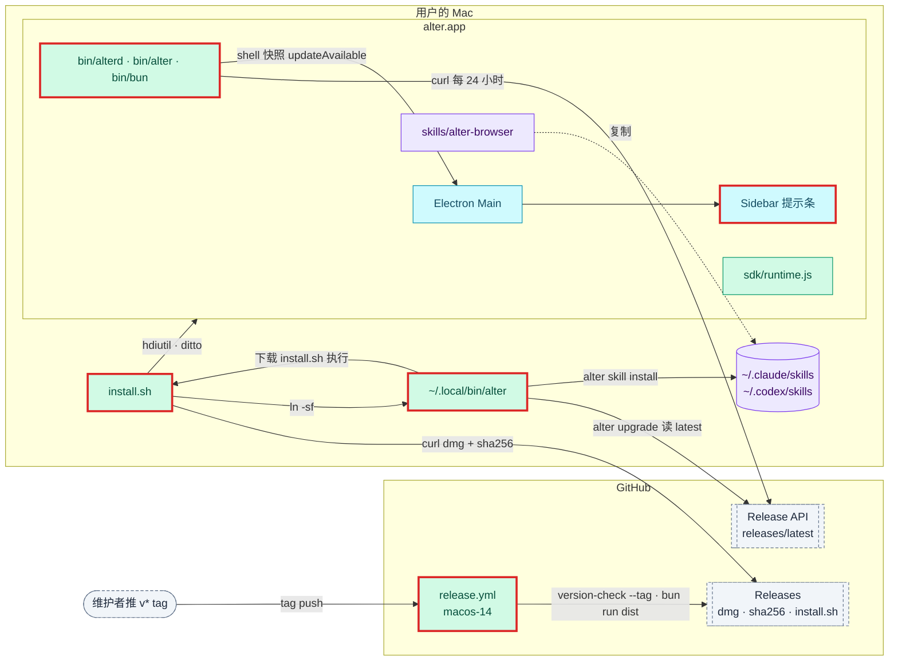
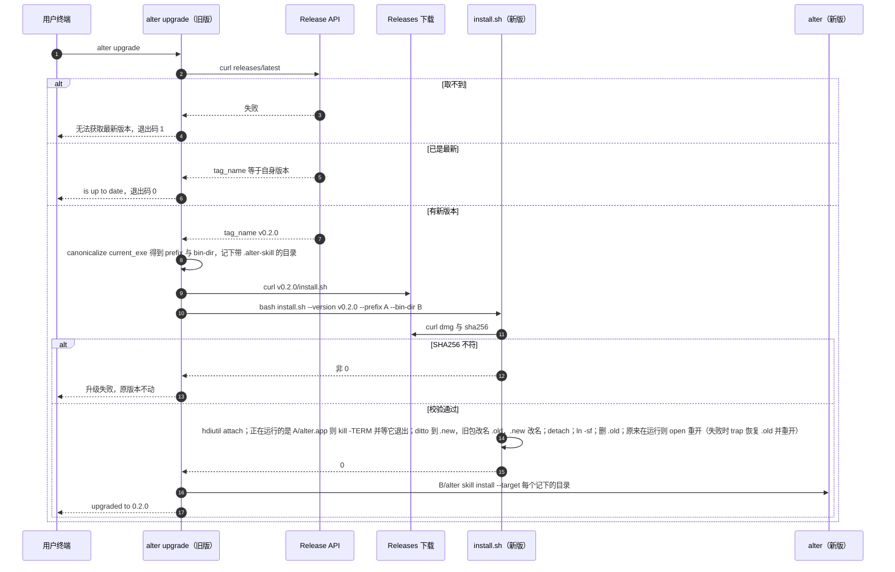

# 设计：打包发布、安装、升级与更新提示

## 上下文
本设计对应 N2 requirement.md 的全部 Spec Delta。代码的现状：
- 找程序的位置：
  - `apps/browser/src/main/daemon.ts:20-31` 已有打包态路径 `process.resourcesPath/bin/alterd`。
  - `crates/alter-cli/src/nodejs.rs:81-114` 在 exe 同目录找 `bun`，在 `../sdk/runtime.js` 找运行时。但 `current_exe()` 没有 canonicalize，经 `~/.local/bin` 的符号链接调用时会找错位置。
- 打包工具：`electron-builder ^26.15.3` 已是 devDependency，但还没有任何打包配置。
- 打包脚本缺两样：没有步骤把 `packages/sdk/src/runtime.ts` 打成 `runtime.js`，也没有步骤取 Bun 二进制。
- `scripts/version-check.sh` 检查三处版本号，目前不认 tag。
- CI 只有 `ci.yml`，跑在 `macos-latest` 上。
- CLI 的依赖只有 `alter-core`、`clap`、`serde(_json)`、`tungstenite`，没有 HTTP / TLS。冷启动预算是 < 20 ms（`crates/alter-cli/tests/perf.rs`）。
- api.md 早已预留 `app.updateAvailable {version, url}`，标为「待发布 change」。
- 仓库：`ethanyulabs/alter`，MIT。

约束：
- 宪章要求 install.sh 过 shellcheck，并用 `--dry-run` 验证。
- 测试不访问外网，所有 GitHub 交互都改走假 Release 服务器（127.0.0.1）。
- alterd 在 debug 构建里默认不检查更新，免得开发和测试时联网。

## 目标与非目标
- 目标：
  - 可分发的 arm64 DMG，以及推 tag 自动发布。
  - install.sh 安装与覆盖升级，`alter upgrade` 与 `alter skill install|uninstall`。
  - 更新提示的三个出口：Gateway 通知、Shell 快照、SDK 打印。
- 非目标：
  - 公证；Intel 包。
  - app 内下载安装。
  - 自动后台升级。

## 架构
<!-- dflow:diagram assets/arch-release-install.mmd -->

<!-- /dflow:diagram -->

新增与改动的部分，全部在 alter 仓库：

| 位置 | 新增 / 改动 | 内容 |
|---|---|---|
| `apps/browser/electron-builder.yml` | 新增 | 打包配置 |
| `scripts/dist.sh` | 新增 | 打包脚本：编译 → 取 Bun → 打运行时 → electron-vite → electron-builder → sha256 |
| `scripts/fetch-bun.sh` | 新增 | 取 Bun 二进制 |
| `scripts/install.sh` | 新增 | 安装脚本 |
| `scripts/version-check.sh` | 改动 | 加 `--tag` |
| `.github/workflows/release.yml` | 新增 | 推 tag 发布 |
| `crates/alter-cli/src/{exe.rs,skill.rs,upgrade.rs}` | 新增 | 找自身路径、skill 安装、升级 |
| `crates/alter-cli/src/nodejs.rs` | 改动 | 改用 `exe.rs` |
| `crates/alterd/src/update.rs` | 新增 | 检查更新 |
| `crates/alterd/src/gateway/` | 改动 | 推送更新通知 |
| `crates/alterd/src/tabs/` | 改动 | 快照字段 |
| `crates/alter-core/src/protocol/{gateway,shell}.rs` | 改动 | 协议类型 |
| `crates/alter-core/src/config.rs` | 改动 | `update_check` |
| `packages/sdk/src/runtime.ts` | 改动 | 打印更新提示 |
| `apps/browser/src/renderer/src/UpdateBanner.tsx` | 新增 | 侧边栏提示条 |
| `skills/alter-browser/SKILL.md` | 新增占位 | N3 替换成正式内容 |

## 组件
| 组件 | 仓库 | 职责 | 新增 / 变更 |
|---|---|---|---|
| `scripts/dist.sh` | alter | `cargo build --release -p alterd -p alter-cli` → `scripts/fetch-bun.sh build/bin/bun` → `bun build packages/sdk/src/runtime.ts --target bun --outfile build/sdk/runtime.js` → `bun run --cwd apps/browser build` → `electron-builder -c electron-builder.yml --mac dmg --arm64`（`--dir` 时只出 `.app`）→ `shasum -a 256` | 新增 |
| `scripts/fetch-bun.sh` | alter | 按 `.bun-version` 下载 `bun-darwin-aarch64.zip`，用同一个 release 的 `SHASUMS256.txt` 校验，解压到目标路径；已存在且版本一致就跳过 | 新增 |
| `apps/browser/electron-builder.yml` | alter | `appId: dev.ethanyulabs.alter`，`productName: alter`，`mac.target: dmg (arm64)`，`mac.identity: "-"`（ad-hoc），`mac.hardenedRuntime: false`；`extraResources` 把 `build/bin` 放到 `bin`、`build/sdk` 放到 `sdk`、`skills/alter-browser` 放到 `skills/alter-browser`；`artifactName: alter-${version}-arm64.${ext}`；`directories.output: ../../dist` | 新增 |
| `scripts/version-check.sh` | alter | 新增 `--tag <tag>`：三处一致以后再比较 `v<版本>` 与 tag | 变更 |
| `.github/workflows/release.yml` | alter | `on: push: tags: ['v*']`，`runs-on: macos-14`；依次执行 checkout、工具链、`bun install --frozen-lockfile`、`bash scripts/version-check.sh --tag "$GITHUB_REF_NAME"`、`bun run dist`、`bash scripts/check-bundle.sh dist/mac-arm64/alter.app "${GITHUB_REF_NAME#v}"`、`gh release create "$GITHUB_REF_NAME" dist/alter-<版本>-arm64.dmg dist/alter-<版本>-arm64.dmg.sha256 scripts/install.sh --title … --generate-notes`（三个资产逐个写出）；`permissions: contents: write` | 新增 |
| `scripts/check-bundle.sh` | alter | 用法 `check-bundle.sh <alter.app> <版本号>`。断言：文件布局；包内 `alter --version`、`bun --version` 与版本号、`.bun-version` 一致；`Info.plist` 版本；`codesign --verify --deep --strict`；旁边有 DMG 时，`.sha256` 与实际 SHA256 一致，并挂载 DMG 对里面的 app 再查一遍版本与签名。R1.S1 的测试和 release 工作流共用它 | 新增 |
| `scripts/install.sh` | alter | 见接口契约 | 新增 |
| `alter_cli::exe` | alter | `real_exe()`：返回 `current_exe()` 经 `canonicalize` 之后的结果。`bundle_root()`：路径符合 `…/alter.app/Contents/Resources/bin/alter` 时返回 `…/alter.app` | 新增 |
| `alter_cli::skill` | alter | `install` / `uninstall`，源目录的查找顺序：`ALTER_SKILL_DIR` → `<real_exe 目录>/../skills/alter-browser` → 编译期的 `CARGO_MANIFEST_DIR/../../skills/alter-browser` | 新增 |
| `alter_cli::upgrade` | alter | 用 `std::process::Command` 调 `/usr/bin/curl`，`serde_json` 解析，版本号按三段整数比较 | 新增 |
| `alterd::update` | alter | 用 `tokio::process::Command` 调 curl。首次延迟 `ALTER_UPDATE_CHECK_DELAY_MS`（默认 5000），之后每 24 小时一次。结果写进 TabService 的 `update_available`，广播一份快照，并交给 Gateway | 新增 |
| Gateway | alter | 保存最近一次的 `UpdateAvailable`。发现新版本时向全部已鉴权连接推送一次，之后每个新连接鉴权成功后各推一次 | 变更 |
| `alter_core::protocol` | alter | `UpdateAvailable {version, url}`（gateway.rs）、`ShellState.update_available: Option<UpdateAvailable>`（`#[serde(default, skip_serializing_if = "Option::is_none")]`） | 变更 |
| `alter_core::config::Config` | alter | `update_check: Option<bool>`，默认 true | 变更 |
| SDK `runtime.ts`、`client.ts`、`alter.ts` | alter | 收到 `app.updateAvailable` 时 `console.error` 一次；Client 新增被动监听 `onNotification`（不建连、不阻止空闲断开，脚本照常退出），`createAlter()` 暴露它 | 变更 |
| Renderer `UpdateBanner.tsx` | alter | 读快照的 `updateAvailable` 显示提示条。点击时发出已有的 `shell.event.openRequested`（当前 Space，`input` 为 `url`）；「×」在 Renderer 内存里记下已隐藏的版本 | 新增 |

## 接口契约
`scripts/install.sh`：
- 参数：
  - `--version v<x.y.z>`：省略时取 latest。
  - `--prefix <dir>`：默认 `/Applications`；不可写时改为 `~/Applications`，并提示。
  - `--bin-dir <dir>`：默认 `~/.local/bin`。
  - `--with-skill`
  - `--dry-run`
  - `-h|--help`
  - 未知参数：退出码 2。
- 环境变量：`ALTER_RELEASE_API`、`ALTER_RELEASE_BASE`（含义见 requirement.md「术语」）；测试用的 `ALTER_INSTALL_UNAME_M`、`ALTER_INSTALL_UNAME_S`，覆盖 `uname -m` / `uname -s` 的结果。
- 执行步骤，`--dry-run` 下每步打印 `[dry-run] <步骤>`，不执行：
  1. 平台检查。`uname -s` 不是 `Darwin` 时 stderr 输出 `alter 只支持 macOS`，退出码 1；`uname -m` 不是 `arm64` 时 stderr 输出 `alter 目前只支持 Apple Silicon（arm64）`，退出码 1。
  2. 确定版本。省略 `--version` 时执行 `curl -fsSL <API>/releases/latest`，用 `sed` 取出 `tag_name`，不依赖 jq。
  3. 在 `mktemp -d` 出的临时目录里下载 `alter-<v>-arm64.dmg` 与 `.sha256`。用 `curl -fL`；失败时 stderr 包含版本号，退出码 1。
  4. 校验：`shasum -a 256` 的结果与 `.sha256` 第一列不符时，stderr 输出 `SHA256 校验失败`，退出码 1。
  5. `hdiutil attach -nobrowse -readonly -mountpoint <tmp>/mnt`。从这一步起，`trap` 保证退出时执行 detach 并删除临时目录。
  6. 正在运行的 alter：用 `lsappinfo info -only pid,bundlepath -app dev.ethanyulabs.alter` 取 pid 与包路径。只有包路径（`pwd -P` 规范化后）正是 `<prefix>/alter.app` 时才处理：`kill -TERM <pid>`，最多等 10 秒；仍没退出就报错（stderr `…10 秒内没有退出，没有做任何改动`），退出码 1，不做任何改动。成功退出后，装完或中途失败时都用 `open` 重新打开。`lsappinfo` 不需要 AppleScript 的自动化授权；测试在 PATH 里放假的 `lsappinfo` 与 `open`。`--prefix`、`--bin-dir` 先转成绝对路径。
  7. `ditto <mnt>/alter.app <prefix>/alter.app.new`，执行 `xattr -dr com.apple.quarantine`（失败时忽略）；然后把旧的 `alter.app` 改名为 `alter.app.old`，再把 `.new` 改名为 `alter.app`。之后任何一步（detach、链接）失败时，EXIT trap 都会删掉新包、把 `.old` 恢复回来；全部成功后才删除 `.old`。detach 普通方式与强制方式都失败时，提示残留的挂载并以非 0 退出。
  8. `mkdir -p <bin-dir>`，`ln -sfn <prefix>/alter.app/Contents/Resources/bin/alter <bin-dir>/alter`。
  9. `<bin-dir>` 不在 `PATH` 里时，stderr 输出 `提示：<bin-dir> 不在 PATH 中，把 export PATH="<bin-dir>:$PATH" 加进 shell 配置`。
  10. 带 `--with-skill` 时执行 `<bin-dir>/alter skill install`。失败只在 stderr 提示，退出码仍为 0。
  11. stdout 最后一行：`alter <x.y.z> installed to <prefix>/alter.app`。
- 文件头写 `#!/usr/bin/env bash` 与 `set -euo pipefail`，用 bash 3.2 语法，因为 macOS 自带的是这个版本，要避开关联数组与 `${var,,}`。必须通过 `shellcheck -S style`。

`alter skill install|uninstall`（clap 子命令 `skill`，下分 `install` / `uninstall`，都可以重复传 `--target <dir>`）：
- `install`：
  - 先复制到同级的暂存目录 `.alter-browser.tmp-<pid>`，写入 `.alter-skill`（内容为 CLI 版本、不带换行），再把旧的 alter-browser 改名为 `.alter-browser.old-<pid>`，把暂存目录改名为 alter-browser，最后删掉 old。任何一步失败时清理暂存目录并恢复旧版本，退出码 1。
  - 源与目标的 alter-browser 是同一个目录（或互相包含）时拒绝，退出码 1，stderr `skill 的源与目标相同…`。
  - 每个目标输出一行 `installed alter-browser -> <dir>/alter-browser`。
  - 没有目标时退出码 1，stderr 输出 `没有找到 ~/.claude/skills 或 ~/.codex/skills，用 --target <dir> 指定`。
  - 找不到源目录时退出码 1，stderr 包含 `alter-browser`。
- `uninstall`：
  - 带标记的目录：删除后输出 `removed <path>`。
  - 不带标记的目录：stderr 输出 `<path> 不是 alter 安装的，未删除`。
  - 退出码为 0。

`alter upgrade`：
- `--check` 的输出：
  - 有新版本：`alter <latest> is available (current <current>)`。
  - 已是最新：`alter <current> is up to date`。
  - `--json`：`{"current","latest","updateAvailable"}`。
- 参数：`--json` 必须与 `--check` 一起用，否则是 clap 的用法错误（退出码 2），不访问网络；`--version` 必须是 `v` 加三段整数，否则退出码 1，stderr `版本号应为 v<x.y.z>`，不访问网络。
- 只升不降：不带 `--version` 时，latest 不比自身新（包括 Release 被撤回、latest 变旧）一律报 up to date；只有显式 `--version` 才能装更旧的版本。
- 升级的前提：`bundle_root()` 为空时，退出码 1，stderr 输出 `alter upgrade 只能用于 install.sh 安装的 alter，请重新运行 install.sh`。`bundle_root()` 要求路径恰好是 `<名字>.app/Contents/Resources/bin/alter`。
- 下载的 install.sh 写进独占创建、权限 0700 的临时目录（`alter-upgrade-<pid>-<纳秒>`），文件用 `create_new` 写入，执行后删除。
- 升级的参数：
  - `--prefix` 取 `bundle_root()` 的父目录。
  - `--bin-dir` 按两种情况取：
    - 用户经符号链接调用（`argv[0]` 经 `PATH` 解析得到的路径不等于 `real_exe`）时，取该链接所在的目录。
    - 否则取 `~/.local/bin`。
- skill 刷新：升级前记下 `~/.claude/skills/alter-browser/.alter-skill` 与 `~/.codex/skills/alter-browser/.alter-skill` 中存在的那些。install.sh 成功后，对每个记下的目录执行新版的 `<bin-dir>/alter skill install --target <其父目录>`。
- 成功时 stdout 最后一行为 `upgraded to <latest>`。
- 退出码：
  - 0：成功，或已是最新。
  - 1：取不到版本、不是从安装包运行、install.sh 失败。这种情况下原来的安装不受影响，由 install.sh 的 `.new` 改名保证。
- curl 调用都带 `--max-time 30` 和 `-A alter/<version>`。

alterd 更新检查：
- 地址：`ALTER_RELEASE_API` 未设置时，release 构建用 GitHub，debug 构建不检查。
- 请求：`curl -q -fsSL --max-time 10 -A alter/<version> <API>/releases/latest`。`-q` 必须是第一个参数：不读用户的 `.curlrc`，请求只带 User-Agent。用户手动运行的 `alter upgrade` 与 install.sh 不加 `-q`，因为用户的代理等设置是他们需要的。
- 判断：`tag_name` 去掉 `v` 后比自身新时，记为 `UpdateAvailable {version, url: html_url}`。`html_url` 必须以 `https://`（或本机测试用的 `http://127.0.0.1`）开头，否则记为检查失败，因为这个地址会被侧边栏打开。
- 失败处理：curl 非 0、JSON 无效或 `tag_name` 不是三段数字时，记 `WARN 检查更新失败`（带 `error`），不改状态。
- 同一版本在本次运行里只推送一次（按 version 记在集合里）；之后发现更新的版本时再推。Gateway 在登记新连接（以及补推）与广播时都持有同一把更新状态锁（锁顺序：先更新状态，后 listeners），所以每个连接恰好收到一次。
- Gateway 通知：`{"jsonrpc":"2.0","method":"app.updateAvailable","params":{"version","url"}}`。
- Shell 快照：`ShellState.updateAvailable`。

## 数据模型
不改表结构。`update_available` 只放在 alterd 的内存里，重启后重新检查。

## 核心流程
<!-- dflow:diagram assets/seq-release-install.mmd -->

<!-- /dflow:diagram -->

## 决策
| 决策 | 选择 | 考虑过的替代方案 | 理由 |
|---|---|---|---|
| upgrade 的实现 | 复用 install.sh：Rust 只负责取版本、比较和调用 | 在 CLI 里引入 ureq + rustls，自己下载、挂载、替换 | 安装步骤只有一份，测一次即可；CLI 不新增运行时依赖，不影响 20 ms 冷启动。用户在 2026-10-22 选定 |
| HTTP | CLI 与 alterd 都调用系统的 `/usr/bin/curl` | `ureq`、`reqwest` | macOS 一定有 curl；不引入 TLS 栈。代价是要处理子进程的退出码，这一点由测试覆盖 |
| 更新提示 | 做：alterd 定期检查 | 只提供 `alter upgrade --check` | 用户在 2026-10-22 选「做」；`update_check = false` 可以关闭，debug 构建默认不联网 |
| skill 安装入口 | `alter skill install` 子命令，install.sh 的 `--with-skill` 只是调用它 | 只在 install.sh 里复制 | 用户要求「skills 可以使用 alter 命令单独安装，原因：用户可以后期自己安装」 |
| 签名 | electron-builder `mac.identity: "-"` 做 ad-hoc 签名 | 不签名；Developer ID 签名加公证 | Apple Silicon 要求代码至少有签名；curl 下载的文件不带 quarantine，Gatekeeper 不拦，见 add-core-features 的澄清记录 |
| 架构 | 只出 arm64 | 再出 x64；出 universal | 用户在 2026-10-22 选定 |
| 打包脚本 | bash（`scripts/dist.sh`、`fetch-bun.sh`、`check-bundle.sh`），全部过 shellcheck | Bun 写的 TS 脚本 | 与 install.sh、version-check.sh 用同一种语言，共用 shellcheck 门禁 |
| 脚本的测试放在哪 | `crates/alter-cli/tests/{install_script,release_scripts,upgrade,skill}.rs`，用 `assert_cmd` 跑脚本，配一个用 `std::net::TcpListener` 自写的假 Release 服务器 | 新建测试包；bats | 都是分发 CLI 相关的契约，`cargo test` 已经在 CI 里跑；不引入新的测试框架 |
| app 正在运行时 | install.sh 用 lsappinfo 找到正在运行、且正是要替换的那个包的 alter，kill -TERM 后装完再 open；10 秒不退出就放弃 | 拒绝安装，让用户先退出；用 AppleScript 退出 app | 升级是用户主动发起的，自动退出再打开体验最顺；AppleScript 会弹自动化授权，lsappinfo 与 kill 不会；只看包路径，就不会误伤别处的 alter |

## 风险与权衡
- [风险] electron-builder 的 `identity: "-"` 在 26.x 的行为与预期不符，例如跳过了签名。→ 由 `check-bundle.sh` 的 `codesign --verify` 断言发现。兜底办法是在 `afterSign` 钩子里执行 `codesign --force --deep -s - <app>`，这个钩子在任务备注里写好了。
- [风险] 打包时要联网下载 Bun 与 Electron。→ `dist` 只在 T3、T4 与 release 工作流里跑。本机没有网络时把这两个任务标 `[blocked:network]`，其余任务照常进行。
- [风险] release 工作流只有真推 tag 才能端到端验证。→ 工作流里的每一步都是本地能跑的脚本，已在任务里验证；首次发布是一条 `monitored after release` 的成功标准。
- [风险] `current_exe()` 在 macOS 上返回的是符号链接本身，而不是它指向的文件。→ 用 R8.S1 钉住，统一走 `exe::real_exe()`。
- [权衡] alterd 每 24 小时访问一次 GitHub API，未登录的配额是每小时 60 次，够用。请求只带 User-Agent，不带任何标识。

## 迁移与上线
- 不需要数据迁移。
- 第一次发布的顺序：
  1. 本需求合并进 main。
  2. 维护者把三处版本号改成 `0.2.0`。
  3. 推 `v0.2.0` tag，工作流发布。
  4. 主页（N3）的 install 命令随即可用。
- 回滚：在 GitHub 上把有问题的 Release 标为 draft，latest 就回到上一个版本；用户执行 `install.sh --version <旧版本>` 即可回退。
- 功能开关：`config.toml` 的 `update_check = false`。

## 宪章检查
| 原则 | 状态 | 说明 |
|---|---|---|
| 规格先行 | PASS | 全部写在 N2 的 Spec Delta 里 |
| 测试先行 | PASS | 各类场景的 seam：脚本与 CLI 用 `assert_cmd` 加假 Release 服务器；alterd 用 Gateway 契约测试；Renderer 用 e2e；DMG 用 `check-bundle.sh` 加打包后的 app 的 e2e |
| 简单优先 | PASS | 不新增运行时依赖：HTTP 用系统 curl，JSON 用已有的 serde_json，版本号比较是十几行代码，不引入 semver crate。不新增 crate 或包。新增的模块（`exe`、`skill`、`upgrade`、`update`）各对应一条需求 |
| 边界契约 | PASS | install.sh 的参数、输出与退出码，`alter upgrade` / `skill` 的输出与退出码，`app.updateAvailable` 与 `ShellState.updateAvailable`，都写在本节「接口契约」，并先由测试覆盖 |
