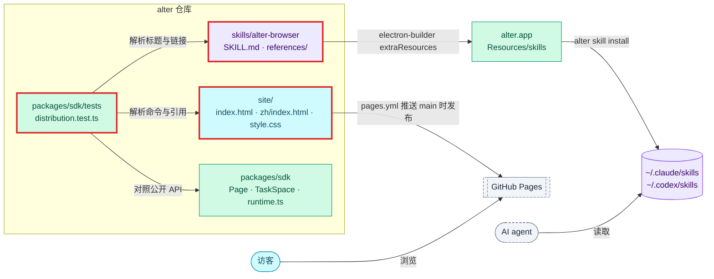

# 设计：主页与 agent skill

## 上下文
本设计对应 N3 requirement.md 的全部 Spec Delta。

现状：
- `site/` 和 `skills/` 都不存在。N2 只放了一个占位的 `skills/alter-browser/SKILL.md`。
- README 还写着「工程骨架阶段」。
- SDK 的公开面在 `packages/sdk/src/`：
  - `runtime.ts` 挂全局的 `taskSpace`、`takeOverTaskSpace`、`claimTaskSpace`、`listTaskSpaces`、`AlterError`。
  - `page.ts` 的 `Page` 有 `goto`、`snapshot`、`click`、`fill` 等方法，还有 `mouse.*`、`keyboard.*`、`waitForEvent`。
  - `task-space.ts` 的 `TaskSpace` 有 `page`、`userPage`、`handOff`、`waitForControl`、`finish` 等方法。
- `bunfig.toml` 让 `bun test` 只扫 `packages/`。

约束：
- 宪章「简单优先」：站点不引入生成器或框架。
- 测试不访问外网。
- skill 的 API 形状与 ego-browser 保持一致（api.md 的约定），方便迁移。

## 目标与非目标
- 目标：
  - 两页静态主页，以及发布工作流。
  - 一个能直接用的 skill，有测试保证它与 SDK 不漂移、示例能跑。
  - README 的安装说明。
- 非目标：
  - 站点生成器、搜索、统计。
  - skill 的 `learnings/` 目录（ego-browser 有，本次不做）。
  - skill 的多语言版本。

## 架构
<!-- dflow:diagram assets/arch-site-skill.mmd -->

<!-- /dflow:diagram -->

新增的文件：

| 文件 | 内容 |
|---|---|
| `site/index.html` | 英文主页 |
| `site/zh/index.html` | 中文主页 |
| `site/style.css` | 两页共用的样式 |
| `site/favicon.svg` | 站点图标 |
| `.github/workflows/pages.yml` | 发布到 GitHub Pages |
| `skills/alter-browser/SKILL.md` | skill 正文 |
| `skills/alter-browser/references/{api,handoff,playwright,install}.md` | 参考文档 |
| `packages/sdk/tests/distribution.test.ts` | 站点、skill 与 SDK 的一致性测试 |
| `apps/browser/e2e/skill.spec.ts` | 示例的真实运行 |

改动的文件：
- `README.md`。
- `apps/browser/e2e/fixtures/server.ts`：加一个标题为 `Example Domain` 的页面。

## 组件
| 组件 | 仓库 | 职责 | 新增 / 变更 |
|---|---|---|---|
| `site/` | alter | 手写 HTML / CSS。页面分节为 hero、安装（命令加复制按钮，复制用页面内联的十几行 JS）、功能（Space、命令栏、Peek、导入、agent）、给 agent、FAQ（Gatekeeper、Apple Silicon、卸载）。中英两页结构相同 | 新增 |
| `pages.yml` | alter | 触发条件：`on: push: branches: [main], paths: ['site/**']` 或 `workflow_dispatch`。依次执行 `actions/configure-pages`、`actions/upload-pages-artifact`（`path: site`）、`actions/deploy-pages`，权限为 `pages: write`、`id-token: write` | 新增 |
| `skills/alter-browser` | alter | 结构仿照 ego-browser：`SKILL.md` 写何时用、怎么跑、核心流程与规则，`references/` 写细节 | 新增，替换 N2 的占位 |
| `distribution.test.ts` | alter | 解析 HTML 与 Markdown，不引入解析库：HTML 只取 `<code>`、`src`、`href`、`lang`，用正则就够；front matter 用 `Bun.YAML`，如果当前 Bun 版本没有它，就手写 `key: value` 解析 | 新增 |
| README | alter | 「安装」一节写安装命令与 `alter skill install`；更新「现状」一节 | 变更 |

## 接口契约
SKILL.md 的结构，约束 agent 读到的内容：
- 版本：front matter 里不写版本号。skill 随 app 包发布，`alter skill install` 写入的 `.alter-skill` 记录装的是哪个版本。
- front matter：
  - `name: alter-browser`。
  - `description`：说明什么时候用。表述为在用户已登录的 alter 浏览器里打开网站、填表、截图、抓取数据；用户可以随时接管。
- 正文各节：
  1. Run scripts：`alter nodejs <<'EOF' … EOF`，最小示例是 `const ts = await taskSpace("demo"); const p = ts.page("p1"); await p.goto("https://example.com"); console.log(await p.title()); await ts.finish();`。
  2. Core loop：snapshot → act → verify。
  3. Rules：
     - 不重试 `E_USER_CONTROL`。
     - page budget 为 8。
     - `finish({keep})`。
     - 看到 `[alter:notice]` 只转告用户，不自己运行 `alter upgrade` 或安装脚本：升级会退出用户正在用的 alter。
  4. Hand off to the user。
  5. Playwright。
  6. Troubleshooting：指向 `install.md`。
- `references/` 下的文件：
  - `api.md`：三级标题的写法是调用名加签名，例如 `### page.click(selector, options?)`。测试只取 `(` 或空白之前的调用名。
  - `handoff.md`：交接控制权的指引，必含 `E_USER_CONTROL`、`do not retry`、`handOff()`、`waitForControl()`。
  - `playwright.md`：经 `gateway.json` 里的 `cdpPort` 与 token 调用 `connectOverCDP`。
  - `install.md`：install.sh、`alter skill install`、`alter status`、常见错误（退出码 2 表示 app 没在运行）。升级与重装只由用户来做，错误表里涉及重装的处理都写成「请用户重装」。

公开 API 集合的求法（测试与文档共用这条定义）：
- 全局函数：`runtime.ts` 的四个入口函数，调用名就是函数名，例如 `taskSpace`。不含 `AlterError`，它是类，不算调用。
- `TaskSpace.prototype` 上的方法：调用名写成 `taskSpace.<name>`，`constructor`、`_` 开头的、以及 TS 源码里声明为 `private` 的除外（private 在运行时也挂在原型上），getter 也算。
- `Page.prototype` 上的方法：调用名写成 `page.<name>`，排除规则同上。
- `page.mouse` 与 `page.keyboard` 对象上的方法：调用名写成 `page.mouse.<name>`、`page.keyboard.<name>`，取值时用一个不连网关的 `Page` 实例。

## 数据模型
不涉及。

## 决策
| 决策 | 选择 | 考虑过的替代方案 | 理由 |
|---|---|---|---|
| 站点技术 | 手写静态 HTML / CSS | Astro、VitePress | 只有两页，生成器的依赖和构建步骤得不偿失。这是 add-core-features 澄清记录里已经定下的 |
| 一致性测试放在哪 | `packages/sdk/tests/distribution.test.ts` | 新建 `packages/site-check` 包；把 `bunfig.toml` 的 `root` 改成 `.` | skill 与 SDK 的对照本来就属于 SDK 的契约；把 root 改成 `.` 会让 `bun test` 扫到 e2e 的 `*.spec.ts`；为两页 HTML 单建一个包也不值得 |
| skill 的语言 | 英文 | 中英双份 | 与 ego-browser 一致；双份要同步维护 |
| 示例怎么验证 | e2e 里从 `SKILL.md` 取出代码块，替换 URL 后真实执行 | 在 skill 里另放一个可执行的示例脚本 | 直接执行文档里的原文，文档本身就是被测对象，不会出现「示例脚本能跑而文档里的不能跑」 |

## 风险与权衡
- [风险] Pages 工作流只能在 GitHub 上验证。→ 对应父级 SC6 `monitored after release`，本地只校验 YAML 能解析。仓库的 Pages 设置（Source 选 GitHub Actions）需要维护者在仓库设置里打开一次，写进 PR 描述的后续事项。
- [风险] SDK 以后新增方法时忘了写文档。→ R5 的双向一致测试让 `bun test` 失败。
- [权衡] HTML 用正则解析，只适用于我们自己写的、结构简单的页面。测试注释里写明这个前提。

## 迁移与上线
- 不需要数据迁移。
- 上线：合并到 main 后，`pages.yml` 发布站点；维护者在仓库 Settings → Pages 把 Source 设为 GitHub Actions。
- skill 随下一次 tag 发布进入 DMG。
- 回滚：还原提交即可，Pages 会重新部署。

## 宪章检查
| 原则 | 状态 | 说明 |
|---|---|---|
| 规格先行 | PASS | 全部写在 N3 的 Spec Delta 里 |
| 测试先行 | PASS | `distribution.test.ts`（bun test）覆盖 R1–R6，`skill.spec.ts`（e2e）覆盖 R7 |
| 简单优先 | PASS | 不新增依赖、包或生成器 |
| 边界契约 | PASS | 公开 API 集合的定义写在「接口契约」，由 R5 的测试双向守住 |
