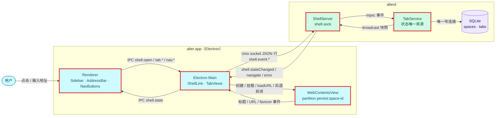
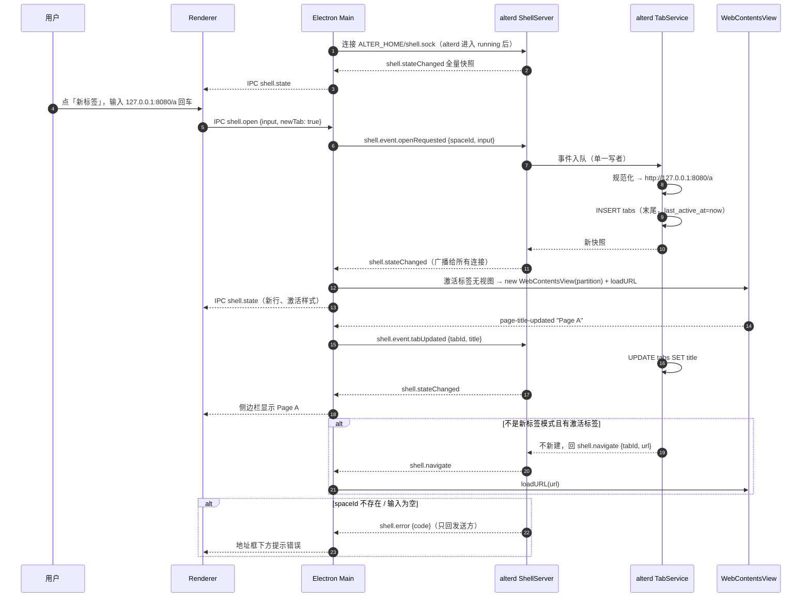
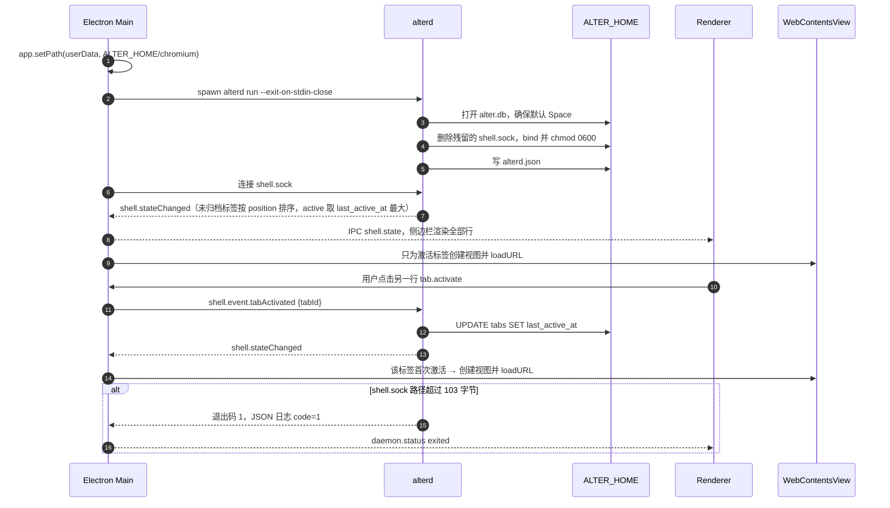

# 设计：浏览器基础 UI：Shell Control 与侧边栏标签

<!-- 用于 feature 类需求的设计（以及新增依赖、改动数据模型、跨仓库，或带有安全 / 性能 / 迁移风险的 chore）。图：源文件在 ./assets/*.mmd，用 dflow:diagram 块嵌入（references/diagrams.md）。 -->

## 上下文
现状：`alterd run` 只建库、写健康文件、等信号（`crates/alterd/src/lifecycle.rs`）；Electron Main 只托管 alterd（`apps/browser/src/main/daemon.ts`）；Renderer 只显示状态文字。`infra/api.md` 已经规划了 Shell Control Channel 的消息表，`infra/data-model.md` 的 0001 迁移里已有 `spaces`、`tabs` 两张表，可以直接用，不需要迁移。

本设计对应需求文档的全部 Spec Delta（shell-control R1–R3、spaces R4、tabs R5–R11、app-shell R12）与成功标准 SC1、SC2。

## 目标与非目标
- 目标：Shell Control Channel 的服务端（alterd）与客户端（Electron Main），alterd 作为 Space / 标签状态的唯一来源；Electron 侧的 WebContentsView 管理与侧边栏 UI；契约测试（假客户端驱动 alterd）与 Electron 端到端测试。
- 非目标：多 Space 管理、partition 隔离验证、固定、拖拽、快捷键（add-space-management）；agent 用的 `createTab` / `setOverlay` 指令；表结构变更；断线重连。

## 架构
<!-- dflow:diagram assets/arch-add-spaces-sidebar.mmd -->

<!-- /dflow:diagram -->

边界：
- **alterd**（`crates/alterd/`）新增 `shell/`（Unix socket 服务端：监听、按行读写、广播）和 `tabs/`（TabService：处理事件、输入规范化、生成快照）。TabService 是一个独立 tokio 任务，独占 `Store`；所有连接把事件经 `mpsc` 交给它，它是唯一写者。它把快照序列化一次，经 `tokio::sync::broadcast` 发给所有连接；`shell.error` 与 `shell.navigate` 只回发送方。
- **alter-core**（`crates/alter-core/`）新增协议类型 `protocol/shell.rs`（`ShellCommand`：alterd → Electron，`ShellEvent`：Electron → alterd，都是 `#[serde(tag = "type")]`）和仓储 `store/spaces.rs`、`store/tabs.rs`；`ErrorCode` 新增 `E_TAB_NOT_FOUND`、`E_INVALID_ARGUMENT`。TS 类型经 `bun run protocol:export` 生成到 `packages/protocol`。
- **Electron Main**（`apps/browser/src/main/`）新增 `shell-link.ts`（连接、按行解析、发送）与 `tab-views.ts`（按快照增删、挂载 WebContentsView，转发页面事件）；`index.ts` 在 ready 之前把 `userData` 设到 `ALTER_HOME/chromium`，并在 `daemon.status` 变为 running 时连接 ShellLink。
- **Renderer**（`apps/browser/src/renderer/src/`）新增 `Sidebar.tsx`、`AddressBar.tsx`、`NavButtons.tsx`，`App.tsx` 改为「侧边栏 240 px + 内容区占位」布局；内容区本身由 Main 用 WebContentsView 覆盖在侧边栏右侧。
- **shared**（`apps/browser/src/shared/shell.ts`）：Main 与 Renderer 之间的 IPC 通道名与载荷类型，写法沿用 `shared/daemon.ts`。

## 组件
| 组件 | 仓库 | 职责 | 新增 / 变更 |
|---|---|---|---|
| ShellServer | alter:crates/alterd/src/shell/ | 删除残留 socket、bind、chmod 0600、按行读写、广播快照；连接断开只影响该连接 | 新增 |
| TabService | alter:crates/alterd/src/tabs/ | 默认 Space、`openRequested` / `tabUpdated` / `tabActivated` / `tabClosed` 的处理，地址规范化，快照 | 新增 |
| lifecycle | alter:crates/alterd/src/lifecycle.rs | 启动时拉起 ShellServer 与 TabService；退出时删除 `shell.sock` | 变更 |
| 协议类型 | alter:crates/alter-core/src/protocol/shell.rs | `ShellCommand`、`ShellEvent`、`ShellState`、`SpaceView`、`TabView` | 新增 |
| 仓储 | alter:crates/alter-core/src/store/{spaces,tabs}.rs | Space / 标签的读写 SQL | 新增 |
| ShellLink | alter:apps/browser/src/main/shell-link.ts | Electron 端的 socket 客户端 | 新增 |
| TabViews | alter:apps/browser/src/main/tab-views.ts | WebContentsView 生命周期、布局、导航、事件回传 | 新增 |
| Sidebar / AddressBar / NavButtons | alter:apps/browser/src/renderer/src/ | 侧边栏 UI | 新增 |
| DaemonSupervisor | alter:apps/browser/src/main/daemon.ts | 不变；ShellLink 订阅它的 running 状态 | 不变 |

## 接口契约
Shell Control Channel：Unix socket `ALTER_HOME/shell.sock`（0600），UTF-8，每行一个 JSON 对象，字段 camelCase，`type` 区分消息。alterd 是服务端，接受多个连接（Electron Main 一个；契约测试会开两个）。

alterd → Electron（`ShellCommand`）：

```json
{"type":"shell.stateChanged",
 "activeSpaceId":"01JAB3C4D5E6F7G8H9J0KMNPQR",
 "spaces":[{"id":"01JAB3C4D5E6F7G8H9J0KMNPQR","name":"Personal","color":"#6366f1"}],
 "tabs":[{"id":"01JAB3…","spaceId":"01JAB3…","url":"http://127.0.0.1:8080/a","title":"Page A","faviconUrl":null,"active":true}]}
{"type":"shell.navigate","tabId":"01JAB3…","url":"https://example.com"}
{"type":"shell.error","code":"E_SPACE_NOT_FOUND","message":"Space 不存在：01JZZ…"}
```

- `spaces` 按 `position` 升序，只含未归档的；`tabs` 只含未归档的，先按所属 Space 的顺序、再按 `tabs.position` 升序；每个 Space 至多一个 `active: true`。
- `shell.stateChanged` 每次都是全量，客户端直接替换本地状态，不做增量合并。
- 每个连接经 `broadcast`（容量 256）接收快照；积压超过容量时跳过最旧的几份（记 WARN），缓冲里更新的快照仍依次送达，所以最后发布的快照一定到达。
- `shell.navigate` 与 `shell.error` 只发给触发它的连接。

Electron → alterd（`ShellEvent`）：

| type | 字段 | 效果 | 错误 |
|---|---|---|---|
| `shell.event.openRequested` | `spaceId`、`input`、`tabId?` | 无 `tabId`：规范化后在该 Space 末尾新建并激活标签，广播快照。有 `tabId`：回 `shell.navigate`，不改库（URL 等页面真正导航后由 `tabUpdated` 回写） | `E_SPACE_NOT_FOUND`、`E_TAB_NOT_FOUND`、`E_INVALID_ARGUMENT`（空输入） |
| `shell.event.tabUpdated` | `tabId`、`url?`、`title?`、`faviconUrl?` | 更新对应列，有变化才广播 | `E_TAB_NOT_FOUND` |
| `shell.event.tabActivated` | `tabId` | 设 `last_active_at` 为当前时间（保证严格大于同 Space 其他标签），广播 | `E_TAB_NOT_FOUND` |
| `shell.event.tabClosed` | `tabId` | 置 `archived_at`；若它是激活标签，按「下方优先、否则上方」激活相邻标签；广播 | `E_TAB_NOT_FOUND` |

- 无法解析的行、未知 `type`：记 WARN（附前 200 个字符），丢弃，连接保持。
- 错误码用 `alter_core::protocol::ErrorCode`，新增 `E_TAB_NOT_FOUND`、`E_INVALID_ARGUMENT`。

和 `infra/api.md` 原规划的差别（存档时同步 api.md）：
- 原表里的 `shell.createTab` / `closeTab` / `activateTab` / `setLayout` 不实现。改为声明式：Main 收到全量快照后自己决定哪些视图要创建、挂载或销毁，少一组需要往返确认的指令。agent 网关需求需要指定标签与 CDP target 的对应关系时，再增加指令。
- 新增 `shell.navigate`、`shell.error`；`shell.event.openRequested` 增加可选 `tabId`。

Main ↔ Renderer IPC（`apps/browser/src/shared/shell.ts`，经 preload 的 `window.alter` 暴露）：

| 通道 | 方向 | 载荷 |
|---|---|---|
| `shell.state` | Main → Renderer（send），Renderer → Main（invoke 取当前值） | `{state: ShellState \| null, nav: {canGoBack, canGoForward, url}, error?: {code, message}}` |
| `shell.open` | Renderer → Main | `{input: string, newTab: boolean}` |
| `tab.activate` / `tab.close` | Renderer → Main | `{tabId}` |
| `nav.back` / `nav.forward` / `nav.reload` | Renderer → Main | `{}` |

地址规范化（`crates/alterd/src/tabs/url.rs`，纯函数 `normalize_input(&str) -> Option<String>`，`None` 表示空输入），规则见 R5。`blob:` 原样使用是为了网页弹窗（`setWindowOpenHandler` 拿到的是已解析的 URL）；`data:` 不放行，Chromium 本身也限制顶层导航到 `data:` 以防钓鱼。判断「主机名」只看第一个 `/` 之前、去掉 `:端口` 后的部分：等于 `localhost` 或是四段 0–255 数字即本地地址，含 `.`、只由字母、数字、`-`、`.` 组成、且不以 `.` 开头或结尾即域名（所以 `example.com?q=x` 这类不是「主机名[:端口][/路径]」形式的输入走搜索）。`openRequested` 先校验 `spaceId`，再看 `tabId`。

## 数据模型
不改表结构，沿用 0001 迁移里的 `spaces` 与 `tabs`。

```sql
-- 默认 Space（数据库里没有未归档 Space 时）
INSERT INTO spaces (id, name, color, position, created_at) VALUES (?1, 'Personal', '#6366f1', 0, ?2);
-- 新建标签：末尾位置，last_active_at 取 max(now, 同 Space 最大值 + 1)
INSERT INTO tabs (id, space_id, url, title, position, last_active_at)
  VALUES (?1, ?2, ?3, '', (SELECT COALESCE(MAX(position), -1) + 1 FROM tabs WHERE space_id = ?2), ?4);
-- 快照
SELECT id, space_id, url, title, favicon_url, last_active_at FROM tabs
  WHERE archived_at IS NULL ORDER BY space_id, position;
-- 关闭
UPDATE tabs SET archived_at = ?2 WHERE id = ?1 AND archived_at IS NULL;
```

- ID 用 ULID（`ulid` crate，`data-model.md` 已规定 Space 与 Tab 用 ULID）。
- 激活标签 = 每个 Space 中未归档且 `last_active_at` 最大的标签。写入时保证严格递增，避免同一毫秒内两次激活打平。
- `position` 只增不重排：关闭后留下的空洞不影响排序；拖拽重排由 add-space-management 处理。

## 核心流程
<!-- dflow:diagram assets/seq-add-spaces-sidebar.mmd -->

<!-- /dflow:diagram -->

重启恢复与懒加载：

<!-- dflow:diagram assets/seq-restore-tabs.mmd -->

<!-- /dflow:diagram -->

TabViews 处理每个快照的规则：
1. 删除快照里已经不存在的标签的视图（`webContents.close()`）。
2. 当前 Space 的激活标签若还没有视图，就用 `partition: "persist:space-<spaceId>"` 新建 WebContentsView，`loadURL(tab.url)`；`webPreferences` 不设 preload，`sandbox: true`。
3. 窗口只挂载激活标签的视图，边界为 `{x: 240, y: 0, width: 窗口宽 - 240, height: 窗口高}`；窗口 `resize` 时重算。没有激活标签时不挂任何视图，露出 Renderer 的「没有打开的标签」。
4. 视图上的 `page-title-updated`、`page-favicon-updated`、`did-navigate`、`did-navigate-in-page` 转成 `shell.event.tabUpdated`；激活视图的导航状态（`navigationHistory.canGoBack()` 等）随 `shell.state` 推给 Renderer。
5. 已加载的视图在切走后保留（不销毁），切回时不重新加载。

## 决策
| 决策 | 选择 | 考虑过的替代方案 | 理由 |
|---|---|---|---|
| 页面容器 | `WebContentsView` | `BrowserView` | `BrowserView` 从 Electron 30 起已弃用，Electron 44 推荐 `WebContentsView` |
| 通道语义 | 全量快照（声明式）+ 少量指令（`navigate`） | `api.md` 原规划的 createTab / closeTab / activateTab 指令 | 全量快照让 Main 无状态地对齐视图，不用为每个指令设计确认与失败回滚；500 标签的快照约 100 KB，序列化在 SC1 预算内 |
| 用户导航在哪里执行 | 后退 / 前进 / 刷新、页内跳转由 Main 直接调 webContents，再经 `tabUpdated` 回写；地址输入经 alterd 规范化后才导航 | 所有导航都经 alterd | 后退前进是纯视图操作，经 alterd 多一次往返没有收益；地址规范化放在 alterd，以后命令栏和 agent 都能复用 |
| 地址规范化位置 | alterd（Rust 纯函数，契约测试驱动） | Renderer / Main 里的 TS 函数 | 规则只有一份；`apps/browser` 目前没有单测运行器，放 Rust 里测试最直接 |
| 状态写入并发 | TabService 单任务独占 `Store`，连接经 mpsc 投递事件 | 每个连接各自加锁访问 Store | 与「单写连接」约定一致；current_thread 运行时下不需要锁；事件天然有序 |
| Chromium 数据目录 | `app.setPath("userData", ALTER_HOME/chromium)` | 默认的 `~/Library/Application Support/<应用名>` | 测试用临时 `ALTER_HOME` 时，Cookie / 缓存也一并隔离；数据都集中在 `ALTER_HOME` 下。已用 Electron 44 实测：partition 目录为 `chromium/Partitions/space-<id 小写>` |
| 网页弹窗 | 视图的 `setWindowOpenHandler` 一律返回 `{action: "deny"}`，并以弹出的 URL 发 `openRequested`（该视图所属 Space，不带 `tabId`） | Electron 默认创建 BrowserWindow；直接拒绝不打开 | 状态仍只由 alterd 维护；与 Arc 把弹窗变成新标签一致；代价是 opener 拿不到新窗口引用（见需求「假设」） |
| 关闭标签 | 置 `archived_at` | DELETE | `data-model.md` 规定除级联外不做硬删除；也对应 Arc「关掉的标签进归档」 |
| 激活标签存储 | 由 `last_active_at` 推导 | 新增 `app_state` 表或 `spaces.active_tab_id` 列 | 不需要迁移；激活本来就要更新 `last_active_at`（自动归档依赖它） |

## 风险与权衡
- [socket 路径上限] macOS 的 `sun_path` 最多 104 字节（含结尾 0）。默认 `~/Library/Application Support/alter/shell.sock` 约 60 字节，没有问题；测试用的临时目录在 `$TMPDIR` 下约 70 字节。缓解：路径超长时明确报错退出（R3），不静默截断。
- [bind 与 chmod 之间的窗口] bind 后立即 chmod 0600，中间有极短的窗口期，按进程 umask 创建。缓解：bind 前把 umask 临时设为 `0o177`、bind 后恢复。alterd 此时是单线程启动阶段，不会影响别的文件创建。
- [Playwright 看不到 WebContentsView] e2e 不依赖 `app.windows()` 是否包含标签页面，统一用 `app.evaluate(({webContents}) => …)` 在主进程读 URL / 标题，侧边栏用 Renderer 页面的 DOM 断言。
- [快照体积] 500 标签约 100 KB / 次；只在状态变化时发送，标题变化频繁的页面会导致多次广播。缓解：`tabUpdated` 只在值真的变化时广播；SC1 用 500 标签测上限。
- [视图内存] 已加载的视图切走后不销毁，打开很多标签时内存会涨。本需求接受；自动归档需求再处理休眠。

## 迁移与上线
- 无数据迁移；首次启动时为已有数据库补默认 Space。
- 只有本机单进程组，没有跨仓库部署顺序。`userData` 目录换到 `ALTER_HOME/chromium` 后，旧位置（开发时为 `~/Library/Application Support/Electron` 或 `@alter/browser`）里的数据不再使用，骨架阶段没有用户数据，不迁移。
- 回滚：还原本需求的提交即可；`tabs` 表里新增的行对旧版本无害。

## 宪章检查
| 原则 | 状态 | 说明 |
|---|---|---|
| 规格先行 | PASS | 全部行为来自需求文档 R1–R12 |
| 测试先行 | PASS | 通道行为用假客户端的契约测试先行（`crates/alterd/tests/shell.rs`），UI 行为用 Playwright e2e 先行 |
| 简单优先 | PASS | 新增依赖：`ulid` 3.0.0（ULID 是 data-model 已定的 ID 格式，手写需要时间戳 + 随机数 + Crockford base32，不值得）；tokio 打开 `net`、`io-util` feature（Unix socket 与按行读写，标准库同步 socket 需要额外线程模型）。`libc` 从 alterd 的 dev 依赖提为正式依赖，只用于 bind 前后的 `umask`（workspace 已有该依赖）。没有新 crate / 新包；Renderer 不引入任何 UI 库 |
| 边界契约 | PASS | Shell Control 消息定义在 alter-core 并导出 TS，契约测试在 Electron 端使用之前完成（T1–T3 先于 T4） |
