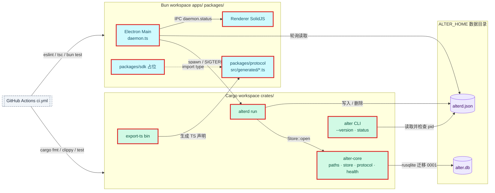
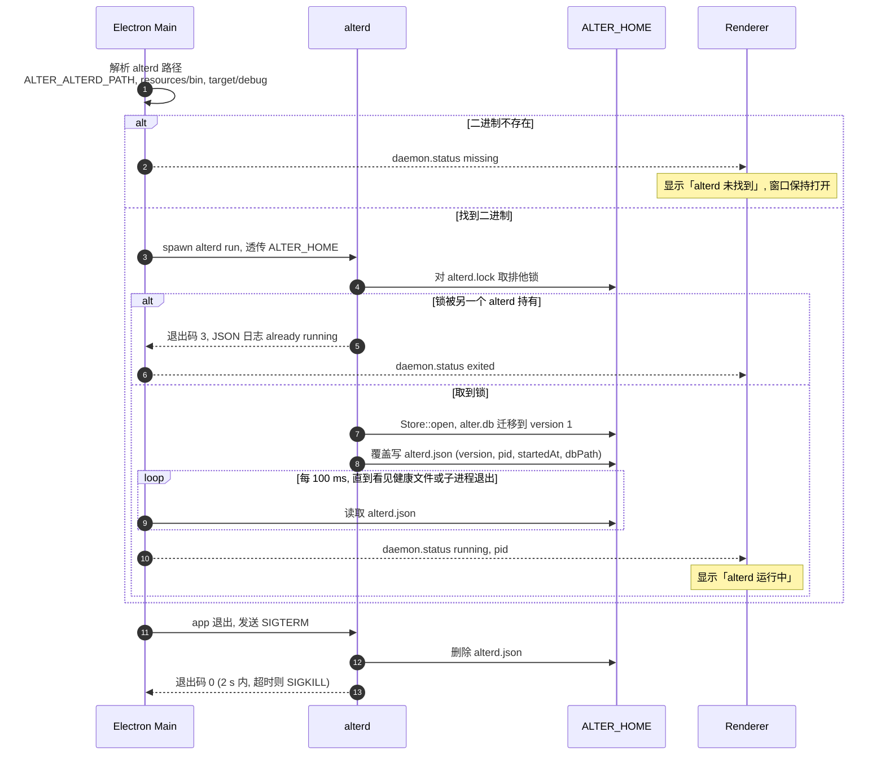

# 设计：工程骨架：双工作区、核心存储与三进程启动

<!-- 用于 feature 类需求的设计（以及新增依赖、改动数据模型、跨仓库，或带有安全 / 性能 / 迁移风险的 chore）。图：源文件在 ./assets/*.mmd，用 dflow:diagram 块嵌入（references/diagrams.md）。 -->

## 上下文
仓库为空，目标架构见 `.dev-flow/infra/architecture.md`（三个可部署单元：alter.app、alterd、alter CLI）与 `components.md`（15 个组件）。本设计只覆盖 requirement.md 的 R1–R7：把 `alter-core`、`alterd`、`alter CLI`、`Electron Main`、`Renderer`、`packages/protocol` 六个组件建到「能启动、能测试」的程度，其余组件只留目录占位。约束：只有 alterd 写 SQLite；Electron Main 不碰数据库；协议类型源头在 Rust；性能预算 CLI 冷启动 < 20 ms。

本机工具链：bun 1.3.14、cargo / rustc 1.98.1（Homebrew，crates 走公司镜像）、node 24；没有 electron、hyperfine。

## 目标与非目标
- 目标：两套工作区与全部门禁可跑；`Store::open` 建库迁移；`export-ts` 生成 `ErrorCode` 与 `HealthFile`；`alterd run` 写健康文件并能被 SIGTERM 干净关掉；`alter --version` / `alter status`；Electron 窗口托管 alterd；Playwright e2e 运行器；README / LICENSE / CI。
- 非目标：Gateway、CDP、Shell Control Channel、业务 UI、导入、SDK 实现、打包分发、`install.sh`。

## 架构
<!-- dflow:diagram assets/arch-add-workspace-skeleton.mmd -->

<!-- /dflow:diagram -->

边界：Cargo workspace（`crates/`）与 Bun workspace（`apps/`、`packages/`）是两个独立的构建单元，只通过两条线相连：`export-ts` 生成 `packages/protocol/src/generated/*.ts`（构建期），Electron Main 以子进程方式 spawn `alterd`（运行期）。`ALTER_HOME` 目录是三个进程唯一共享的运行时状态：`alter.db` 只有 alterd 打开；`alterd.json` 由 alterd 写、由 Electron Main 与 CLI 读；`alterd.lock` 是 alterd 的实例锁，只有 alterd 打开。所有组件都在本仓库 `alter`。

## 组件
| 组件 | 仓库 | 职责 | 新增 / 变更 |
|---|---|---|---|
| alter-core（`crates/alter-core`） | alter | `paths`（`ALTER_HOME` 解析）、`store`（`Store::open`、迁移运行器、`migrations/0001_init.sql`）、`protocol`（`ErrorCode`、`HealthFile`，ts-rs 导出）、`health`（读写 `alterd.json`、pid 存活判断） | 新增 |
| export-ts（`crates/alter-core/src/bin/export_ts.rs`） | alter | 显式调用各协议类型的 ts-rs `export_all`，写到参数指定目录；类型上不加 `#[ts(export)]`，`cargo test` 因而不会往仓库写 `bindings/` | 新增 |
| alterd（`crates/alterd`） | alter | `run` 子命令：持有实例锁 `alterd.lock`、打开 Store、写健康文件、SIGTERM / SIGINT 处理、退出清理 | 新增 |
| alter CLI（`crates/alter-cli`） | alter | clap 入口：`--version`、`status [--json]` | 新增 |
| Electron Main（`apps/browser/src/main`） | alter | 创建主窗口；`daemon.ts` 解析 alterd 路径、spawn、轮询健康文件、退出时 SIGTERM、向 Renderer 推 `daemon.status` | 新增 |
| Preload（`apps/browser/src/preload`） | alter | 暴露 `window.alter.onDaemonStatus` | 新增 |
| Renderer（`apps/browser/src/renderer`） | alter | SolidJS 根组件：显示 `alter` 与 alterd 状态文本 | 新增 |
| e2e（`apps/browser/e2e`） | alter | Playwright `_electron` 测试：窗口、守护进程托管 | 新增 |
| packages/protocol | alter | `src/generated/*.ts`（生成）+ `src/index.ts` 再导出 | 新增 |
| packages/sdk | alter | 占位包：`src/index.ts` 导出 `SDK_NAME`，一个 `bun test` 冒烟测试（不写版本号字面量，守住「版本号只在三处」） | 新增（占位） |
| CI（`.github/workflows/ci.yml`） | alter | macOS runner：`bun run ci:check` | 新增 |
| 仓库卫生 | alter | README、LICENSE（MIT）、`.gitignore`、`.editorconfig`、`.bun-version`、`rust-toolchain.toml`、`rustfmt.toml`、`scripts/version-check.sh` | 新增 |

## 接口契约
环境变量（三个进程共用）：
- `ALTER_HOME`：数据目录；未设置时为 `~/Library/Application Support/alter`。
- `ALTER_ALTERD_PATH`：Electron Main 使用的 alterd 可执行文件路径；未设置时依次找 `process.resourcesPath/bin/alterd`、`<repo>/target/debug/alterd`。

健康文件 `<ALTER_HOME>/alterd.json`（alterd 写，CLI 与 Electron Main 读）：
```json
{ "version": "0.1.0", "pid": 12345, "startedAt": 1760918400000, "dbPath": "/abs/path/alter.db" }
```
Rust 侧 `alter_core::protocol::HealthFile { version: String, pid: u32, started_at: i64, db_path: String }`，serde 与 ts-rs 都用 `camelCase`。写入先写临时文件再 rename，避免读到半截。

`alter_core::protocol::ErrorCode`：枚举，serde 序列化为 `SCREAMING_SNAKE_CASE` 字面量，取值即 api.md 的 14 个错误码；ts-rs 导出为字符串字面量联合。

`export-ts` 命令：`export-ts <dir>`；目录不存在则创建；成功退出 0；写失败打印错误退出 1。

alterd 退出码：`0` 正常退出；`3` 已有实例在跑；`1` 其他错误（含打开数据库失败）。stderr 只输出 tracing 的 JSON 行日志，退出码 1 与 3 的日志带 `code` 字段，退出码 3 那条的 message 为 `alterd: already running (pid <n>)`（pid 读不到时为 `unknown`）。单实例判定：开库之前对 `<ALTER_HOME>/alterd.lock` 取排他锁（`File::try_lock`），持有到进程退出；取不到即退出 3。取到锁后已存在的 `alterd.json` 一律视为残留并覆盖。alter CLI 不取锁，仍用健康文件加 `kill(pid, 0)`（`EPERM` 也算存活）判断是否在运行。

alter CLI：
- `alter --version` → stdout `alter 0.1.0`，退出 0。
- `alter status` → 运行中：stdout `alterd running (pid <n>, version 0.1.0)`，退出 0；无文件：`not running`，退出 1；残留：`not running (stale)`，退出 1。
- `alter status --json` → 单行 JSON，字段见 requirement.md R5；`dbPath` 取健康文件的值。

Electron IPC（Main → Renderer，经 preload）：通道 `daemon.status`，载荷 `{ state: "starting" | "running" | "missing" | "exited", pid?: number, path?: string }`。Renderer 文案：`running` → `alterd 运行中`，`missing` → `alterd 未找到`，`exited` → `alterd 已退出`，`starting` → `alterd 启动中`。

根 `package.json` 脚本（契约，T3 / T7 / T9 建）：`dev`、`build`、`lint`、`typecheck`、`test`、`e2e`、`protocol:export`、`version:check`、`ci:check`。

## 数据模型
不新增表。迁移 0001 原样采用 `.dev-flow/infra/data-model.md`「表结构」一节的全部 DDL（`schema_version` + 7 张业务表及索引）。迁移运行器规则：
- 迁移文件 `crates/alter-core/migrations/NNNN_<name>.sql` 以 `include_str!` 编进二进制，按编号升序执行。
- 打开连接后先 `PRAGMA journal_mode=WAL`、`PRAGMA foreign_keys=ON`，再读 `schema_version`（表不存在视为版本 0），对每个版本号大于当前值的迁移在一个事务里执行 SQL 并插入 `schema_version` 行。
- 迁移失败整个事务回滚，`Store::open` 返回错误。

```sql
-- 不新增 DDL；见 .dev-flow/infra/data-model.md
```

## 核心流程
<!-- dflow:diagram assets/seq-add-workspace-skeleton.mmd -->

<!-- /dflow:diagram -->

## 决策
| 决策 | 选择 | 考虑过的替代方案 | 理由 |
|---|---|---|---|
| Rust edition | 2024 | 2021 | 本机 rustc 1.98，新仓库没有历史包袱；AGENTS.md 已同步改为 2024 |
| 协议类型导出 | ts-rs（`#[derive(TS)]`，`export-ts` bin 显式写目录） | 手写 TS；typeshare | 手写会漂移；typeshare 需要额外 CLI 工具且对 serde 属性支持不如 ts-rs；bin 显式导出比 ts-rs 的 `cargo test` 副作用导出可控 |
| 健康文件 | 独立的 `alterd.json` | 复用 api.md 的 `gateway.json` | `gateway.json` 的语义是「网关可连」且含 token；本需求没有网关，混用会让以后的 CLI 误判网关就绪 |
| 单实例与存活判断 | alterd 用 `alterd.lock` 排他锁保证单实例；CLI 读健康文件加 `kill(pid, 0)` | 只用健康文件加 `kill(pid, 0)`；向 alterd 发请求 | 只看健康文件在两个 alterd 同时启动时有竞态（评审 CR1）；锁由内核在进程退出时释放，崩溃也不会留下死锁。CLI 不需要取锁，读健康文件即可；pid 复用误判记为后续项 |
| Electron 工具链 | electron-vite + electron-builder | Electron Forge | 用户选择；electron-vite 与 SolidJS 的 Vite 插件直接复用 |
| Electron 主进程运行时 | Electron 自带 Node | Bun 跑主进程 | Electron 主进程必须跑在它自带的 Node 上；Bun 只做包管理、脚本运行与 `bun test` |
| 端到端运行器 | Playwright `_electron.launch` | Spectron；WebdriverIO | Spectron 已停止维护；Playwright 对 Electron 的支持是官方的，且后续 Renderer 测试同一套 |
| 二进制测试 | `assert_cmd` + `CARGO_BIN_EXE_*` + 临时 `ALTER_HOME` | 在进程内调用 main 函数 | 场景断言的是退出码、stderr、信号处理，只有真实子进程能证明 |
| CLI 测试里的「运行中」 | 用测试进程自己的 pid 写健康文件 | 在 alter-cli 测试里构建并拉起 alterd | Cargo 不给跨 crate 的 `CARGO_BIN_EXE_`；alterd 写文件的行为由 R3 的测试证明，CLI 只需证明读与判断 |
| 版本号单一来源 | Cargo workspace `[workspace.package] version` + 两个 package.json，`version:check` 脚本比对 | 构建时从 Cargo 注入 package.json | 三处文本同步最简单，脚本一行 diff 就能守住 |

## 风险与权衡
- [Electron 二进制下载在公司网络失败] → Electron 44 没有 postinstall，首次解析 `electron` 路径时按需从 GitHub 下载，本机直连可用，因此不配 `.npmrc` 镜像，也不需要 `trustedDependencies`；网络受限时设环境变量 `ELECTRON_MIRROR=https://npmmirror.com/mirrors/electron/`。
- [bun.lock 记录公司 npm 镜像地址，CI 与外部贡献者装不上] → 锁文件条目不带下载地址，安装时走各自配置的源（评审 CR2）。
- [macOS 26 下 Playwright 启动 Electron 可能需要 `--no-sandbox` 或签名相关参数] → e2e 的 `launch` 允许从 `ALTER_E2E_ARGS` 追加参数；失败模式记进 log.md。
- [clippy `-D warnings` 对 ts-rs 生成的派生代码报警] → 在 `protocol` 模块上加 `#[allow(clippy::...)]` 只豁免具体 lint，不全局关闭。
- [hyperfine 未安装，SC3 无法测] → `brew install hyperfine`；装不上则 SC3 用 `for i in $(seq 20); do /usr/bin/time ...; done` 的平均值并在验证报告里注明方法。
- [pid 复用导致 `alter status` 误报运行中] → 本需求接受；后续在网关需求里改成「健康文件 + 网关握手」双重判断（follow-up）。
- [app 退出时 alterd 2 秒内没退] → Electron Main 等 2 秒后 SIGKILL，并删除健康文件；e2e 从发起关闭时计时，断言 2 秒内 pid 死亡与文件删除。
- [alterd 持有主进程的 stdio 拖住主进程退出] → alterd 的 stderr 用管道由主进程转发，不直接继承。
- [alterd 启动慢（以后的大迁移）界面卡在「启动中」] → 就绪轮询每 100 ms 一次，不设截止时间，直到看见健康文件或子进程退出（评审 CR3）。
- [crates 走公司镜像，CI 的 GitHub runner 走 crates.io] → 不把镜像配置提交进仓库（用户级 `~/.cargo/config.toml`），CI 用默认源。

## 迁移与上线
无数据迁移（首个版本，0001 即初始建表）。无功能开关。回滚：删除 `ALTER_HOME` 目录即回到空状态。CI 工作流首次启用在合并本需求的 PR 时生效。

## 宪章检查
| 原则 | 状态 | 说明 |
|---|---|---|
| 规格先行 | PASS | 七个需求、16 个场景覆盖全部行为；工具链类任务无行为变更，用 VERIFY 证据 |
| 测试先行 | PASS | 每个场景在其 seam（`Store::open`、三个二进制、Playwright）有 RED → GREEN；T1 / T3 先把两个测试运行器建起来 |
| 简单优先 | PASS | 新依赖逐个说明：Rust 侧 rusqlite（bundled；SQLite 唯一选择）、serde + serde_json（协议序列化）、ts-rs（类型导出，见决策）、clap（CLI 解析，手写参数解析会在后续子命令增多时失控）、tokio（信号处理与后续网关共用的运行时，本需求只用 `signal` 与 `rt`）、tracing + tracing-subscriber（可观测性 NFR）、libc（`kill(pid,0)`）、assert_cmd + tempfile（二进制测试）。TS 侧 electron、electron-vite、electron-builder（用户选择的工具链）、solid-js + vite-plugin-solid（用户选择的 UI 框架）、@playwright/test（e2e）、eslint + typescript-eslint、typescript。没有新增抽象层：没有 trait、没有 DI 容器 |
| 边界契约 | PASS | 健康文件 JSON、alterd 退出码、CLI 输出、IPC `daemon.status` 都写在上面「接口契约」里，并由 R2 / R3 / R5 / R7 的测试覆盖；Gateway 与 Shell Control 协议不在本需求 |
