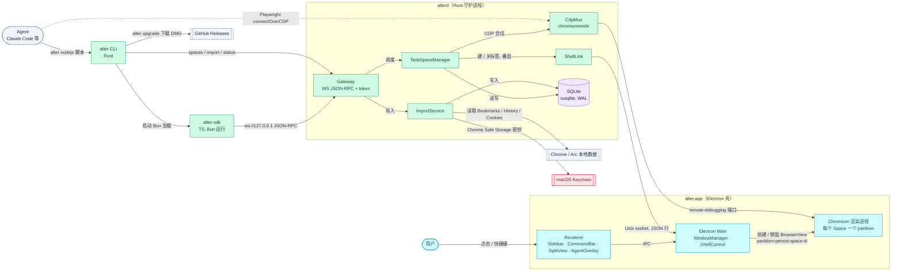

# 架构

<!-- dflow:diagram assets/arch-overview.mmd -->

<!-- /dflow:diagram -->

## 分层与边界
三个可部署单元，都在本机，由一个 DMG 分发：

| 单元 | 进程 | 语言 | 职责 | 仓库路径 |
|---|---|---|---|---|
| alter.app | Electron Main + Renderer + Chromium 渲染进程 | TypeScript（SolidJS） | 窗口、侧边栏 / 命令栏 / 分屏 / agent 叠层、BrowserView 生命周期、Chromium partition | `apps/browser/` |
| alterd | 守护进程，alter.app 启动时以子进程拉起，app 退出时随之退出 | Rust | agent 网关、TaskSpace 状态机、CDP 多路复用、SQLite、导入与 Keychain | `crates/alterd/`（协议与存储在 `crates/alter-core/`） |
| alter CLI | 用户 / agent 的终端命令，`~/.local/bin/alter` 链到 app 包内 | Rust；`alter nodejs` 启动 Bun 跑 `packages/sdk` | 子命令直连 Gateway；脚本运行时加载 SDK | `crates/alter-cli/`、`packages/sdk/` |

运行时边界：
- **Chromium 与 Electron Main 之间**：Electron 只创建 / 销毁 BrowserView 并指定 partition；页面内的动作（导航、点击、快照）全部由 alterd 经 CDP 直接下发，不经过 Electron Main，这是低延迟的关键。
- **alterd 与 Electron Main 之间**：Shell Control Channel（Unix socket，`~/Library/Application Support/alter/shell.sock`）。alterd 是 Space / Tab / TaskSpace 状态的唯一来源，Electron 是它的"显示器和手"。
- **alterd 与客户端之间**：Gateway（`ws://127.0.0.1:<port>`，端口随机，写入 `gateway.json`）。SDK、CLI、以及未来的 MCP 适配都只走这一个接口。
- **Space 之间**：Chromium partition 隔离 Cookie、storage、cache；TaskSpace 不跨 Space。

信任边界：所有接口只监听 loopback；`~/Library/Application Support/alter/gateway.json` 含 token，权限 0600；本机任何能读该文件的进程等同于用户本人。Keychain 授权弹窗由 macOS 保证，alterd 不缓存密钥到磁盘。

## 外部依赖
| 依赖 | 用途 | 负责人 / SLA |
|---|---|---|
| Electron（Chromium 内核） | 窗口、BrowserView、partition、remote-debugging 端口 | 开源；跟随 Electron 稳定版，升级走 chore 需求 |
| chromiumoxide（Rust） | alterd 的 CDP 客户端与多路复用 | 开源；TBD — 建网关需求时确认版本与 Electron 的 CDP 兼容性 |
| rusqlite（bundled SQLite） | 本地数据库 | 开源 |
| security-framework（Rust） | 读取 Keychain「Chrome Safe Storage」密钥 | 开源；依赖 macOS 授权弹窗 |
| tokio | alterd 异步运行时 | 开源 |
| Bun | `alter nodejs` 的脚本运行时，随 app 打包一份固定版本 | 开源；版本锁在仓库 |
| SolidJS + Vite | Renderer UI | 开源 |
| electron-builder | 打包 DMG，内含 alterd、alter、Bun 二进制；签名与公证 | 开源；签名证书 TBD — 发布需求时确认 Apple Developer 账号 |
| GitHub Releases / Pages | DMG 分发、`install.sh` 下载源、主页托管 | GitHub |
| Chrome / Arc 本地数据目录 | 导入来源：`~/Library/Application Support/Google/Chrome/<Profile>/`、`~/Library/Application Support/Arc/User Data/<Profile>/` | 只读；格式随上游变化，导入需求里加 fixture 测试 |

## 横切关注点
- 认证鉴权：Gateway 每个连接需 `Authorization: Bearer <token>`；token 由 alterd 启动时生成并写入 `gateway.json`。Shell Control Channel 靠 socket 文件权限（0600）。无多用户概念。
- 可观测性：alterd 用 `tracing` 输出 JSON 行日志到 `~/Library/Logs/alter/alterd.log`（按天滚动，保留 7 天）；每个 agent 动作一条 receipt 日志：`task_space_id`、`label`、`method`、`duration_ms`、`ok`、`error_code`。Electron Main 日志到 `~/Library/Logs/alter/app.log`。`alter status` 打印两者的最近错误。
- 进程存活：alterd 启动后原子写入 `~/Library/Application Support/alter/alterd.json`（`version`、`pid`、`startedAt`、`dbPath`），收到 SIGTERM / SIGINT 后删除。单实例由 alterd 对同目录的 `alterd.lock` 取排他锁保证，锁随进程结束由内核释放，崩溃也不会留下死锁；alter CLI 与 Electron Main 用健康文件加 `kill(pid, 0)`（`EPERM` 也算存活）判断 alterd 是否在运行。它与含 token 的 `gateway.json` 是两个文件，网关需求再加握手确认。骨架阶段 alterd 的 tracing 日志只写 stderr，由 Electron Main 转发。
- 配置与密钥：用户配置在 `~/Library/Application Support/alter/config.toml`（自动归档阈值、page budget 等）；Keychain 密钥只在导入任务的内存里存在；没有任何云端配置。
- 错误处理：Gateway 错误统一为 `{code, message, data}`，错误码见 api.md；SDK 把错误码映射为异常类名；CLI 用退出码 0 / 1（业务错误）/ 2（无法连接或未授权）。agent 侧的原则：`E_USER_CONTROL` 必须停止，不重试。
- 性能预算（宪章门禁，由基准测试守住）：`alter --version` 冷启动 < 20 ms；Gateway 收到 `page.click` 到发出 CDP 命令的内部开销 < 5 ms；`page.snapshot` 对 2000 节点页面 < 150 ms（含 CDP 往返）；Electron 侧边栏在 500 标签下切换 Space < 50 ms。数值在建网关需求时用真实基准校准。
- 并发模型：alterd 单进程多任务（tokio）；每个 TaskSpace 一个串行命令队列，不同 TaskSpace 并行；SQLite 单写连接 + WAL，读用连接池。

## 架构决策
| 日期 | 决策 | 理由 | 替代方案 |
|---|---|---|---|
| 2026-10-20 | 内核用 Chromium（Electron 壳），热路径用 Rust 守护进程 alterd，CLI 用 Rust，脚本运行时用 Bun | agent 驱动依赖 CDP，只有 Chromium 有；Electron 是 macOS 上最省力的 Chromium 宿主；把网关 / CDP / 存储移出 Node 主进程，agent 动作不经过 JS 主进程，满足低延迟 | Chromium 源码定制（构建链路太重）；Tauri / SwiftUI + WKWebView（无 CDP）；全 Rust + CEF 壳（cef-rs 不成熟，可作第二阶段替换壳）；Go 守护进程（GC、CDP / Keychain 库弱）；全 TS（热路径仍在 JS） |
| 2026-10-20 | agent 主接口为 CLI + `alter nodejs` 脚本运行时 + TaskSpace / Page 精简 API，同时转发 CDP 端点给 Playwright | 与 ego-browser 的 agent 心智一致，skill 可复用；精简 API 让 agent 少犯错；CDP 直连兜底 | 只开 CDP 端口（没有 TaskSpace / 接管语义）；本地 HTTP + MCP server（要自定义全部语义，工程量大） |
| 2026-10-20 | Space = 独立 partition；TaskSpace 挂在 Space 下共享登录态 | 隔离是 Arc 的核心特点；agent 复用用户登录态是 ego 的核心特点 | Space 只做标签分组（无隔离） |
| 2026-10-20 | 首期导入 Chrome / Arc 的书签 + 历史 + Cookie（Keychain 解密，用户授权） | 不导 Cookie 就得重新登录，体验断裂；Arc 与 Chrome 同格式，一套代码 | 只导书签与历史 |
| 2026-10-20 | 存储用 SQLite（rusqlite），alterd 独占写 | 历史 / 书签量大时仍快；真实 DDL 可写进 data-model.md；单写者避免锁竞争 | JSON 文件（electron-store） |
| 2026-10-20 | UI 用 SolidJS + Vite | 细粒度响应式，侧边栏与 agent 光标叠层高频更新开销最小 | React（生态大但开销高）；Svelte 5（runes 较新） |
| 2026-10-20 | 分发：GitHub Releases 放 DMG，`scripts/install.sh` 下载安装并链接 CLI，主页发 GitHub Pages，skill 放 `skills/alter-browser/` | 零基础设施成本，与开源协作一致 | 自有域名 + 对象存储；仅本地源码构建 |
| 2026-10-20 | 单仓双工作区：Cargo workspace + Bun workspace；协议类型源头在 Rust，TS 类型生成 | Rust 与 TS 共享一份协议定义，避免漂移；单仓便于原子变更 | 多仓；手写两份类型 |
