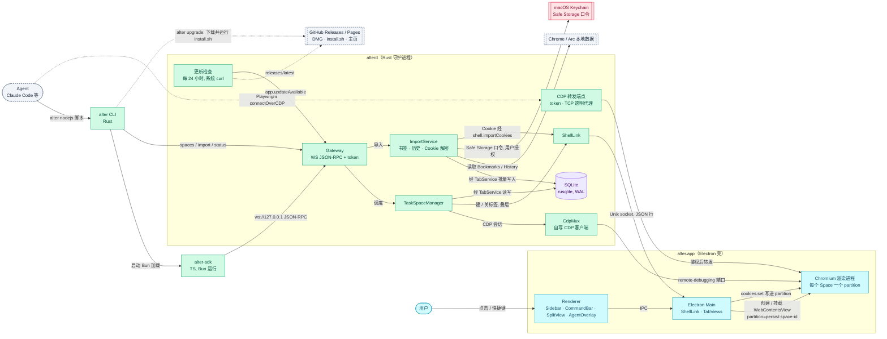

# 架构

<!-- dflow:diagram assets/arch-overview.mmd -->

<!-- /dflow:diagram -->

## 分层与边界
三个可部署单元，都在本机，由一个 DMG（`alter-<版本>-arm64.dmg`，只出 Apple Silicon）分发：

| 单元 | 进程 | 语言 | 职责 | 仓库路径 |
|---|---|---|---|---|
| alter.app | Electron Main + Renderer + Chromium 渲染进程 | TypeScript（SolidJS） | 窗口、侧边栏 / 命令栏 / 分屏 / agent 叠层、WebContentsView 生命周期、Chromium partition | `apps/browser/` |
| alterd | 守护进程，alter.app 启动时以子进程拉起，app 退出时随之退出 | Rust | agent 网关、TaskSpace 状态机与接管、CDP 多路复用与转发、SQLite、书签 / 历史 / Cookie 导入（Keychain 取口令、内存里解密）、更新检查 | `crates/alterd/`（协议与存储在 `crates/alter-core/`） |
| alter CLI | 用户 / agent 的终端命令，`~/.local/bin/alter` 链到 app 包内的 `Contents/Resources/bin/alter`（经符号链接运行时用 canonicalize 后的路径找同包的 bun、SDK 与 skill） | Rust；`alter nodejs` 启动 Bun 跑 `packages/sdk` | 子命令直连 Gateway；脚本运行时加载 SDK | `crates/alter-cli/`、`packages/sdk/` |

运行时边界：
- **Chromium 与 Electron Main 之间**：Electron 只创建 / 销毁 WebContentsView 并指定 partition，用户自己的后退 / 前进 / 刷新与页内跳转由 Main 直接调 webContents 再回报 alterd；页面内的动作（导航、点击、快照）全部由 alterd 经 CDP 直接下发，不经过 Electron Main，这是低延迟的关键。
- **alterd 与 Electron Main 之间**：Shell Control Channel（Unix socket `ALTER_HOME/shell.sock`，0600，alterd 为服务端）。alterd 是 Space / Tab / TaskSpace 状态的唯一来源（TabService 独占数据库写连接），每次状态变化向所有连接广播全量快照；Electron 是它的「显示器和手」，按快照增删、挂载页面视图，并上报用户事件。
- **alterd 与客户端之间**：Gateway（`ws://127.0.0.1:<port>`，端口随机，写入 `gateway.json`）。SDK、CLI、以及未来的 MCP 适配都只走这一个接口。
- **Space 之间**：Chromium partition 隔离 Cookie、storage、cache；TaskSpace 不跨 Space。

信任边界：所有接口只监听 loopback；`~/Library/Application Support/alter/gateway.json` 含 token，权限 0600；本机任何能读该文件的进程等同于用户本人。CDP 转发端点同样要求 token，有 TaskSpace 由用户控制时拒绝新连接并断开已有连接；Chromium 自己的 remote-debugging 端口只绑 127.0.0.1，端口号只在 `ALTER_HOME/chromium/DevToolsActivePort` 与 alterd 内存里。Cookie 导入：Keychain 授权弹窗由 macOS 保证；口令与派生的密钥只在导入任务的局部变量里，不写日志、不落盘；Cookie 库经 SQLite backup 读进内存，不在 `ALTER_HOME` 留副本；明文只经 `shell.sock`（0600）交给持有 Chromium 的 Electron Main 一次，与 Chromium 自己落盘的 Cookie 在同一信任边界。测试用 `ALTER_KEYCHAIN_FAKE` 替代 Keychain，只在 debug 构建生效。

## 外部依赖
| 依赖 | 用途 | 负责人 / SLA |
|---|---|---|
| Electron（Chromium 内核） | 窗口、WebContentsView、partition、remote-debugging 端口；`userData` 设为 `ALTER_HOME/chromium` | 开源；跟随 Electron 稳定版，升级走 chore 需求 |
| tokio-tungstenite / futures-util（Rust） | Gateway 与自写 CDP 客户端的异步 WebSocket（add-core-features 实测 chromiumoxide 的生成类型跟不上 Electron 44，改为自写约 400 行的最小客户端） | 开源 |
| tungstenite（Rust） | `alter` CLI 的同步 WebSocket（CLI 不引入 tokio，守冷启动预算） | 开源 |
| toml（Rust） | 解析 `config.toml` | 开源 |
| rusqlite（bundled SQLite） | 本地数据库 | 开源 |
| security-framework（Rust） | 读取 Keychain 里的「Chrome Safe Storage」/「Arc Safe Storage」口令 | 开源；依赖 macOS 授权弹窗 |
| pbkdf2、sha1、sha2、aes、cbc（RustCrypto） | Cookie 解密：PBKDF2-HMAC-SHA1 派生密钥，AES-128-CBC 解密，SHA256 校验主机名前缀 | 开源；纯 Rust，不链接系统库 |
| 系统 curl（`/usr/bin/curl`） | alterd 的更新检查、`alter upgrade` 与 install.sh 的下载；不引入 Rust HTTP / TLS 依赖 | macOS 自带 |
| tokio | alterd 异步运行时 | 开源 |
| Bun | `alter nodejs` 的脚本运行时，随 app 打包一份固定版本 | 开源；版本锁在仓库 |
| SolidJS + Vite | Renderer UI | 开源 |
| electron-builder | `scripts/dist.sh` 打包 DMG（`apps/browser/electron-builder.yml`），`Contents/Resources` 内含 `bin/{alterd,alter,bun}`、`sdk/runtime.js`、`skills/alter-browser`；ad-hoc 签名（`identity: "-"`，install.sh 安装不需要公证） | 开源 |
| GitHub Releases / Pages / Actions | 推 `v*` tag 时 `release.yml` 打包并发布 DMG、`.sha256` 与 `install.sh`；`pages.yml` 把 `site/` 发到 Pages；alterd 与 `alter upgrade` 读 Release API 的 latest | GitHub；未登录 API 配额每小时 60 次，alterd 每 24 小时查一次 |
| Chrome / Arc 本地数据目录 | 导入来源：`~/Library/Application Support/Google/Chrome/<Profile>/`、`~/Library/Application Support/Arc/User Data/<Profile>/` | 只读；格式随上游变化，导入需求里加 fixture 测试 |

## 横切关注点
- 认证鉴权：Gateway 每个连接需 `Authorization: Bearer <token>`；token 由 alterd 启动时生成并写入 `gateway.json`。Shell Control Channel 靠 socket 文件权限（0600）。无多用户概念。
- 可观测性：alterd 用 `tracing` 输出 JSON 行日志到 stderr，由 Electron Main 转发（Main 的 stdout / stderr 断开后照常运行，alterd 日志读走丢弃）；每个 agent 动作一条 receipt 日志：`task_space_id`、`label`、`method`、`duration_ms`、`ok`、`error_code`；导入记开始、每类计数、结束。落盘到 `~/Library/Logs/alter/`（按天滚动）与 `alter status` 打印最近错误仍是目标，未实现。
- 进程存活：alterd 启动后原子写入 `~/Library/Application Support/alter/alterd.json`（`version`、`pid`、`startedAt`、`dbPath`），收到 SIGTERM / SIGINT 后删除；由 app 托管时还会在 stdin 管道关闭（app 被强制结束）后删除并退出。单实例由 alterd 对同目录的 `alterd.lock` 取排他锁保证，锁随进程结束由内核释放，崩溃也不会留下死锁；alter CLI 与 Electron Main 用健康文件加 `kill(pid, 0)`（`EPERM` 也算存活）判断 alterd 是否在运行。它与含 token 的 `gateway.json` 是两个文件，网关需求再加握手确认。骨架阶段 alterd 的 tracing 日志只写 stderr，由 Electron Main 转发。
- 配置与密钥：用户配置在 `ALTER_HOME/config.toml`（`handoff_timeout_minutes`、`archive_after_hours`、`download_dir`、`update_check`（false 关闭更新检查）；环境变量 `ALTER_HANDOFF_TIMEOUT_MS` / `ALTER_ARCHIVE_AFTER_MS` / `ALTER_DOWNLOAD_DIR` 优先，测试用来缩短）；Keychain 口令与密钥只在导入任务的内存里存在；没有任何云端配置。外部系统的地址都可用环境变量改，测试靠它们隔离：`ALTER_RELEASE_API`（debug 构建只有设置了它才检查更新）、`ALTER_RELEASE_BASE`、`ALTER_UPDATE_CHECK_DELAY_MS`、`ALTER_IMPORT_COOKIE_TIMEOUT_MS`、`ALTER_SKILL_DIR`、`ALTER_KEYCHAIN_FAKE`（仅 debug 构建）。
- 错误处理：Gateway 错误统一为 `{code, message, data}`，错误码见 api.md；SDK 把错误码映射为异常类名；CLI 用退出码 0 / 1（业务错误）/ 2（无法连接或未授权）。agent 侧的原则：`E_USER_CONTROL` 必须停止，不重试。
- 性能预算（宪章门禁，由基准测试守住）：`alter --version` 冷启动 < 20 ms；Gateway 收到 `page.click` 到发出 CDP 命令的内部开销 < 5 ms；`page.snapshot` 对 2000 节点页面 < 150 ms（含 CDP 往返）；Electron 侧边栏在 500 标签下切换 Space < 50 ms。数值在建网关需求时用真实基准校准。
- 并发模型：alterd 单进程、tokio **单线程**运行时（`new_current_thread`，启动时断言）：接管的保证依赖它——TabService 写 ownership=user 与递增接管信号是同一个不让出的回合；每个 TaskSpace 一把 `Mutex` 的串行命令队列，不同 TaskSpace 交错执行；SQLite 单写连接 + WAL，全部读写都在 TabService 的循环里（文件 IO 与解析放进 `spawn_blocking`）。

## 架构决策
| 日期 | 决策 | 理由 | 替代方案 |
|---|---|---|---|
| 2026-10-20 | 内核用 Chromium（Electron 壳），热路径用 Rust 守护进程 alterd，CLI 用 Rust，脚本运行时用 Bun | agent 驱动依赖 CDP，只有 Chromium 有；Electron 是 macOS 上最省力的 Chromium 宿主；把网关 / CDP / 存储移出 Node 主进程，agent 动作不经过 JS 主进程，满足低延迟 | Chromium 源码定制（构建链路太重）；Tauri / SwiftUI + WKWebView（无 CDP）；全 Rust + CEF 壳（cef-rs 不成熟，可作第二阶段替换壳）；Go 守护进程（GC、CDP / Keychain 库弱）；全 TS（热路径仍在 JS） |
| 2026-10-20 | agent 主接口为 CLI + `alter nodejs` 脚本运行时 + TaskSpace / Page 精简 API，同时转发 CDP 端点给 Playwright | 与 ego-browser 的 agent 心智一致，skill 可复用；精简 API 让 agent 少犯错；CDP 直连兜底 | 只开 CDP 端口（没有 TaskSpace / 接管语义）；本地 HTTP + MCP server（要自定义全部语义，工程量大） |
| 2026-10-20 | Space = 独立 partition；TaskSpace 挂在 Space 下共享登录态 | 隔离是 Arc 的核心特点；agent 复用用户登录态是 ego 的核心特点 | Space 只做标签分组（无隔离） |
| 2026-10-20 | 导入 Chrome / Arc 的书签 + 历史 + Cookie（Keychain 解密，用户授权）——add-core-features 先交付书签与历史，add-release-and-cookies（2026-10-22）补上 Cookie | 不导 Cookie 就得重新登录，体验断裂；Arc 与 Chrome 同格式，一套代码 | 只导书签与历史 |
| 2026-10-20 | 存储用 SQLite（rusqlite），alterd 独占写 | 历史 / 书签量大时仍快；真实 DDL 可写进 data-model.md；单写者避免锁竞争 | JSON 文件（electron-store） |
| 2026-10-20 | UI 用 SolidJS + Vite | 细粒度响应式，侧边栏与 agent 光标叠层高频更新开销最小 | React（生态大但开销高）；Svelte 5（runes 较新） |
| 2026-10-20 | 分发：GitHub Releases 放 DMG，`scripts/install.sh` 下载安装并链接 CLI，主页发 GitHub Pages，skill 放 `skills/alter-browser/` | 零基础设施成本，与开源协作一致 | 自有域名 + 对象存储；仅本地源码构建 |
| 2026-10-20 | 单仓双工作区：Cargo workspace + Bun workspace；协议类型源头在 Rust，TS 类型生成 | Rust 与 TS 共享一份协议定义，避免漂移；单仓便于原子变更 | 多仓；手写两份类型 |
| 2026-10-21 | 页面容器用 `WebContentsView` | `BrowserView` 从 Electron 30 起弃用 | `BrowserView` |
| 2026-10-21 | Shell Control 以全量快照（声明式）为主，只保留 `navigate` 等少量指令 | Main 无状态地按快照对齐视图，不需要为每条指令设计确认与回滚；500 标签时一次往返 p95 约 1.1 ms | `api.md` 早先规划的 createTab / closeTab / activateTab 指令（agent 网关需要时再加） |
| 2026-10-21 | Chromium 用户数据放在 `ALTER_HOME/chromium` | 数据集中在一个目录；测试用临时 `ALTER_HOME` 时 Cookie / 缓存一起隔离 | 默认的 `~/Library/Application Support/<应用名>` |
| 2026-10-21 | CDP 客户端自写（tokio-tungstenite + serde_json，flatten session），标签 ↔ target 用 Electron 的 `getOrCreateDevToolsTargetId()` 由 Main 上报 | chromiumoxide 的生成类型跟不上 Electron 44 的 Chromium，还假设由它启动浏览器；只用二三十个方法；Electron 直接给出 targetId，不依赖页面加载顺序 | chromiumoxide；新标签先加载带标记的 `about:blank` 再按 URL 认领 |
| 2026-10-21 | alterd 用 tokio 单线程运行时，接管用 `watch` 信号（每个 TaskSpace 一个、全局一个），与写 ownership 同一步递增；CDP 写出前、转发每次恢复时都先看信号 | 单线程下「写库 + 发信号」不可分，接管之后不会再写出 agent 的字节；`E_USER_CONTROL` 不可绕过 | 多线程运行时 + 每个命令一个 `CancellationToken`（检查与写出之间有竞态） |
| 2026-10-22 | Cookie 经 Electron `session.fromPartition('persist:space-<id>').cookies.set` 写入，由 Shell 指令 `shell.importCookies` 驱动，只发给发过 `cdpReady` 的连接 | Electron 的 partition 不在 DevTools 的 browserContext 表里，CDP `Storage.setCookies` 写不进去；只有持有 Chromium 的 Main 能写，也不把明文广播给无关连接 | CDP `Storage.setCookies {browserContextId}`；开隐藏视图后在它的会话上发 `Network.setCookies` |
| 2026-10-22 | `alter upgrade` 复用 install.sh：CLI 只取版本、比较、下载该版本的 install.sh 并带 `--version --prefix --bin-dir` 运行；HTTP 一律用系统 curl | 安装步骤只有一份；CLI 与 alterd 不引入 TLS 栈，守 20 ms 冷启动 | CLI 里用 ureq + rustls 自己下载、挂载、替换 |
| 2026-10-22 | skill 用 `alter skill install` / `alter skill uninstall` 单独安装（install.sh 的 `--with-skill` 只是调用它，`alter upgrade` 刷新已装的） | 用户可以之后再装、装到任意 agent 的 skills 目录 | 只在 install.sh 里复制 |
| 2026-10-22 | 有新版本只提示不自动升级：侧边栏提示条、Gateway `app.updateAvailable`、SDK 在 stderr 打 `[alter:notice]`；skill 要求 agent 只转告用户 | 升级会退出并重开 alter，打断用户与 agent 正在做的事 | 自动下载安装 |
| 2026-10-21 | CDP 转发端点是 TCP 透明代理（读请求头校验 token 后双向拷贝），有 TaskSpace 由用户控制时回 423、接管时断开 | 不解析 HTTP / WS 就能转发发现接口与 WebSocket，依赖最少 | hyper；按 CDP 消息解析转发 |

