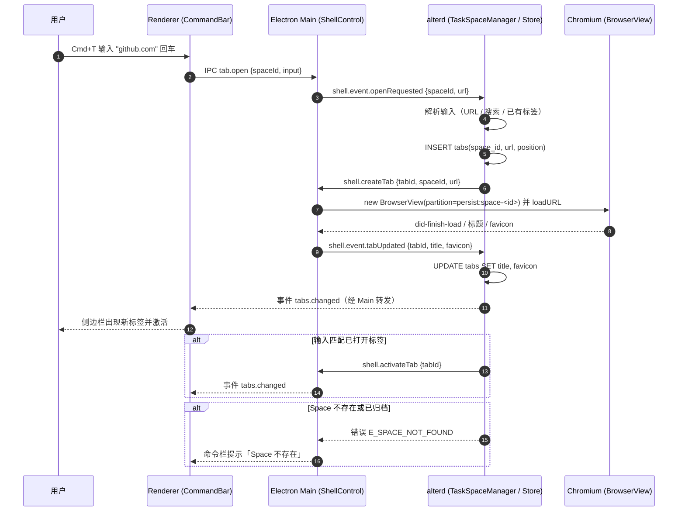
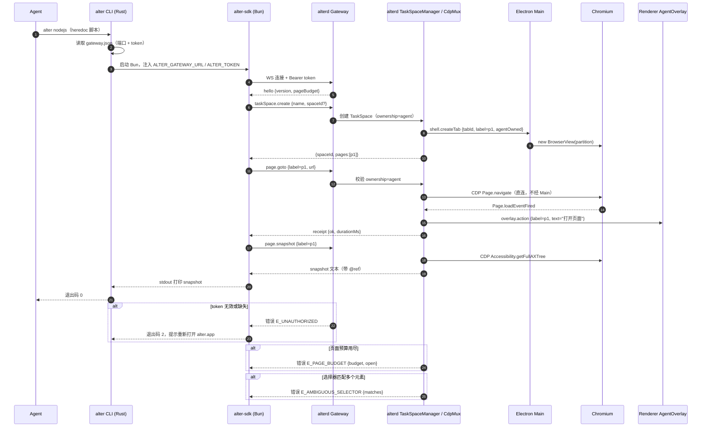
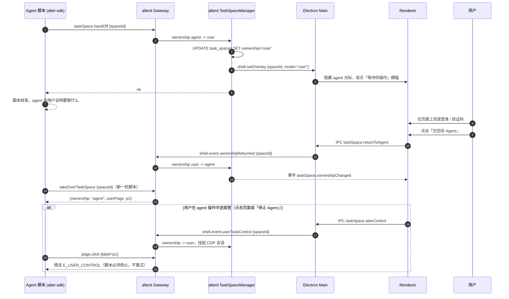
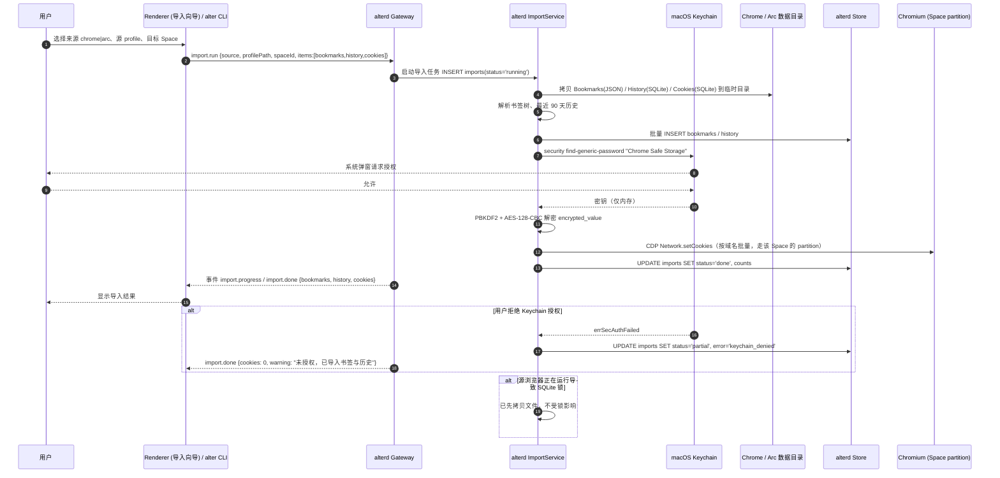
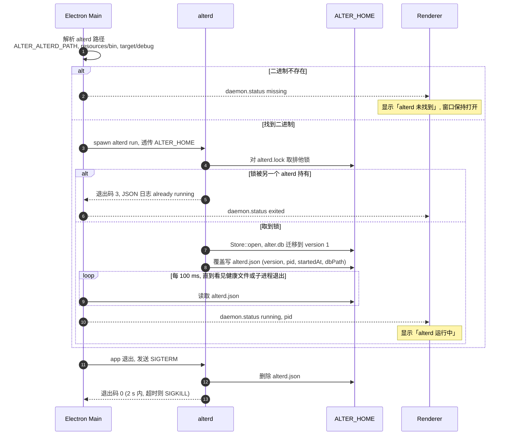

# 核心流程

<!-- 承载业务的少数几条请求 / 事件路径。每条流程一节、一张时序图。 -->

## 流程：用户在 Space 里打开页面
<!-- dflow:diagram assets/seq-open-tab.mmd -->

<!-- /dflow:diagram -->

- 触发：用户在某个 Space 内按 Cmd+T 打开命令栏，输入 URL、搜索词或已打开标签的名字后回车。
- 步骤：1–2 Renderer 经 IPC 把输入交给 Electron Main；3 Main 经 Shell Control Channel 上报 alterd；4–5 alterd 解析输入（URL / 搜索 / 匹配已有标签），落库分配 tab id；6–7 alterd 下发 `shell.createTab`，Main 用该 Space 的 partition 创建 BrowserView 并加载；8–10 加载事件回流 alterd 更新标题与 favicon；11–12 变更事件推到 Renderer，侧边栏出现并激活新标签。
- 失败处理：输入匹配已打开标签时只激活不新建；Space 不存在或已归档返回 `E_SPACE_NOT_FOUND`，命令栏内联提示；页面加载失败由 Chromium 自己的错误页承担，alterd 只记录 `tabs.title` 为错误标题。
- 代码入口：TBD — `alter:apps/browser/src/renderer/command-bar/`、`alter:apps/browser/src/main/shell-control.ts`、`alter:crates/alterd/src/shell/`、`alter:crates/alterd/src/tabs/`（建侧边栏需求归档时填真实路径）。

## 流程：agent 用脚本驱动页面
<!-- dflow:diagram assets/seq-agent-script.mmd -->

<!-- /dflow:diagram -->

- 触发：agent 运行 `alter nodejs`（heredoc 或 `-e`）执行一段使用 SDK 的脚本。
- 步骤：1–3 CLI 读 `gateway.json`，启动打包的 Bun 并注入网关地址与 token；4–5 SDK 建立 WS 连接并通过鉴权；6–10 `taskSpace()` 让 alterd 创建 ownership=agent 的 TaskSpace，并经 ShellLink 让 Electron 建一个带 `p1` 标签的页面；11–16 `page.goto` 经 Gateway 校验 ownership 后由 CdpMux 直接发 CDP，完成后向 AgentOverlay 推送动作文字，并返回 receipt；17–20 `page.snapshot` 取无障碍树，打印到 stdout；21 CLI 以退出码 0 结束，TaskSpace 与页面保留到 `finish()`。
- 失败处理：token 无效 → `E_UNAUTHORIZED`，CLI 退出码 2 并提示重开 alter.app；页面预算用尽 → `E_PAGE_BUDGET`，附当前预算与打开数；选择器多匹配 → `E_AMBIGUOUS_SELECTOR`，附匹配数；CDP 超时 → `E_TIMEOUT`，TaskSpace 保持可用。每个动作的 receipt 都写入 alterd 日志。
- 代码入口：TBD — `alter:crates/alter-cli/src/nodejs.rs`、`alter:packages/sdk/src/task-space.ts`、`alter:crates/alterd/src/gateway/`、`alter:crates/alterd/src/task_space/`、`alter:crates/alterd/src/cdp/`。

## 流程：交还与接管
<!-- dflow:diagram assets/seq-handoff.mmd -->

<!-- /dflow:diagram -->

- 触发：agent 遇到必须由人完成的步骤（登录、验证码、权限弹窗）调用 `task.handOff()`；或用户在 agent 操作中途主动接管。
- 步骤：1–5 handOff 把 ownership 切到 user，落库，并让 Electron 隐藏 agent 光标、显示「等待你操作」横幅；6–8 脚本结束，用户在页面上操作；9–13 用户点「交还给 Agent」，Electron 上报，alterd 切回 agent 并广播 `taskSpace.ownershipChanged`；14–15 agent 新一轮脚本用 `takeOverTaskSpace(id)` 接回，得到 `userPage`。
- 失败处理：ownership=user 期间 agent 的任何 `page.*` 调用返回 `E_USER_CONTROL`，SDK 抛异常，脚本必须停止，不得重试或换 TaskSpace 绕开；用户主动接管时 alterd 挂起该 TaskSpace 的 CDP 会话，正在执行的命令以 `E_USER_CONTROL` 结束；TaskSpace 在 user 状态超过配置阈值未交还则标记 `inactive`，`listTaskSpaces()` 可见。
- 代码入口：TBD — `alter:crates/alterd/src/task_space/ownership.rs`、`alter:apps/browser/src/renderer/agent-overlay/`、`alter:packages/sdk/src/task-space.ts`。

## 流程：从 Chrome / Arc 导入 profile
<!-- dflow:diagram assets/seq-import-profile.mmd -->

<!-- /dflow:diagram -->

- 触发：首次启动向导、设置页的「导入」，或 `alter import --from chrome|arc --space <id>`。
- 步骤：1–3 用户选来源、源 profile 和目标 Space，Gateway 创建 `imports` 记录；4–6 ImportService 先把 Bookmarks（JSON）、History、Cookies（SQLite）拷到临时目录再读，解析书签树与最近 90 天历史并批量写库；7–11 经 Keychain 取「Chrome Safe Storage」密钥（Arc 为「Arc Safe Storage」），系统弹窗由用户授权，PBKDF2 派生后 AES-128-CBC 解密 `encrypted_value`；12 经 CDP `Network.setCookies` 写入目标 Space 的 partition；13–15 更新计数与状态，推送进度与结果。
- 失败处理：用户拒绝 Keychain 授权 → 状态 `partial`，书签与历史已导入，Cookie 为 0，结果里带警告；源浏览器运行中的 SQLite 锁因先拷贝文件而不受影响；解析失败的单条记录跳过并计数到 `error`，不中断整个导入；同一来源重复导入按 URL + 标题去重。
- 代码入口：TBD — `alter:crates/alterd/src/import/{chromium.rs,keychain.rs,cookies.rs}`、`alter:apps/browser/src/renderer/import-wizard/`、`alter:crates/alter-cli/src/import.rs`。

## 流程：app 启动并托管 alterd
<!-- dflow:diagram assets/seq-app-startup.mmd -->

<!-- /dflow:diagram -->

- 触发：用户打开 alter.app（开发时为 `bun run dev`）。
- 步骤：1 Electron Main 依次在 `ALTER_ALTERD_PATH`、`process.resourcesPath/bin/alterd`、`<repo>/target/debug/alterd` 找 alterd；2 找不到时推 `daemon.status missing`，窗口保持打开；3–4 找到就 spawn `alterd run`，alterd 先对 `alterd.lock` 取排他锁；5–6 锁被占用时 alterd 以退出码 3 退出，Main 推 `exited`；7–8 取到锁后 `Store::open` 迁移 `alter.db`，覆盖写 `alterd.json`；9–10 Main 每 100 ms 读一次健康文件，不设截止时间，直到看到它或子进程退出，然后推 `running` 与 pid；11–13 app 退出时 Main 拦下 `before-quit`，发 SIGTERM，alterd 删除健康文件并以 0 退出，2 秒内没退出则 SIGKILL 并删除 pid 匹配的健康文件。
- 失败处理：alterd 的 stderr 经管道由 Main 转发，不继承主进程 stdio，避免拖住 app 退出；alterd 其他错误（打开数据库失败等）以退出码 1 退出并写 `code=1` 的 JSON 日志，Main 推 `exited`。app 被强制结束时 alterd 不会收到 SIGTERM，修复见进行中的需求 `fix-orphan-alterd`。
- 代码入口：`alter:apps/browser/src/main/daemon.ts`（`resolveAlterdPath`、`DaemonSupervisor`）、`alter:apps/browser/src/main/index.ts`（`before-quit`）、`alter:crates/alterd/src/lifecycle.rs`（`run`）、`alter:crates/alter-core/src/health.rs`。

## 未展开的流程
- 自动归档与 Peek、分屏布局：纯 Electron + Renderer 内的交互，无跨进程契约，在各自需求的 design.md 里画图。
- `install.sh` 与 `alter upgrade`：线性脚本，见 api.md 的 CLI 表和发布需求的 design.md。
