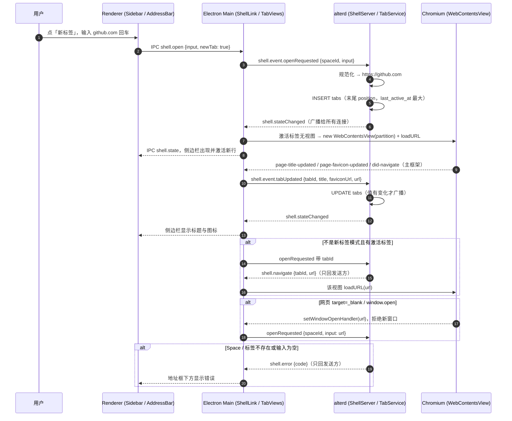
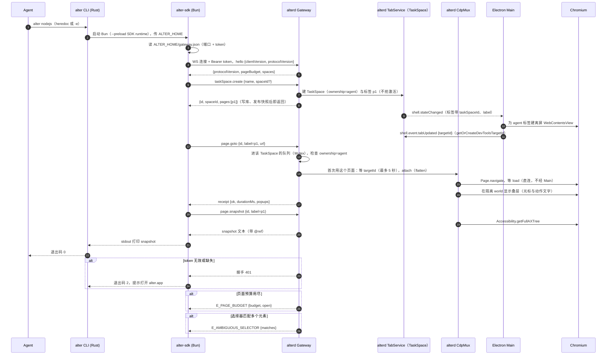
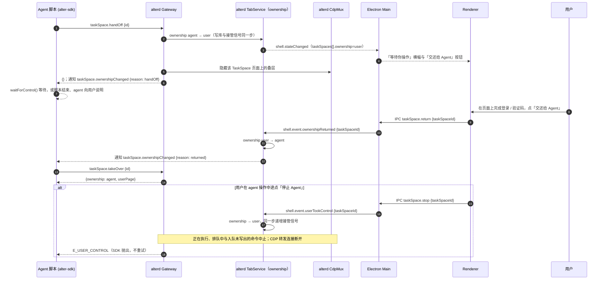
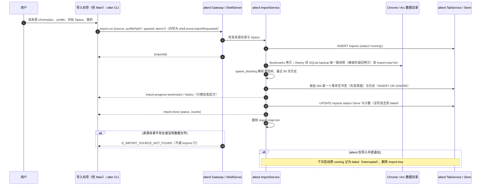
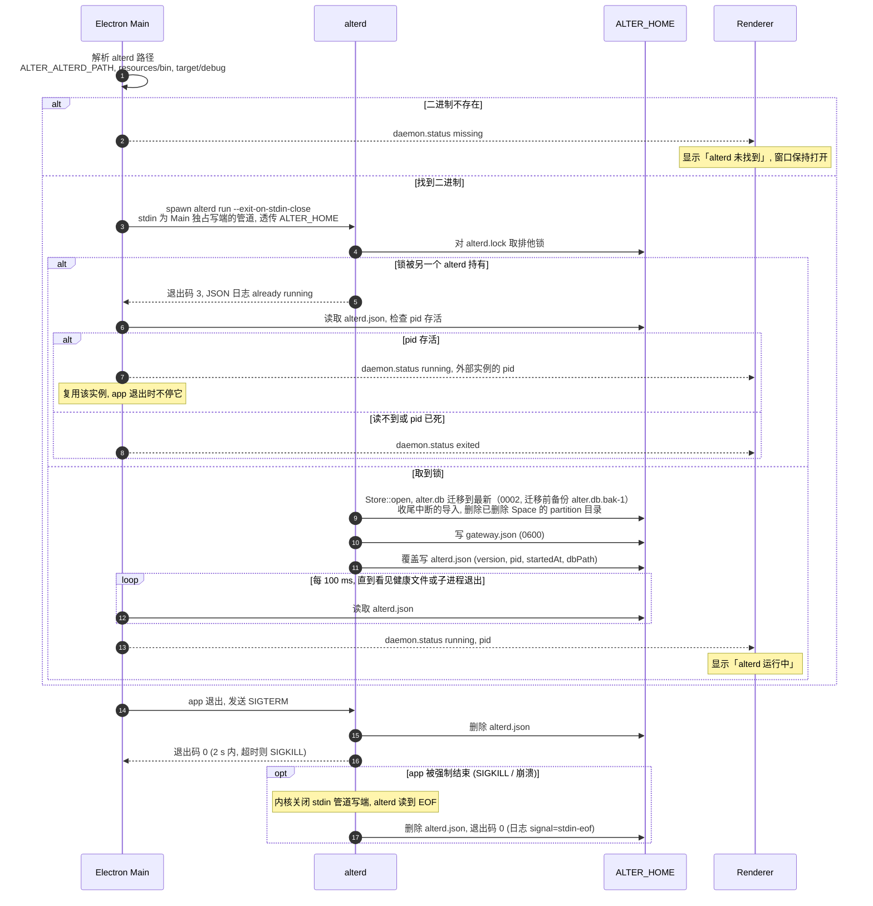

# 核心流程

<!-- 承载业务的少数几条请求 / 事件路径。每条流程一节、一张时序图。 -->

## 流程：用户在 Space 里打开页面
<!-- dflow:diagram assets/seq-open-tab.mmd -->

<!-- /dflow:diagram -->

- 触发：用户在侧边栏点「新标签」后在地址框输入网址或搜索词回车（不点「新标签」时在当前激活标签打开）；或网页里点 `target="_blank"` 链接、调用 `window.open`。Cmd+T 打开命令栏，选「打开或搜索」项同样发 `openRequested`；主框架导航完成时 alterd 写一条浏览历史。
- 步骤：1–2 Renderer 经 IPC 把输入交给 Electron Main；3 Main 经 Shell Control Channel 上报 `openRequested`；4–5 TabService 规范化输入并落库（末尾位置、成为激活标签）；6 广播全量快照；7–8 Main 发现激活标签还没有视图，用该 Space 的 partition 新建 WebContentsView 并加载，Renderer 出现新行；9–14 页面标题、favicon 与主框架导航回写 alterd，再广播，侧边栏更新。
- 失败处理：Space 不存在、标签不存在、输入为空分别回 `E_SPACE_NOT_FOUND`、`E_TAB_NOT_FOUND`、`E_INVALID_ARGUMENT`，只发给请求方，地址框下方显示；页面加载失败由 Chromium 自己的错误页承担；iframe 的页内导航不回写标签地址。
- 代码入口：`alter:apps/browser/src/renderer/src/AddressBar.tsx`、`alter:apps/browser/src/main/index.ts`（IPC → ShellLink）、`alter:apps/browser/src/main/shell-link.ts`、`alter:apps/browser/src/main/tab-views.ts`、`alter:crates/alterd/src/shell/mod.rs`、`alter:crates/alterd/src/tabs/{mod.rs,url.rs}`、`alter:crates/alter-core/src/store/tabs.rs`。

## 流程：agent 用脚本驱动页面
<!-- dflow:diagram assets/seq-agent-script.mmd -->

<!-- /dflow:diagram -->

- 触发：agent 运行 `alter nodejs`（heredoc 或 `-e`）执行一段使用 SDK 的脚本。
- 步骤：1–3 CLI 启动 Bun 预加载 SDK，SDK 读 `ALTER_HOME/gateway.json`；4–5 建立 WS 连接、鉴权并握手；6–8 `taskSpace()` 让 TabService 建 ownership=agent 的 TaskSpace 与标签 `p1`，写库并发布快照后即返回；9–11 Main 异步为它建离屏视图并上报 targetId；12–17 `page.goto` 进该 TaskSpace 的队列、检查 ownership，首次使用时等 targetId 并 attach，由 CdpMux 直接发 CDP，叠层由 CDP 注入页面的隔离 world，返回 receipt；18–20 `page.snapshot` 取无障碍树，打印到 stdout；21 CLI 以退出码 0 结束，TaskSpace 与页面保留到 `finish()`。
- 失败处理：token 无效 → 握手 401，CLI 退出码 2 并提示打开 alter.app；页面预算用尽 → `E_PAGE_BUDGET`，附当前预算与打开数；选择器多匹配 → `E_AMBIGUOUS_SELECTOR`，附匹配数；CDP 超时 → `E_TIMEOUT`，TaskSpace 保持可用。每个动作的 receipt 都写入 alterd 日志。
- 代码入口：`alter:crates/alter-cli/src/nodejs.rs`、`alter:packages/sdk/src/{runtime.ts,alter.ts,task-space.ts,page.ts}`、`alter:crates/alterd/src/gateway/{rpc.rs,page.rs,actions.rs}`、`alter:crates/alterd/src/tabs/task_space.rs`、`alter:crates/alterd/src/cdp/{mod.rs,overlay.rs}`、`alter:apps/browser/src/main/tab-views.ts`。

## 流程：交还与接管
<!-- dflow:diagram assets/seq-handoff.mmd -->

<!-- /dflow:diagram -->

- 触发：agent 遇到必须由人完成的步骤（登录、验证码、权限弹窗）调用 `task.handOff()`；或用户在 agent 操作中途主动接管。
- 步骤：1–6 handOff 把 ownership 切到 user（写库与递增接管信号同一步），快照让 Renderer 显示横幅，Gateway 经 CDP 隐藏叠层，并通知 SDK；7 agent 用 `waitForControl()` 等待或结束脚本；8–12 用户点「交还给 Agent」，Electron 上报，alterd 切回 agent 并通知 `taskSpace.ownershipChanged`；13–14 agent 用 `takeOverTaskSpace(id)` 接回，得到 `userPage`。
- 失败处理：ownership=user 期间 agent 的任何 `page.*`、`taskSpace.release` / `finish` 返回 `E_USER_CONTROL`，SDK 抛异常，脚本必须停止，不得重试；有任何 TaskSpace 由用户控制时原始 CDP 透传与 CDP 转发一律拒绝（换 TaskSpace 也绕不开）；用户主动接管时，正在执行、排队中与入队未写出的命令都以 `E_USER_CONTROL` 结束（单线程运行时下接管时刻之后不再写出 agent 的字节）；TaskSpace 在 user 状态超过配置阈值未交还则标记 `inactive`，`listTaskSpaces()` 可见。
- 代码入口：`alter:crates/alterd/src/tabs/ownership.rs`、`alter:crates/alterd/src/takeover.rs`、`alter:crates/alterd/src/gateway/{rpc.rs,forward.rs,events.rs}`、`alter:crates/alterd/src/cdp/{mod.rs,overlay.rs}`、`alter:apps/browser/src/renderer/src/HandoffBanner.tsx`、`alter:packages/sdk/src/task-space.ts`。

## 流程：从 Chrome / Arc 导入 profile
<!-- dflow:diagram assets/seq-import-profile.mmd -->

<!-- /dflow:diagram -->

- 触发：侧边栏底部菜单的「导入…」向导，或 `alter import --from chrome|arc --space <id>`。
- 步骤：1–5 用户选来源、profile、目标 Space 与类别，Gateway（向导经 Shell）检查来源与 Space、建 `imports` 记录并立即返回 importId；6–7 ImportService 把 Bookmarks 拷贝、History 经 SQLite backup 取一致快照到临时目录，在 `spawn_blocking` 里解析书签树与最近 90 天历史；8–9 经 TabService 每批 500 条一个事务写库，每完成一类推一条进度；10–12 写最终状态与计数，推 `import.done`，删除临时副本。
- 失败处理：来源目录不存在或没有数据文件 → `E_IMPORT_SOURCE_NOT_FOUND`，不建 imports 行；解析失败的单条记录跳过并计入 `skipped`；重复导入不产生重复（书签先查再插，历史按（URL、访问时间）去重）；结果没写进数据库时记 `failed`；alterd 中途退出的导入在下次启动时记为 `failed`（`interrupted`）并删除临时副本。Cookie 导入（Keychain 取 Safe Storage 口令、解密、经 CDP 写进目标 Space 的 partition，拒绝授权时 `partial`）待后续 change。
- 代码入口：`alter:crates/alterd/src/import/{mod.rs,sources.rs,bookmarks.rs,history.rs}`、`alter:crates/alterd/src/gateway/imports.rs`、`alter:crates/alter-core/src/store/{bookmarks.rs,imports.rs,history.rs}`、`alter:apps/browser/src/renderer/src/ImportWizard.tsx`、`alter:crates/alter-cli/src/import.rs`。

## 流程：app 启动并托管 alterd
<!-- dflow:diagram assets/seq-app-startup.mmd -->

<!-- /dflow:diagram -->

- 触发：用户打开 alter.app（开发时为 `bun run dev`）。alterd 进入 running 后 Main 连接 `shell.sock`，收到的第一份快照即恢复上次的标签（只为各 Space 的激活标签建视图）。
- 步骤：1 Electron Main 依次在 `ALTER_ALTERD_PATH`、`process.resourcesPath/bin/alterd`、`<repo>/target/debug/alterd` 找 alterd；2 找不到时推 `daemon.status missing`，窗口保持打开；3–4 找到就 spawn `alterd run --exit-on-stdin-close`，stdin 是只有 Main 持有写端的管道，alterd 先对 `alterd.lock` 取排他锁；5–6 锁被占用时 alterd 以退出码 3 退出，Main 读 `alterd.json`，其中 pid 存活就复用这个外部实例（推 `running` 与它的 pid，app 退出时不停它），否则推 `exited`；7–8 取到锁后 `Store::open` 迁移 `alter.db`（迁移前备份）、收尾中断的导入、清理已删除 Space 的 partition 目录，先写 `gateway.json` 再覆盖写 `alterd.json`；9–10 Main 每 100 ms 读一次健康文件，不设截止时间，直到看到它或子进程退出，然后推 `running` 与 pid；11–13 app 退出时 Main 拦下 `before-quit`，发 SIGTERM，alterd 删除健康文件并以 0 退出，2 秒内没退出则 SIGKILL 并删除 pid 匹配的健康文件。
- 失败处理：alterd 的 stderr 经管道由 Main 转发，不继承主进程 stdio，避免拖住 app 退出。Main 自己的 stdout / stderr 读端可能已关闭（启动它的终端或测试进程已退出）：写入错误一律忽略，不成为未捕获异常；alterd 日志的转发在 stderr 正常时保留背压，stderr 断开后读走丢弃，alterd 不会因写满管道而卡住（`apps/browser/src/main/stdio.ts`）。alterd 其他错误（打开数据库失败等）以退出码 1 退出并写 `code=1` 的 JSON 日志，Main 推 `exited`。app 被强制结束（SIGKILL、崩溃）时 `before-quit` 不执行，但内核会关闭 stdin 管道写端，alterd 读到 EOF（或读取出错）后走同一条清理路径：删除健康文件，退出码 0。此时 stderr 管道也已断开，alterd 关闭了 tracing 的内部错误报告，写日志失败不会 panic。复用外部实例后 Main 不再监视它，外部实例之后退出时页面仍显示「运行中」（后续由网关握手 / 心跳处理）。
- 代码入口：`alter:apps/browser/src/main/daemon.ts`（`resolveAlterdPath`、`DaemonSupervisor`）、`alter:apps/browser/src/main/index.ts`（`before-quit`）、`alter:crates/alterd/src/lifecycle.rs`（`run`）、`alter:crates/alter-core/src/health.rs`。

## 未展开的流程
- 自动归档（alterd 的 Archiver 定时请 TabService 归档）、Peek（Electron 内的浮层视图）、分屏（快照的 `splitGroup`，Main 并排挂两个视图）、命令栏（`searchRequested` / `searchResults`）：在 add-core-features 的 N4 design.md 里画了图。
- `install.sh` 与 `alter upgrade`：线性脚本，待发布 change。
