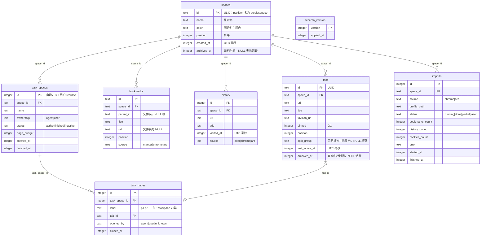

# 数据模型

<!-- dflow:diagram assets/er-overview.mmd -->

<!-- /dflow:diagram -->

## 表结构
数据库文件 `~/Library/Application Support/alter/alter.db`，SQLite，WAL 模式，只有 alterd 持有写连接。Cookie、localStorage、缓存不在这里：它们由 Chromium 按 partition 存在 app 的 userData 目录下。

```sql
-- 迁移 0001：初始表结构（crates/alter-core/migrations/0001_init.sql）
PRAGMA journal_mode = WAL;
PRAGMA foreign_keys = ON;

CREATE TABLE schema_version (
  version    INTEGER PRIMARY KEY,
  applied_at INTEGER NOT NULL                      -- UTC 毫秒
);

CREATE TABLE spaces (
  id          TEXT PRIMARY KEY,                    -- ULID；partition 名为 persist:space-<id>
  name        TEXT NOT NULL,
  color       TEXT NOT NULL DEFAULT '#6366f1',
  position    INTEGER NOT NULL,
  created_at  INTEGER NOT NULL,
  archived_at INTEGER                              -- NULL 表示活跃
);
CREATE UNIQUE INDEX idx_spaces_position ON spaces(position) WHERE archived_at IS NULL;

CREATE TABLE tabs (
  id             TEXT PRIMARY KEY,                 -- ULID
  space_id       TEXT NOT NULL REFERENCES spaces(id) ON DELETE CASCADE,
  url            TEXT NOT NULL,
  title          TEXT NOT NULL DEFAULT '',
  favicon_url    TEXT,
  pinned         INTEGER NOT NULL DEFAULT 0 CHECK (pinned IN (0, 1)),
  position       INTEGER NOT NULL,
  split_group    TEXT,                             -- 同组并排显示；NULL 单页
  last_active_at INTEGER NOT NULL,
  archived_at    INTEGER                           -- 自动归档时间；NULL 活跃
);
CREATE INDEX idx_tabs_space_active ON tabs(space_id, archived_at, position);
CREATE INDEX idx_tabs_last_active ON tabs(archived_at, pinned, last_active_at);

CREATE TABLE bookmarks (
  id        TEXT PRIMARY KEY,
  space_id  TEXT NOT NULL REFERENCES spaces(id) ON DELETE CASCADE,
  parent_id TEXT REFERENCES bookmarks(id) ON DELETE CASCADE,   -- NULL 为根
  title     TEXT NOT NULL,
  url       TEXT,                                  -- 文件夹为 NULL
  position  INTEGER NOT NULL,
  source    TEXT NOT NULL DEFAULT 'manual' CHECK (source IN ('manual', 'chrome', 'arc'))
);
CREATE INDEX idx_bookmarks_parent ON bookmarks(space_id, parent_id, position);
CREATE UNIQUE INDEX idx_bookmarks_dedupe ON bookmarks(space_id, parent_id, url, title) WHERE url IS NOT NULL;

CREATE TABLE history (
  id         INTEGER PRIMARY KEY AUTOINCREMENT,
  space_id   TEXT NOT NULL REFERENCES spaces(id) ON DELETE CASCADE,
  url        TEXT NOT NULL,
  title      TEXT NOT NULL DEFAULT '',
  visited_at INTEGER NOT NULL,
  source     TEXT NOT NULL DEFAULT 'alter' CHECK (source IN ('alter', 'chrome', 'arc'))
);
CREATE INDEX idx_history_space_time ON history(space_id, visited_at DESC);
CREATE UNIQUE INDEX idx_history_dedupe ON history(space_id, url, visited_at);

CREATE TABLE task_spaces (
  id          INTEGER PRIMARY KEY AUTOINCREMENT,   -- CLI 用它 resume
  space_id    TEXT NOT NULL REFERENCES spaces(id) ON DELETE CASCADE,
  name        TEXT NOT NULL,
  ownership   TEXT NOT NULL DEFAULT 'agent' CHECK (ownership IN ('agent', 'user')),
  status      TEXT NOT NULL DEFAULT 'active' CHECK (status IN ('active', 'finished', 'inactive')),
  page_budget INTEGER NOT NULL DEFAULT 8,
  created_at  INTEGER NOT NULL,
  finished_at INTEGER
);
CREATE INDEX idx_task_spaces_status ON task_spaces(status, space_id);

CREATE TABLE task_pages (
  id            INTEGER PRIMARY KEY AUTOINCREMENT,
  task_space_id INTEGER NOT NULL REFERENCES task_spaces(id) ON DELETE CASCADE,
  label         TEXT NOT NULL,                     -- p1, p2 …
  tab_id        TEXT REFERENCES tabs(id) ON DELETE SET NULL,
  opened_by     TEXT NOT NULL CHECK (opened_by IN ('agent', 'user', 'unknown')),
  closed_at     INTEGER,
  UNIQUE (task_space_id, label)
);
CREATE UNIQUE INDEX idx_task_pages_tab ON task_pages(tab_id) WHERE tab_id IS NOT NULL AND closed_at IS NULL;

CREATE TABLE imports (
  id              INTEGER PRIMARY KEY AUTOINCREMENT,
  space_id        TEXT NOT NULL REFERENCES spaces(id) ON DELETE CASCADE,
  source          TEXT NOT NULL CHECK (source IN ('chrome', 'arc')),
  profile_path    TEXT NOT NULL,
  status          TEXT NOT NULL CHECK (status IN ('running', 'done', 'partial', 'failed')),
  bookmarks_count INTEGER NOT NULL DEFAULT 0,
  history_count   INTEGER NOT NULL DEFAULT 0,
  cookies_count   INTEGER NOT NULL DEFAULT 0,
  error           TEXT,
  started_at      INTEGER NOT NULL,
  finished_at     INTEGER
);
```

## 规则
- 一个 Space 一个 partition：partition 名由 `spaces.id` 派生（`persist:space-<id>`），不单独存储；删除 Space 时 alterd 负责清理 partition 数据目录。
- `tabs.space_id` 不可变：标签不能在 Space 之间移动（避免 Cookie 隔离被绕过）；需要时复制 URL 新建。
- 激活标签不单独存储：每个 Space 中未归档且 `last_active_at` 最大的标签即激活标签；写入时取「同 Space 最大值 + 1」与当前时间中较大者，保证严格递增。激活的 Space 目前取未归档 Space 中 `position` 最小的（add-space-management 再持久化）。
- 关闭标签即归档：只置 `tabs.archived_at`，不删除行；`position` 只增不重排，留下的空洞不影响排序。
- 首次启动（没有未归档的 Space）时建默认 Space `Personal`（颜色取列默认值 `#6366f1`）。
- partition 的磁盘目录是 `ALTER_HOME/chromium/Partitions/space-<id 小写>`（Electron 44 实测会转成小写），清理时按小写匹配。
- 固定标签（`pinned = 1`）不参与自动归档；归档只设 `archived_at`，不删除；恢复即清空该字段并追加到列表末尾。
- `split_group` 内的标签必须属于同一 Space，由代码保证；分屏解散即置 NULL。
- `task_pages.label` 在 TaskSpace 内唯一，关闭后不复用；一个活跃标签同一时刻只能被一个 TaskSpace 托管（部分唯一索引）。
- TaskSpace 不跨 Space：`task_pages.tab_id` 指向的标签必须与 `task_spaces.space_id` 一致，由代码在 adopt 时校验。
- 时间戳全部 UTC 毫秒整数；没有软删除之外的删除，`ON DELETE CASCADE` 只在删除 Space 时触发。
- 导入去重：书签按（父节点、URL、标题）唯一；历史按（URL、访问时间）唯一，重复导入是幂等的。
- 写入只经 alterd 的单写连接；Electron 和 CLI 不打开数据库文件。
- 迁移：`crates/alter-core/migrations/NNNN_<name>.sql` 按序号执行，每个文件一个事务，执行后写 `schema_version`；alterd 启动时自动迁移，降级不支持。备份文件 `alter.db.bak-<version>` 计划在升级前自动生成，在第一个非初始迁移（0002）时实现，目前只有 0001。
- 数据目录（`ALTER_HOME`）里除 `alter.db`（及 WAL 文件）外还有 alterd 的健康文件 `alterd.json` 与实例锁 `alterd.lock`，二者都不是数据库内容，格式见 api.md「进程状态」。
